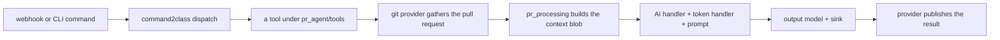
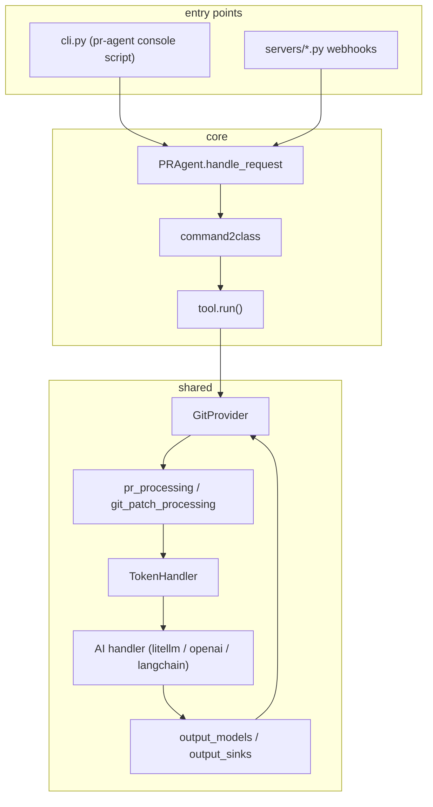

# Overview

PR-Agent is the original open-source pull request (PR) reviewer. It is now a community-maintained legacy project of Qodo. Given a pull request, it produces reviews, descriptions, code suggestions, answers, documentation, changelog updates, labels, and compliance checks. It runs as a command-line interface (CLI) tool and as webhook servers for GitHub, GitLab, Bitbucket (cloud and server), Azure DevOps, Gitea, Gerrit, AWS CodeCommit, local checkouts, and plain diffs.

## What it does

A user or a webhook sends a command such as `/review`, `/describe`, `/improve`, or `/ask`. PR-Agent turns that command into a tool run. The tool gathers the pull request through a git provider, builds a context blob, renders a prompt, calls a model handler, and publishes the result back to the provider.

## Words on this page

| Word | Meaning |
|------|---------|
| Pull request (PR) | A proposed change to a repository that waits for review and merge |
| Artificial intelligence (AI) | Software that produces text or code from a prompt |
| Command-line interface (CLI) | A program run from a terminal by typing a command |
| Webhook | A HyperText Transfer Protocol (HTTP) callback that a host sends when an event happens |
| Git provider | Code that reads and writes a specific host, such as GitHub or GitLab |
| Prompt | The text sent to the model, made of a system part and a user part |

## The numbers

- 120 Python files in the `pr_agent` package.
- 12 tool classes under `pr_agent/tools/`.
- 10 git providers under `pr_agent/git_providers/`.
- 9 webhook servers under `pr_agent/servers/` (plus a GitHub Action runner and a polling loop).
- 24 TOML settings files under `pr_agent/settings/`.
- Version 0.49.0, MIT license, requires Python 3.12 or newer.

## The layers

| Layer | Where | Role |
|-------|-------|------|
| Provider | `git_providers/`, `identity_providers/`, `secret_providers/` | Read the pull request and write the result back |
| Brain | `algo/` (AI handlers, token handler, model routing) | Turn text into a model call within budget |
| Tools | `tools/` | Each command's specific behavior and prompt |
| Entry | `servers/`, `cli.py` | Receive the request and start the flow |

## The one idea

The prompts and the configuration are data files, not code. The same binary serves twelve tools and ten providers because the behavior is defined by TOML files loaded at runtime. The code is a shell; the data is the behavior.

## How to read this documentation

Start with [Architecture](01-architecture.md) for the request flow and the package layers. Then follow the path of a request: [the core agent](02-the-core-agent.md), [AI handlers and model routing](03-ai-handlers-and-model-routing.md), [token handling and prompts](04-token-handling-and-prompts.md), and [pull request and patch processing](05-pr-and-patch-processing.md). The rest of the chapters cover each layer in depth.

## Where to go next

Read [Architecture](01-architecture.md) for the full request flow and the package map.
