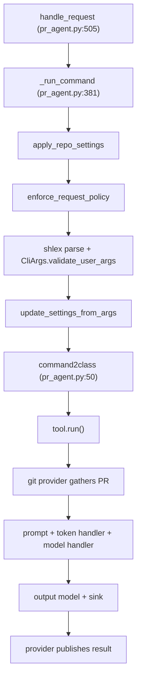

# Architecture

PR-Agent is one Python package, `pr_agent`, with a single entry point and a layered pipeline. This chapter explains the package map and the request flow.

## The package map

```
pr_agent/
├── agent/            (3 py)   PRAgent orchestration + request policy
├── algo/            (33 py)   shared algorithms, AI handlers, token/prompt, types
├── tools/           (15 py)   12 tools + 2 helpers + empty __init__
├── git_providers/   (16 py)   10 providers + base + diff parser + helpers
├── identity_providers/ (3 py)
├── secret_providers/  (4 py)  AWS Secrets Manager, Google Cloud Storage
├── servers/         (17 py)   9 webhook entrypoints + 2 other entrypoints + helpers
├── mosaico/         (11 py)   agent-to-agent (A2A) executor layer
├── telemetry/        (9 py)   Prometheus + OpenTelemetry tracing
├── settings/        (24 toml) configuration.toml + prompt templates
└── cli.py / config_loader.py / config_security.py / doctor.py
```

The numbers are exact at commit `b32a021`: 120 Python files in `pr_agent`.

## Three layers carry the system

| Layer | Where | Role |
|-------|-------|------|
| Provider | `git_providers/`, `identity_providers/`, `secret_providers/` | Read the pull request and write the result back |
| Brain | `algo/` | Turn text into a model call within budget |
| Tools | `tools/` | Each command's specific behavior and prompt |

The `agent/` package ties the layers together. `servers/` and `cli.py` are the entry points. `mosaico/` is a newer, parallel entry point that speaks the A2A protocol.

## The request flow

A request enters through `PRAgent.handle_request`. The flow is fixed (`pr_agent/agent/pr_agent.py:505`):

1. `_run_command` applies repository settings, then the request policy, then shell-style parsing (`pr_agent/agent/pr_agent.py:381`).
2. `command2class` maps the slash command to a tool class (`pr_agent/agent/pr_agent.py:50-72`).
3. The tool obtains a git provider and gathers the pull request.
4. The tool builds prompt variables, renders the prompt, and calls the model handler.
5. The tool publishes or stores the output through the provider.



## The dispatch table

`command2class` is a dictionary that maps slash commands to tool classes (`pr_agent/agent/pr_agent.py:50-72`). The mapping is the heart of the system:

| Command | Aliases | Tool class |
|---------|---------|------------|
| `review` | `review_pr`, `auto_review`, `answer` | `PRReviewer` |
| `describe` | `describe_pr` | `PRDescription` |
| `improve` | `improve_code` | `PRCodeSuggestions` |
| `ask` | `ask_question` | `PRQuestions` |
| `ask_line` | — | `PR_LineQuestions` |
| `update_changelog` | — | `PRUpdateChangelog` |
| `config` | `settings` | `PRConfig` |
| `help` | — | `PRHelpMessage` |
| `similar_issue` | — | `PRSimilarIssue` |
| `add_docs` | — | `PRAddDocs` |
| `generate_labels` | — | `PRGenerateLabels` |

One entry, `help_docs`, is disabled with a `SECURITY` comment referencing issue 2445 (`pr_agent/agent/pr_agent.py:69-71`). The `PRHelpDocs` tool exists on disk but is not reachable through the command table. The `/help` tool (`PRHelpMessage`) loads its own help documentation and does not delegate to it.

## Where the behavior lives

The prompts and the defaults are TOML files under `pr_agent/settings/`. `config_loader.py` loads a 24-entry `settings_files` list through a custom Dynaconf loader (`pr_agent/config_loader.py:27-52`); it adds `settings/.secrets.toml` and `settings_prod/.secrets.toml` and omits the unreferenced `pr_evaluate_prompt_response.toml`. A tool reads its prompt with `get_settings().pr_review_prompt.system` and `.user` (`pr_agent/tools/pr_reviewer.py:291-292`). This is why the same binary serves twelve tools without twelve code paths: each tool differs in its prompt file and its output, not its plumbing.

## Aha moments

**Aha: one shared pipeline, many commands.** Every tool funnels through the same provider → context → prompt → token-handler → model-handler → output path. The tools differ in their prompt and their output, not their plumbing.

**Aha: prompts are data, not code.** System and user prompts live as TOML under `pr_agent/settings/`, rendered with Jinja2 and `StrictUndefined`, so a missing variable fails loudly rather than rendering empty (`pr_agent/algo/token_handler.py:154`).

**Aha: the provider is an interface with capability checks.** `GitProvider.is_supported("feature")` gates behavior per provider instead of concrete type checks (`pr_agent/git_providers/git_provider.py:365`), so a provider can stub or override one capability without forking the flow.

## Where to go next

Read [The core agent](02-the-core-agent.md) for the dispatch and the request policy in detail.
