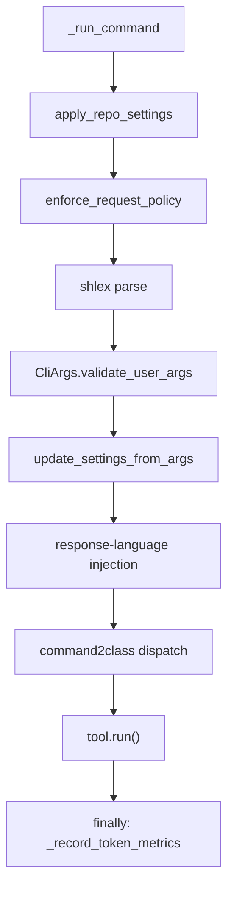
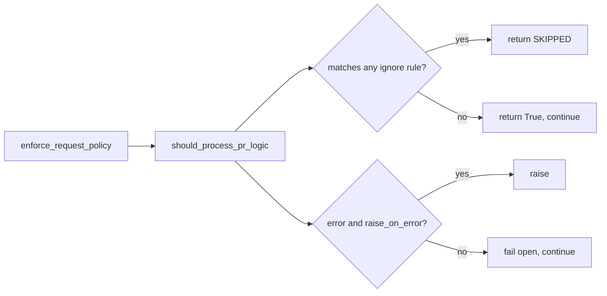

# The core agent

The core agent is three files in `pr_agent/agent/`: `pr_agent.py` (dispatch and orchestration), `request_policy.py` (should this request run at all), and an empty `__init__.py`. The dispatch table and the request flow are the important parts.

## The dispatch table

`command2class` maps slash commands to tool classes (`pr_agent/agent/pr_agent.py:50-72`). `commands = list(command2class.keys())` (`pr_agent/agent/pr_agent.py:74`) is the set of accepted command names, consumed by the CLI argument parser (`pr_agent/cli.py:175`).

```python
command2class = {
    "auto_review": PRReviewer,
    "answer": PRReviewer,
    "review": PRReviewer,
    "review_pr": PRReviewer,
    "describe": PRDescription,
    "describe_pr": PRDescription,
    "improve": PRCodeSuggestions,
    "improve_code": PRCodeSuggestions,
    "ask": PRQuestions,
    "ask_question": PRQuestions,
    "ask_line": PR_LineQuestions,
    "update_changelog": PRUpdateChangelog,
    "config": PRConfig,
    "settings": PRConfig,
    "help": PRHelpMessage,
    "similar_issue": PRSimilarIssue,
    "add_docs": PRAddDocs,
    "generate_labels": PRGenerateLabels,
}
```

The `help_docs` entry is disabled with a `SECURITY` comment referencing issue 2445 (`pr_agent/agent/pr_agent.py:69-71`).

## The `PRAgent` class

`PRAgent.__init__` stores the AI handler factory as a `partial`, not an instantiated handler (`pr_agent/agent/pr_agent.py:337`). The default is `LiteLLMAIHandler`. Storing a factory means each request can build a fresh handler with the request-scoped settings.

There are three methods:

- `_handle_request` (`pr_agent/agent/pr_agent.py:340`) opens an OpenTelemetry span named `"pr_agent.command"`, catches all exceptions, returns `False` on failure, and publishes an incomplete-files notice through `asyncio.to_thread(publish_incomplete_files_comment, ...)`.
- `_run_command` (`pr_agent/agent/pr_agent.py:381`) is the pipeline body.
- `handle_request` (`pr_agent/agent/pr_agent.py:505`) is the public entry, returning `True`, `False`, or `RequestOutcome.SKIPPED`, with a `finally` that flushes telemetry.

## The `_run_command` pipeline

`_run_command` (`pr_agent/agent/pr_agent.py:381`) runs these steps in order:

1. `apply_repo_settings` — load the repository's own `.pr_agent.toml`, if any.
2. `enforce_request_policy` — skip if the request is ignored.
3. Shell-style parsing with `shlex` (`lexer.quotes = '"'`, `lexer.commenters = ''`).
4. `CliArgs.validate_user_args` — reject host-only or dangerous overrides.
5. `update_settings_from_args` — apply `--section.key=value` overrides.
6. A response-language injection: an `extra_instructions` value plus a language instruction text and the separator `"\n======\n\nIn addition, "`.
7. `action = action.lstrip("/").lower()` and tool dispatch.

A `finally` block calls `_record_token_metrics(action, _git_provider)`.



## The request policy

`request_policy.py` is a thin wrapper. `RULE_FIELDS` (`pr_agent/agent/request_policy.py:8-15`) maps provider metadata fields to the ignore rules: `ignore_repositories`, `ignore_pr_authors`, `ignore_pr_title`, `ignore_pr_labels`, `ignore_pr_source_branches`, `ignore_pr_target_branches`.

`RequestOutcome` is an enum with one value, `SKIPPED` (`pr_agent/agent/request_policy.py:18`). Its `__bool__` returns `False`, so a skipped request tests false. `enforce_request_policy` (`pr_agent/agent/request_policy.py:28`) delegates to `pr_agent.servers.utils.should_process_pr_logic`, which evaluates the ignore rules and fails open (returns `True`) unless `raise_on_error` is set.



## Aha moments

**Aha: the dispatch table is the contract.** The whole system is reachable by adding one line to `command2class`. A tool is a module under `pr_agent/tools/` that follows the constructor and `run()` convention; the dispatch table connects a command string to it.

**Aha: command parsing is shell-style, not a regex.** The dispatcher reuses `shlex` with quotes enabled and commenters disabled (`pr_agent/agent/pr_agent.py:381`), so `/ask "what is this?"` and `/ask --foo=bar what` parse correctly. The Azure DevOps server later rebuilds `/ask_line` as a space-joined string precisely to bypass this shell-style path and avoid argument injection (`pr_agent/servers/azuredevops_server_webhook.py:181-187`).

**Aha: a skipped request is still a value, not an exception.** `RequestOutcome.SKIPPED` is a value whose `__bool__` is `False`, so callers test `if result` and treat a skip as "nothing happened, no failure" without a separate error channel (`pr_agent/agent/request_policy.py:18`).

## Where to go next

Read [AI handlers and model routing](03-ai-handlers-and-model-routing.md) for what happens after dispatch.
