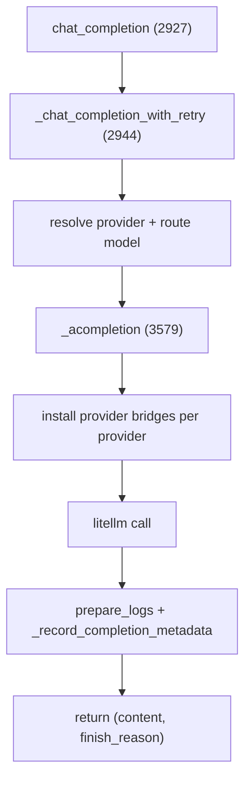
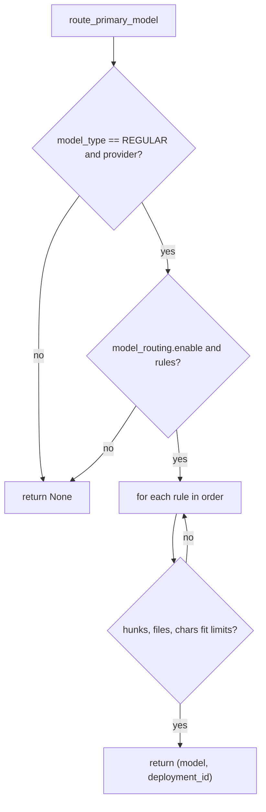

# AI handlers and model routing

The artificial intelligence (AI) handler is the abstraction between PR-Agent and a large language model. There are three handlers, plus a credential layer and a model router. The default is LiteLLM.

## The abstraction

`BaseAiHandler` (`pr_agent/algo/ai_handlers/base_ai_handler.py:7`) declares one concrete method and three abstract members:

```python
class BaseAiHandler(ABC):
    @abstractmethod
    def __init__(self): ...

    @property
    @abstractmethod
    def deployment_id(self): ...

    def build_request_messages(self, model, system_prompt, user_prompt, *, image_path=None) -> list[dict]:
        ...

    @abstractmethod
    async def chat_completion(self, model, system, user, temperature=0.2, img_path=None): ...
```

The interface is small on purpose: a handler turns a system prompt and a user prompt into a model call. The three implementations differ in the underlying library.

| Handler | File | Library |
|---------|------|---------|
| `LiteLLMAIHandler` | `litellm_ai_handler.py` (3839 lines) | LiteLLM (default) |
| `OpenAIHandler` | `openai_ai_handler.py` (81 lines) | `openai` AsyncOpenAI |
| `LangChainOpenAIHandler` | `langchain_ai_handler.py` (122 lines) | LangChain |

The OpenAI and LangChain handlers both set `OPENAI_RETRIES = 5` and share a tenacity retry predicate: retry on `openai.APIError` except `RateLimitError`, `BadRequestError`, `UnprocessableEntityError`, `AuthenticationError`, and `PermissionDeniedError` (`pr_agent/algo/ai_handlers/openai_ai_handler.py:12`, `langchain_ai_handler.py:19`).

## The LiteLLM handler

`LiteLLMAIHandler` (`pr_agent/algo/ai_handlers/litellm_ai_handler.py:399`) is the default. Its constructor snapshots the provider credentials and request parameters once. Key constants (`pr_agent/algo/ai_handlers/litellm_ai_handler.py:154-159`):

- `MODEL_RETRIES = 2`, `DEFAULT_NUM_RETRIES = 4`, `MAX_RETRY_AFTER_SECONDS = 30`.
- `MIN_MAX_OUTPUT_TOKENS = 4096`.
- `MAX_CONFIG_NUM_RETRIES = 10` (`:269`), the cap on `config.num_retries`.
- Cache framing allowances of 16 tokens for the message and 16 for the reply.

The handler's `chat_completion` (`pr_agent/algo/ai_handlers/litellm_ai_handler.py:2927`) delegates to `_chat_completion_with_retry` (`:2944`), decorated with `@retry(reraise=True)`. Two helpers support serverless and health checks: `probe_completion` (`:3454`) and `_acompletion` (`:3579`, which installs provider bridges and request scoping).



## Reasoning and temperature gates

LiteLLM exposes reasoning and temperature knobs per model, and the handler clamps them. The relevant methods cluster around `_resolve_reasoning_effort` (`pr_agent/algo/ai_handlers/litellm_ai_handler.py:2219`) and `_resolve_output_token_limit` (`:2402`). Claude-specific thinking is handled by `_claude_thinking_mode` (`:2347`) and `_configure_claude_extended_thinking` (`:2507`).

```python
def _validate_reasoning_effort(configured_effort): ...   # litellm_ai_handler.py:2205 (a @staticmethod)
def _clamp_gemini_reasoning_effort(self, ...): ...         # litellm_ai_handler.py:2118
def _clamp_grok_reasoning_effort(self, ...): ...           # litellm_ai_handler.py:2191
```

## The credential layer

`cloud_auth.py` (1912 lines) is the credential plumbing. It does not make model calls; it installs "bridges" that monkeypatch LiteLLM internals so PR-Agent's own settings-only credentials reach LiteLLM, which otherwise only reads process environment variables.

Key constants:

- `DUMMY_LITELLM_API_KEY = "dummy_key"` (`pr_agent/algo/ai_handlers/cloud_auth.py:77`).
- `PROVIDER_API_KEY_ENV_VARS` (`:212-312`) — the environment variable names per provider.
- `OPENAI_COMPATIBLE_REQUEST_PROVIDERS = {"custom_openai", "openai_like"}` (`:314`).
- `MANAGED_AUTH_REQUEST_PROVIDERS = {"chatgpt", "github_copilot"}` (`:315`).
- `_SDK_HEADER_MARKER = "x-pr-agent-sdk-header-snapshot"` (`:753`).

The installed bridges cover Azure OIDC, Amazon Bedrock Mantle signing, Google Vertex application default credentials and workload identity federation, Anthropic auth tokens, Databricks keyless auth, and a raw application programming interface (API) key guard.

## Model routing

`model_routing.py` (`pr_agent/algo/model_routing.py`) reroutes a `REGULAR` model call to a different model when the diff is small enough. `route_primary_model` (`:47`) returns `None` immediately unless `model_type == ModelType.REGULAR` and a provider is present. It requires `model_routing.enable` and a non-empty `model_routing.rules` list. Each rule may carry `model`, `max_hunks`, `max_files`, `max_patch_chars`, and `deployment_id`.

The fit is measured by two helpers:

```python
def count_hunks(diff_files):        # model_routing.py:15  total (patch.count("\n@@") + patch.startswith("@@")) or 1
def count_patch_chars(diff_files):  # model_routing.py:27  sum(len(patch)), None on any content_fetch_failed
```

Rules are checked in order; the first whose limits fit wins and returns `(model, deployment_id)`. A rule without a `deployment_id` is skipped when `openai.deployment_id` is set globally (`pr_agent/algo/model_routing.py:83-87`).



## The model registry

The model family lists live in `pr_agent/algo/__init__.py`, not in the handler. The most important:

- `GPT6_MODELS = ('gpt-6-astra', 'gpt-6-sol', 'gpt-6-luna', 'gpt-6.1-sol')` (`:239`).
- `GPT6_MAX_INPUT_TOKENS = {"gpt-6-sol": 922000, "gpt-6-luna": 922000, "gpt-6.1-sol": 922000}` (`:250`).
- `USER_MESSAGE_ONLY_MODELS = ["deepseek/deepseek-reasoner", "o1-mini", "o1-mini-2024-09-12"]` (`:378-382`).
- `STREAMING_REQUIRED_MODELS = ["openai/qwq-plus"]` (`:408-410`).
- `MAX_TOKENS` (`:259-361`) is the explicit token-limit table for dozens of models.

`normalize_litellm_model` (`pr_agent/algo/__init__.py:372`) rewrites the four `openrouter/` router aliases only when the provider is empty or `openrouter`.

## Aha moments

**Aha: the handler is a factory, not a singleton.** `PRAgent.__init__` stores `partial[BaseAiHandler,] = LiteLLMAIHandler` (`pr_agent/agent/pr_agent.py:337`), so each request builds a fresh handler against the request-scoped settings. This is what makes per-request configuration possible without global state.

**Aha: LiteLLM is monkeypatched, not forked.** `cloud_auth.py` installs per-provider bridges so settings-only credentials reach LiteLLM internals that otherwise read only process environment (`pr_agent/algo/ai_handlers/cloud_auth.py`). This is why a Dynaconf `OPENAI.KEY` works even though LiteLLM looks for `OPENAI_API_KEY`.

**Aha: model routing is deliberately narrow.** It reroutes only `ModelType.REGULAR` (`pr_agent/algo/model_routing.py:50-54`), so a tool that explicitly asked for the weak or reasoning tier is never silently rerouted.

## Where to go next

Read [Token handling and prompts](04-token-handling-and-prompts.md) for how the prompt is budgeted before the call.
