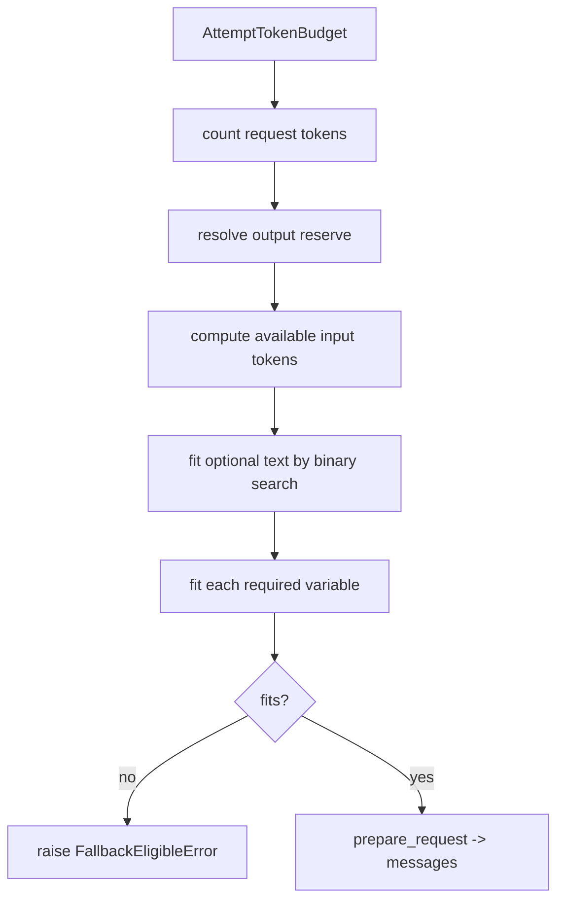

# Token handling and prompts

A model call has a finite context window, and the pull request diff can be larger than it. PR-Agent handles this with three files: `token_handler.py` (count tokens), `token_budget.py` (fit content to budget), and `prompt_fragments.py` (render shared fragments).

## Counting tokens

`TokenHandler` (`pr_agent/algo/token_handler.py:122`) renders the system and user prompts through `SandboxedEnvironment(undefined=StrictUndefined)` and encodes them (`:154`). The `StrictUndefined` setting is load-bearing: a missing prompt variable raises instead of rendering empty.

```python
class TokenHandler:
    CLAUDE_MAX_CONTENT_SIZE = 9_000_000          # token_handler.py:120
    def __init__(self, pr=None, vars=None, system="", user="", model=None, *, count_prompt_tokens=True): ...
    def count_tokens(self, patch: str, force_accurate: bool = False) -> int: ...
```

`_acount_tokens` (`pr_agent/algo/token_handler.py:260`) calls `litellm.acount_tokens` under `asyncio.wait_for` with a timeout from `config.ai_timeout` (default 120). It returns 0 when content exceeds `CLAUDE_MAX_CONTENT_SIZE`, on error, or when the tokenizer is a local tokenizer.

The count is estimated by default and accurate only when forced. `_get_token_count_by_model_type` (`:323`) returns the accurate count when positive; for an OpenAI model with an `OPENAI.KEY` it returns the default estimate; otherwise it applies `config.model_token_count_estimate_factor`. `_apply_estimation_factor` (`:304`) computes `factor = 1 + float(raw_factor)`.

## The token encoder

`TokenEncoder` (`pr_agent/algo/token_handler.py:68`) picks an encoder without downloading tokenizer files. Its `_create_encoder` (`:98`):

```python
@staticmethod
def _create_encoder(model):
    try:
        return encoding_for_model(model) if "gpt" in model else get_encoding("o200k_base")
    except Exception:
        return get_encoding("o200k_base")
```

At import time, `_use_bundled_tiktoken_files` (`pr_agent/algo/token_handler.py:37`) points `TIKTOKEN_CACHE_DIR` at LiteLLM's bundled tokenizer directory, so tiktoken does not download, unless a cache directory is already set.

## The token budget

`token_budget.py` (717 lines) is the fitting engine. The core constants (`pr_agent/algo/token_budget.py:21-23`):

```python
MESSAGE_FRAMING_TOKEN_ALLOWANCE = 16
REPLY_FRAMING_TOKEN_ALLOWANCE = 16
DEFAULT_TRUNCATION_MARKER = "\n...(truncated)\n"
```

`FallbackEligibleError` (`:26`) signals "this model attempt cannot fit the content; try the next fallback model."

The budget entry is the `AttemptTokenBudget` dataclass (`pr_agent/algo/token_budget.py:295`). Its methods include:

- `fit_optional_text` (`:576`) — binary-search the largest prefix of optional text that fits.
- `fit_prompt_variable` (`:675`) — fit a named variable into the remaining budget.
- `prepare_request` — build the final message list.
- `matches` (`:713`) — check whether prepared data belongs to the same model and source token handler.

`clip_tokens` (`pr_agent/algo/token_budget.py:177`) applies a safety factor of 0.9 before clipping, so a count that is slightly off does not overflow the window.



`get_max_tokens(model, ...)` (`pr_agent/algo/token_budget.py:82`) resolves a model's token ceiling in order: `GPT6_MAX_INPUT_TOKENS` (non-native GPT-6 routes with a custom cap), then `MAX_TOKENS[model]`, then `config.custom_model_max_tokens`, then `MAX_TOKENS[model_for_max_tokens]`, then LiteLLM's `get_model_info(...).get("max_input_tokens")`, and finally raises if nothing resolves. `config.max_model_tokens` is applied last as a clamp, not a step.

## Prompt fragments

`prompt_fragments.py` (29 lines) renders two shared Jinja2 fragments stored in TOML:

```python
def render_diff_hunk_format(*, include_line_numbers: bool, include_ai_metadata: bool) -> str:
    ...  # prompt_fragments.py:12, renders settings.prompt_fragments.diff_hunk_format

def render_skills_prefix(*, skills_context: str) -> str:
    ...  # prompt_fragments.py:21, renders settings.prompt_fragments.skills_prefix
```

`render_diff_hunk_format` renders through `_render_fragment`, whose environment uses `trim_blocks=True, lstrip_blocks=True` (`pr_agent/algo/prompt_fragments.py:8`); `render_skills_prefix` builds its own environment with only `SandboxedEnvironment(undefined=StrictUndefined)` (`:28`). The diff hunk fragment defines how a hunk is shown (with or without line numbers and AI metadata), so every tool renders hunks identically.

## The prompt variable bag

Every model-calling tool builds `self.vars` as a plain dictionary with `"diff": ""` as a placeholder filled during `_prepare_prediction`. The shared keys are `title`, `branch`, `description`, `language`, `diff`, `extra_instructions`, `commit_messages_str`. For example, the reviewer sets `diff`, `num_pr_files`, `num_max_findings`, `require_score`, and the other `require_*` flags (`pr_agent/tools/pr_reviewer.py:246-286`). The bag is wrapped in a `TokenHandler` bound to the system and user prompts:

```python
self.token_handler = TokenHandler(self.git_provider.pr, self.vars,
                                  get_settings().pr_questions_prompt.system,
                                  get_settings().pr_questions_prompt.user)
```

(`pr_agent/tools/pr_questions.py:74-77`)

## Aha moments

**Aha: a missing variable fails loudly.** Prompts are rendered with Jinja2 `StrictUndefined` (`pr_agent/algo/token_handler.py:154`, `prompt_fragments.py:8`), so a prompt template that references a variable a tool forgot to set raises instead of silently rendering an empty diff. This turns a prompt bug into a loud error instead of a bad model call.

**Aha: the budget reserves reply framing.** Every message and reply gets 16 tokens of framing allowance (`pr_agent/algo/token_budget.py:21-23`), because the model reply and the surrounding message envelope consume tokens that must not be spent on the prompt.

**Aha: the estimate factor is a margin, not a guess.** `clip_tokens` applies a 0.9 safety factor (`pr_agent/algo/token_budget.py:177`) and the estimation factor is `1 + raw` (`pr_agent/algo/token_handler.py:304`), so the system deliberately under-fills the window rather than risk an overflow.

## Where to go next

Read [Pull request and patch processing](05-pr-and-patch-processing.md) for how the diff that fills the budget is built.
