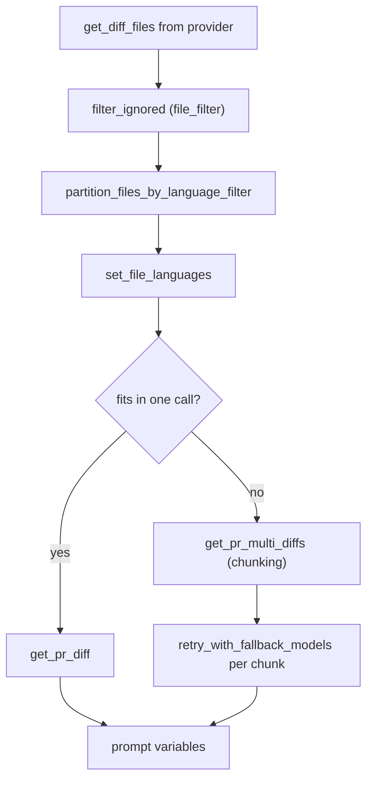

# Pull request and patch processing

Before a model call, the pull request (PR) diff becomes a structured context blob. This chapter covers the four parts: the unified diff parser, the patch processor, the PR processor, and the context builders (file filter, language handler, repository context).

## The unified diff parser

`pr_agent/git_providers/diff_parsing.py` (148 lines) parses a raw unified diff into `FilePatchInfo` objects using the `unidiff` library (`pr_agent/git_providers/diff_parsing.py:4`). The key functions:

```python
_HUNK_HEADER = re.compile(r"^@@ -\d+(?:,(?P<source_length>\d+))? \+\d+(?:,(?P<target_length>\d+))? @@")  # diff_parsing.py:27

def to_hunk_only_patch(patch_str) -> str: ...     # diff_parsing.py:13
def parse_unified_diff(diff_text) -> list[FilePatchInfo]: ...  # diff_parsing.py:54
def reconstruct_base_file_checked(head_file_str, patch_str) -> str | None: ...  # diff_parsing.py:97
```

`parse_unified_diff` skips binary files (`:66`), maps `is_added_file` → `ADDED`, `is_removed_file` → `DELETED`, `is_rename` → `RENAMED`, else `MODIFIED` (`:69-76`), and returns `FilePatchInfo` with empty `base_file`/`head_file` (callers fill them). `reconstruct_base_file_checked` reverse-applies a patch to recover the base file, returning `None` on any mismatch, and requires exactly one patch set (`:104`).

## The patch processor

`pr_agent/algo/git_patch_processing.py` (608 lines) works on individual patches. Key functions:

- `split_diff_lines` (`:20`) and `count_patch_lines` (`:28`).
- `to_hunk_only_patch` (`:33`) — strip file headers, keep hunks.
- `extend_patch` (`:48`) — add context lines around a hunk.
- `decode_if_bytes` (`:71`) — try UTF-16, then UTF-8, then Latin-1.
- `should_skip_patch` (`:85`) — skip files by `config.patch_extension_skip_types`.
- `process_patch_lines` (`:92`) — dynamic context via `config.allow_dynamic_context` and `config.max_extra_lines_before_dynamic_context`.
- `handle_patch_deletions` (`:371`) and `omit_deletion_hunks` (`:331`).
- `decouple_and_convert_to_hunks_with_lines_numbers` (`:404`) — split a patch into hunks with line numbers for the `/improve` tool.
- `extract_hunk_lines_from_patch` (`:537`) — extract the lines for a line-level question.

## The PR processor

`pr_agent/algo/pr_processing.py` (1153 lines) turns the full diff into a prompt-ready string. The bounds (`pr_agent/algo/pr_processing.py:34-38`):

```python
MAX_FILTERED_FILES_TO_PROMPT = 50
OUTPUT_BUFFER_TOKENS_SOFT_THRESHOLD = 1500
OUTPUT_BUFFER_TOKENS_HARD_THRESHOLD = 1000
MAX_EXTRA_LINES = 10
```

The core functions:

- `get_pr_diff(...)` (`:206`) — a single prompt string for the whole diff.
- `get_pr_diff_multiple_patchs` (`:390`) — several prompt strings for a chunked diff.
- `get_pr_multi_diffs(..., max_calls=5, ...)` (`:930`) — the chunking entry, defaulting to 5 model calls.
- `pr_generate_extended_diff` (`:613`) and `pr_generate_compressed_diff` (`:681`).
- `retry_with_fallback_models` (`:847`) — run `_prepare_prediction` across the fallback model chain.
- `add_ai_metadata_to_diff_files` (`:1112`) — annotate files with AI summaries.



## The file filter

`pr_agent/algo/file_filter.py` (263 lines) removes ignored files. `filter_ignored` (`:15`) returns only the filtered list; `filter_ignored_with_status` (`:20`) also returns a `complete` boolean so callers can detect that an invalid pattern or a partial glob expansion left some files unfiltered. Recognized platforms are `github`, `codecommit`, `local`, `plain_diff`, `mosaico`, `bitbucket`, `bitbucket_server`, `gitlab`, `azure`, `gitea`, `gerrit` (`:22-25`).

The filter combines `ignore.regex`, `ignore.glob`, `config.ignore_language_framework`, and `generated_code.<framework>` globs (`:28-53`). Glob expansion is bounded: `_MAX_ENUMERATED_GLOBSTARS = 6`, `_MAX_IGNORE_GLOB_VARIANT_REGEXES = 256` (`:9-12`).

## The language handler

`pr_agent/algo/language_handler.py` (155 lines) classifies files by language and removes generated files. `AUTO_GENERATED_FILES_EXACT` (`:7-11`) is a frozen set of lock-file names including `package-lock.json`, `uv.lock`, `Cargo.lock`, and `poetry.lock`. `_is_valid_file` (`:49`) rejects those exact names, the suffixes `('.min.js', '.min.css', '.js.map', '.ts.map', '.css.map')` (`:52`), and any file whose final extension is in the excluded set.

`build_language_file_matcher` (`:62`) builds a classifier that supports multi-part, wildcard, and case-folded extension keys. `sort_files_by_main_languages` (`:108`) puts main-language files first and the rest under `"Other"`.

## Repository context

`pr_agent/algo/repo_context.py` (622 lines) pulls instruction files (by default `AGENTS.md`) into the prompt. `_get_repo_context_config` (`:114`) reads `repo_context_files` and `repo_context_max_lines` (default 500). `build_repo_context` (`:564`) is the entry point. The cache is a least-recently-used cache with a 15-minute time-to-live (`REPO_CONTEXT_CACHE_TTL_SECONDS = 15 * 60`, `:20`).

## Aha moments

**Aha: the parser returns a `complete` boolean.** `filter_ignored_with_status` (`pr_agent/algo/file_filter.py:20`) tells the caller whether filtering was reliable. An invalid pattern or a truncated glob expansion sets `complete = False` rather than silently dropping files, so the tool can report the uncertainty.

**Aha: base-file reconstruction is verified, not assumed.** `reconstruct_base_file_checked` (`pr_agent/git_providers/diff_parsing.py:97`) reverse-applies the patch and returns `None` on any mismatch. A base file that does not reconstruct is treated as "no original file" rather than a wrong guess.

**Aha: deletions are omitted for suggestions, not for review.** `omit_deletion_hunks` and `handle_patch_deletions` (`pr_agent/algo/git_patch_processing.py:331,371`) exist because a code suggestion targets lines that remain, while a review needs to know what was removed.

## Where to go next

Read [Review pipeline](06-review-pipeline.md) for how the model's review output is parsed, merged, and deduplicated.
