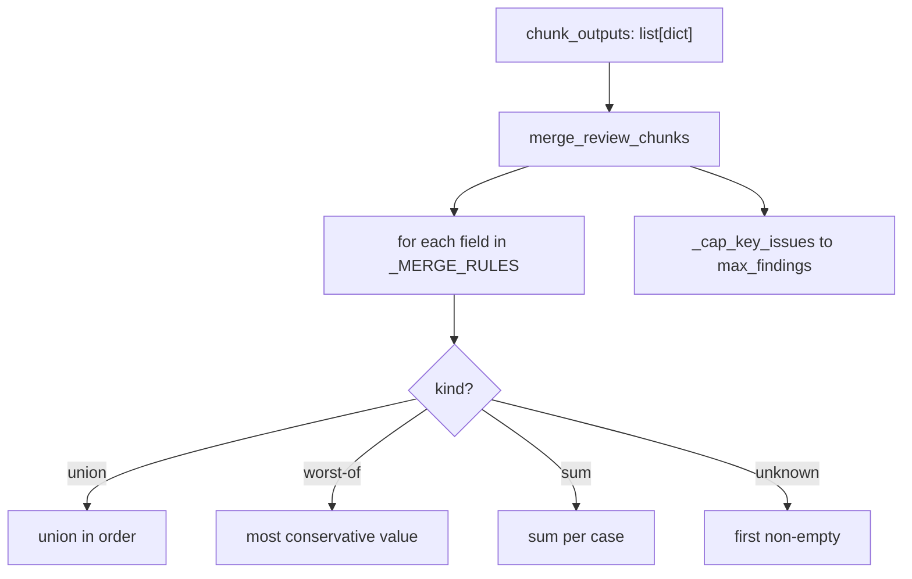
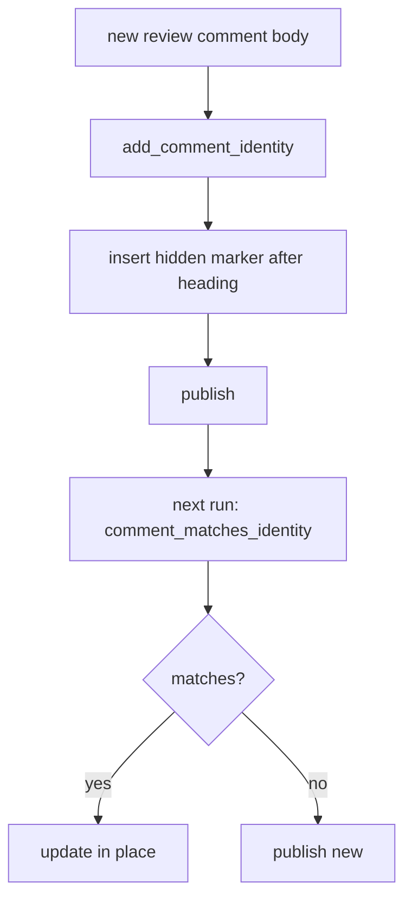

# Review pipeline

A large pull request (PR) is reviewed in chunks, and the chunks must become one review. This chapter covers chunk merge, finding state, the structured JSON output, inline comment deduplication, and comment identity.

## Merging review chunks

`pr_agent/algo/review_merge.py` (469 lines) reduces many chunk outputs into one review. `merge_review_chunks` (`:45`) is the entry. The merge is a rule engine: `_MERGE_RULES` (`:454-469`) maps each field to a merge function.

The merge strategies fall into three classes:

- Union-in-order for "found" fields: `relevant_tests`, `key_issues_to_review`, `todo_sections`, `security_concerns`, `failure_modes`.
- Worst-of for single judgements: `_merge_score` (lowest score wins, `:183`), `_merge_effort` (max clamped to `[1, 5]`, `:171`), `_worst_of` (`:192`).
- Sum for contribution time: `_merge_contribution_time` (`:438`).

Any unknown key keeps the first non-empty value via `_first_non_empty` (`:145`), so a later prompt field still survives. The constants (`pr_agent/algo/review_merge.py:34-38`):

```python
MAX_EFFORT = 5
MAX_SUB_PRS = 3
CONTRIBUTION_TIME_CASES = ("best_case", "average_case", "worst_case")
RISK_LEVELS = ("low", "medium", "high")
MERGE_RECOMMENDATIONS = ("no_concerns_found", "needs_review", "changes_required")
```



## Finding state

`pr_agent/algo/review_finding_state.py` (423 lines) persists review findings inside the posted review comment as a hidden, versioned HTML comment. The marker (`:18-21`):

```python
STATE_SCHEMA_VERSION = 1
DEFAULT_MAX_RESOLVED_FINDINGS = 20
_STATE_MARKER_RE = re.compile(r"<!-- pr-agent-review-state:v(?P<version>\d+)\n(?P<payload>.*?)\n-->", re.DOTALL)
```

`serialize_review_state` (`:169`) dumps the state with `sort_keys=True, separators=(",", ":")` and escapes `-->` as `--\u003e` and `--!>` as `--!\u003e` before wrapping, so the marker stays one comment.

`reconcile_review_findings` (`:200`) is conservative: resolution is allowed only when `allow_resolution` is true and both the previous and current head Secure Hash Algorithm (SHA) values are non-empty and different (`:226-233`). It records `first_seen`, `last_seen`, `reopened_at`, `reopened_count`, `resolved_at`, `resolved_head_sha`, and a `last_run` block.

`normalize_finding` (`:49`) builds `finding_id` via `key_issue_fingerprint(path, _WHITESPACE_RE.sub(" ", body).lower())` and normalizes line start/end. `normalize_findings` (`:96`) deduplicates deterministically by sorted id.

## The structured JSON output

`pr_agent/algo/review_json_output.py` (19 lines) is the smallest file in the layer:

```python
review_json_output_path: ContextVar[str | None] = ContextVar("review_json_output_path", default=None)

def write_review_json_output(review: dict, path: str | None = None) -> None:
    ...  # review_json_output.py:9
```

It writes the review as indented JavaScript Object Notation (JSON) with a trailing newline, raising after logging on `OSError`, `TypeError`, or `ValueError`.

## Inline comment deduplication

`pr_agent/algo/inline_comment_dedup.py` (319 lines) prevents re-posting the same defect. It computes two Secure Hash Algorithm 256 (SHA-256) fingerprints per comment — one for the body and one for the code — and embeds them as HTML comments. The fingerprint helpers:

```python
def _body_fingerprint(relevant_file, target_line_no, body, max_chars):  # :96, SHA-256 of f"{file}|{line}|{normalised}", first 12 hex
def key_issue_fingerprint(relevant_file, body):                          # :114, SHA-256 of f"{file}|{body}"
def key_issue_location_fingerprint(fingerprint, start_line, end_line):   # :119
def code_fingerprint(relevant_file, target_line_no, code):               # :124, no lowercasing
```

The marker URL is `https://github.com/The-PR-Agent/pr-agent` (`:41`). `InlineCommentStore` (`:249`) lazily loads existing comments and degrades to within-run dedup on load failure. Human-resolved threads stay suppressive; outdated-thread sweeps release fingerprints.

## Comment identity

`pr_agent/algo/comment_identity.py` (233 lines) gives every published comment a hidden identity so the next run can find and update it. The identities (`:11-41`):

```python
PRReviewHeader.REGULAR = "## PR Reviewer Guide"
PRReviewIdentity.REGULAR = "<!-- pr-agent:review:full -->"
PRReviewIdentity.INCREMENTAL = "<!-- pr-agent:review:incremental -->"
PRCodeSuggestionsIdentity.SUMMARY / NO_SUGGESTIONS / UNANCHORED
PRDescriptionIdentity.PERSISTENT
PRCommandNoticeIdentity.INCOMPLETE_BITBUCKET_FILES
```

`hidden_marker_forms` (`:104`) returns both the HTML form and its link-reference form. `comment_matches_identity` (`:120`) matches exact lines within the first five lines for hidden markers, or a prefix for legacy headers. `add_comment_identity` (`:155`) inserts the hidden identity after the visible heading.



## Aha moments

**Aha: finding state lives in the comment, not a database.** The review persists its own state as a hidden HTML comment inside the posted review (`pr_agent/algo/review_finding_state.py:18-21`). There is no database and no extra network call; the state travels with the comment and survives across runs because the next run reads the comment back.

**Aha: resolution requires a different head SHA.** Findings are only marked resolved when the previous and current head SHAs are known and different (`pr_agent/algo/review_finding_state.py:226-233`). This prevents a re-run against the same commit from silently closing findings that the author has not actually changed.

**Aha: dedup is by fingerprint, not text equality.** Two comments that say the same defect with different prose, or different code, are both caught because the body and code fingerprints are hashed separately and matched with OR semantics (`pr_agent/algo/inline_comment_dedup.py:96-134`).

## Where to go next

Read [Output models and sinks](07-output-models-and-sinks.md) for the structured outputs and their delivery channels.
