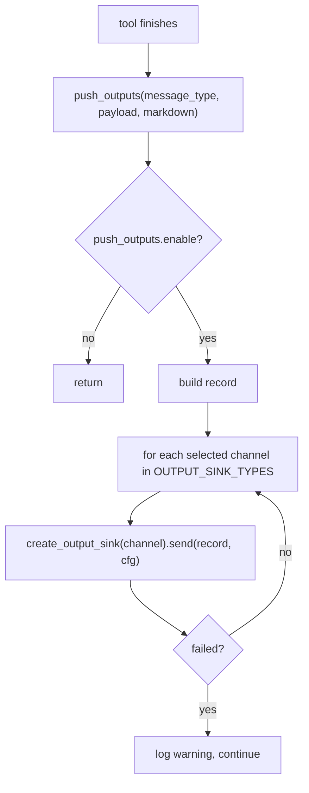

# Output models and sinks

Every tool ends at a delivery channel: a comment on the pull request (PR), a structured file, a log line, or an external sink. This chapter covers the output data shapes and every channel that is not the git provider itself.

## The structured data shapes

The shared shapes live in `pr_agent/algo/types.py` (30 lines). `EDIT_TYPE` is the five-value file-change enum (`ADDED`, `DELETED`, `MODIFIED`, `RENAMED`, `UNKNOWN`, `:5-10`), and `FilePatchInfo` is the dataclass that represents one changed file:

```python
@dataclass
class FilePatchInfo:
    base_file: str
    head_file: str
    patch: str
    filename: str
    tokens: int = -1
    edit_type: EDIT_TYPE = EDIT_TYPE.UNKNOWN
    old_filename: str = None
    num_plus_lines: int = -1
    num_minus_lines: int = -1
    language: str | None = None
    ai_file_summary: str = None
    head_file_is_complete: bool = True
    content_fetch_failed: bool = False   # types.py:30
```

`content_fetch_failed` is load-bearing: a file the provider could not read keeps an empty patch plus this flag instead of being dropped, so diff generation tells the model "this file could not be reviewed" rather than silently omitting it (`pr_agent/algo/types.py:27-30`).

## The model output schemas

Each tool declares its own structured output that the model must emit, and each tool validates it before publishing. The reviewer parses and validates a YAML structure via `_load_review_yaml` (`pr_agent/tools/pr_reviewer.py:1269`) and `_validate_review_schema` (`:1276`), then `_load_valid_review_yaml` (`:1322`). The description and code-suggestion tools each have their own `_prepare_pr_*`/`_prepare_pr_code_suggestions` parsers (`pr_agent/tools/pr_description.py`, `pr_agent/tools/pr_code_suggestions.py:1348`). The schemas themselves are documented in the tool chapters.

## The JSON file output

`pr_agent/algo/review_json_output.py` (19 lines) writes the review to a file. The path travels through a `ContextVar` so a single process can serve many requests without cross-talk:

```python
review_json_output_path: ContextVar[str | None] = ContextVar("review_json_output_path", default=None)

def write_review_json_output(review: dict, path: str | None = None) -> None: ...
```

(`pr_agent/algo/review_json_output.py:6`). The command line sets this variable from `--json-output` (`pr_agent/cli.py:241`).

## The run details footer

`pr_agent/algo/run_output.py` renders the opt-in "Agent run details" section. `show_run_details` (`:139`) lists models, token counts, prompt-cache counts, time cost, AI calls, and (when `config.output_run_cost` is on) an estimated application programming interface (API) cost formatted by `_format_usd` (`:131`). `append_run_details` (`:190`) appends it only when `config.output_run_details` is on and a model was actually used, choosing a collapsible `<details>` block or plain text by the provider's `gfm_markdown` capability.

## The push outputs

`push_outputs` (`pr_agent/algo/run_output.py:34`) emits a tool's output to external channels without any git-provider API. It is disabled by default, builds one `record` of `type`, `timestamp`, `payload`, and optional `markdown` (`:52-58`), and is non-fatal: a failed channel logs a warning and moves on.

The five channels are in `pr_agent/algo/output_sinks.py`, registered in `OUTPUT_SINK_TYPES` (`:104-110`) with local channels before network ones:

| Channel | Class | Behavior |
|---------|-------|----------|
| `stdout` | `StdoutSink` | one JSON line (`:47`) |
| `file` | `FileSink` | append JSON Lines to `file_path`, default `pr-agent-outputs/reviews.jsonl` (`:52`) |
| `webhook` | `WebhookSink` | POST the generic record (`:62`) |
| `slack` | `SlackSink` | POST `{"text": markdown}` to a Slack Incoming Webhook (`:69`) |
| `telegram` | `TelegramSink` | `sendMessage` to a chat, capped at 4096 UTF-16 code units (`:80`) |

Two safety details matter. `_push_outputs_sink_url` (`pr_agent/algo/output_sinks.py:21`) accepts only absolute `https://` URLs with a host, because the review text can quote private code. `_post_json` (`:39`) posts with `allow_redirects=False` so a configured sink cannot redirect the review to a different host.



## The GitHub Action output

`github_action_output` (`pr_agent/algo/run_output.py:20`) appends a key to the `$GITHUB_OUTPUT` file when `github_action_config.enable_output` is on, serialized as compact JSON. This is how a review run hands a structured result back to the workflow.

## The in-memory artifact

The MOSAICO path needs the review text without a real PR. It runs tools with `--config.publish_output=false` and then reads the result back from `get_settings().get("data", {}).get("artifact", "")` (`pr_agent/mosaico/dispatch.py:221-223`). The `data` section of the settings object is the catch-all in-memory sink used when the provider publish path is intentionally bypassed.

## Aha moments

**Aha: sinks are host-only, and the code says why.** The `push_outputs` section has an empty override allowlist (`pr_agent/config_security.py:26`), and the comment explains it: letting a repository set any sink would let a malicious repo exfiltrate review data or reach internal endpoints. The sink is a deliberate operator-only escape hatch.

**Aha: a failed sink never fails the review.** `push_outputs` wraps each channel and the whole function in try/except that logs only the exception type (`pr_agent/algo/run_output.py:60-69`), because a request error embeds the secret-bearing URL in its text. Delivery is best-effort by design.

**Aha: the JSON path is a context variable, not a global.** `review_json_output_path` is a `ContextVar` (`pr_agent/algo/review_json_output.py:6`), so concurrent requests in one process write to their own files instead of racing on a module global.

## Where to go next

Read [Git providers](08-git-providers.md) for the primary delivery channel and its abstraction.
