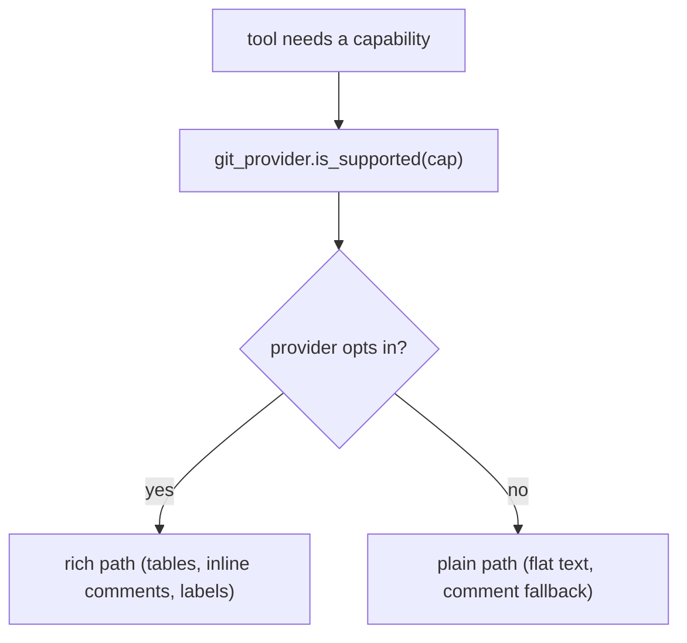

# Git providers

The git provider is the boundary between PR-Agent and a hosted repository. Sixteen files implement ten built-in providers behind one lazy registry and one abstract base class.

## The registry

`pr_agent/git_providers/__init__.py` maps ten provider identifiers to their module and class (`_BUILTIN_GIT_PROVIDERS`, `:11-22`):

| Provider id | Class | File |
|-------------|-------|------|
| `github` | `GithubProvider` | `github_provider.py` |
| `gitlab` | `GitLabProvider` | `gitlab_provider.py` |
| `bitbucket` | `BitbucketProvider` | `bitbucket_provider.py` |
| `bitbucket_server` | `BitbucketServerProvider` | `bitbucket_server_provider.py` |
| `azure` | `AzureDevopsProvider` | `azuredevops_provider.py` |
| `codecommit` | `CodeCommitProvider` | `codecommit_provider.py` |
| `local` | `LocalGitProvider` | `local_git_provider.py` |
| `gerrit` | `GerritProvider` | `gerrit_provider.py` |
| `gitea` | `GiteaProvider` | `gitea_provider.py` |
| `plain-diff` | `PlainDiffGitProvider` | `plain_diff_provider.py` |

The registry is lazy (`_LazyGitProviderRegistry`, `:35`): it imports a provider module only when the identifier is first accessed. A missing dependency raises an `ImportError` with an install hint from `_PROVIDER_EXTRAS` (`:24-32`), for example `pip install 'pr-agent[github]'`. `get_git_provider()` (`:135`) and `get_git_provider_with_context(pr_url)` (`:151`) both force `plain-diff` when `plain_diff.content` is set, so a repo or extra config that changed `config.git_provider` cannot route a loaded diff to a hosted provider.

External providers register through `register_git_provider` (`:120`); the MOSAICO server uses this to add `mosaico_diff` (`pr_agent/mosaico/provider_registration.py:9`).

## The abstract base

`GitProvider` (`pr_agent/git_providers/git_provider.py:355`, 1010 lines) declares 19 abstract methods and a large number of concrete defaults. The abstract contract:

```python
@abstractmethod
def is_supported(self, capability: str) -> bool: ...          # git_provider.py:366
def get_files(self) -> list: ...                              # :644
def get_diff_files(self) -> list[FilePatchInfo]: ...          # :659
def publish_description(self, pr_title, pr_body) -> None: ... # :670
def get_languages(self): ...                                  # :735
def get_pr_branch(self): ...                                  # :765
def get_user_id(self): ...                                    # :769
def get_pr_description_full(self) -> str: ...                 # :773
def get_repo_settings(self): ...                              # :887
def publish_comment(self, pr_comment, is_temporary=False): ...# :1037
def publish_inline_comment(self, body, relevant_file, ...): ...# :1217
def publish_inline_comments(self, comments): ...              # :1226
def remove_initial_comment(self): ...                         # :1230
def remove_comment(self, comment): ...                        # :1234
def get_issue_comments(self) -> Iterable: ...                 # :1238
def publish_labels(self, labels): ...                         # :1250
def get_pr_labels(self, update=False): ...                    # :1260
def remove_reaction(self, issue_comment_id, reaction_id): ... # :1314
def get_commit_messages(self) -> str: ...                     # :1319
```

## The capability system

`is_supported(capability)` is the first abstract method and the key to provider divergence. Each provider answers which capabilities it has, and the tools branch on those answers. The concrete `supports_*` helpers sit on the base and mostly return `False` so a provider opts in: `supports_incremental_kind` (`:385`), `supports_code_suggestions_artifact` (`:392`), `supports_threaded_pr_questions` (`:470`), `supports_checkbox_commands` (`:476`), `supports_markdown_tables` (`:517`), `supports_issue_url_tickets` (`:525`), and `supports_thread_resolution` (`:1074`) among others. A tool like the reviewer checks `is_supported("gfm_markdown")` before using GitHub-flavored markup (`pr_agent/algo/run_output.py:200`).



## Concrete behaviors on the base

Not everything is abstract. The base provides shared logic:

- `redact_credentials` (`git_provider.py:199`) strips credentials from text with a counted replacement, used before logging.
- `clone` (`:615`) and `_clone_inner` (`:579`) clone a repository for context-building, with `_prepare_clone_url_with_token` (`:573`) injecting a token into the clone URL.
- `get_repo_file_content` (`:950`) and `list_repo_directory` (`:953`) fetch repository context files.
- `publish_persistent_comment_full` (`:1149`) implements the edit-in-place persistent comment behavior on top of `supports_comment_editing`.
- `get_incremental_commits` (`:666`) and the `IncrementalPR` helper (`:1453`) support reviewing only new commits.
- `calc_pr_statistics` (`:1346`) and `get_num_of_files` (`:1349`) summarize a PR. `get_main_pr_language` (`:1366`) is a module-level helper, not a base method.

## The providers at a glance

The ten providers vary enormously in size. `github_provider.py` (122 KB) and `gitlab_provider.py` (141 KB) are the largest; `plain_diff_provider.py` (11 KB) and `local_git_provider.py` (12 KB) are the smallest. `diff_parsing.py`, `utils.py`, and `request_timeout.py` are shared helpers, and `codecommit_client.py` wraps the Amazon CodeCommit client used by `codecommit_provider.py`.

## Aha moments

**Aha: the registry imports lazily so a plain install is not every SDK.** The ten providers live behind `_LazyGitProviderRegistry` (`pr_agent/git_providers/__init__.py:35`), and each provider's SDK is an optional extra (`pyproject.toml` `[project.optional-dependencies]`). Installing `pr-agent` does not pull `PyGithub`, `python-gitlab`, or `boto3` until you select that provider.

**Aha: `plain-diff` wins over config.** Both `get_git_provider` and `get_git_provider_with_context` check `plain_diff.content` before reading `config.git_provider` (`pr_agent/git_providers/__init__.py:144-145,174-175`). This is the one provider that a repository's `.pr_agent.toml` cannot redirect, because it keys on already-loaded diff content.

**Aha: the capability string is the contract, not the provider class.** Tools test `is_supported("gfm_markdown")` rather than `isinstance(provider, GithubProvider)`, so a new provider ships by answering capability strings, not by being recognized in every tool.

## Where to go next

Read [Identity and secret providers](09-identity-and-secret-providers.md) for the two much smaller provider layers.
