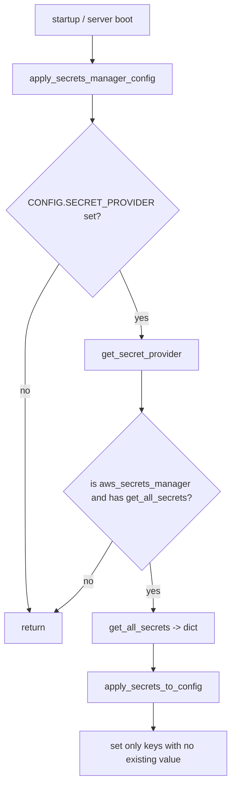

# Identity and secret providers

Two small provider layers sit beside the git providers: one answers "may this user use PR-Agent", and one reads secrets from a cloud vault. Both are pluggable and both default to nothing.

## The identity provider

`pr_agent/identity_providers/` has three files. The base `IdentityProvider` (`pr_agent/identity_providers/identity_provider.py`) is one abstract method plus an eligibility enum:

```python
class Eligibility(Enum):
    NOT_ELIGIBLE = 0
    ELIGIBLE = 1
    TRIAL = 2

class IdentityProvider(ABC):
    @abstractmethod
    def verify_eligibility(self, git_provider, git_provider_id, pr_url): ...
```

The registry (`pr_agent/identity_providers/__init__.py`) maps a single identifier:

```python
_IDENTITY_PROVIDERS = {'default': DefaultIdentityProvider}

def get_identity_provider():
    identity_provider_id = get_settings().get("CONFIG.IDENTITY_PROVIDER", "default")
    if identity_provider_id not in _IDENTITY_PROVIDERS:
        raise ValueError(f"Unknown identity provider: {identity_provider_id}")
    return _IDENTITY_PROVIDERS[identity_provider_id]()
```

The default implementation returns `Eligibility.ELIGIBLE` unconditionally (`pr_agent/identity_providers/default_identity_provider.py:5-6`). The hook exists so a commercial deployment can gate the bot on a user's entitlement, but the open-source install approves everyone.

## The secret provider

`pr_agent/secret_providers/` has four files. The base `SecretProvider` (`pr_agent/secret_providers/secret_provider.py`) declares two abstract methods:

```python
class SecretProvider(ABC):
    @abstractmethod
    def get_secret(self, secret_name: str) -> str: ...
    @abstractmethod
    def store_secret(self, secret_name: str, secret_value: str): ...
```

`__init__.py` names two supported providers (`SUPPORTED_SECRET_PROVIDERS`, `:4`) and two entry points. `validate_secret_provider_setting` (`:7`) rejects a typo at startup without building a client, which matters under gunicorn `preload_app` where an import-time client would be built in the master and inherited by every worker. `get_secret_provider` (`:19`) lazily imports and constructs the matching provider.

The two concrete providers:

- `AWSSecretsManagerProvider` (`aws_secrets_manager_provider.py:23`) wraps `boto3.client('secretsmanager')`. `get_secret` (`:41`) returns the `SecretString` and swallows only `ResourceNotFoundException` as `""`; `get_all_secrets` (`:55`) loads a whole JSON document from the configured Amazon Resource Name (ARN); `store_secret` (`:68`) creates the secret on a first-install race. Throughout, `_error_kind` (`:11`) logs only the AWS error code, never the message, because GitLab passes its webhook token as the secret name.
- `GoogleCloudStorageSecretProvider` (`google_cloud_storage_secret_provider.py:10`) reads and writes blobs in a configured bucket, swallowing only `NotFound` as `""` (`:28-30`).

## How secrets reach configuration

`apply_secrets_manager_config` (`pr_agent/config_loader.py:104`) calls `get_secret_provider()` and, when the provider is `aws_secrets_manager` and exposes `get_all_secrets`, applies the returned dictionary through `apply_secrets_to_config` (`:135`). A dotted key like `openai.key` is split into section and setting, uppercased, and set only when no existing value is present (`:148-160`), so environment variables keep precedence over vault secrets.



## Aha moments

**Aha: the identity provider is a one-line stub with a real contract.** `DefaultIdentityProvider.verify_eligibility` returns `ELIGIBLE` (`default_identity_provider.py:6`), but the `Eligibility` enum has three values, including `TRIAL`. The whole layer is an extension point a hosted product can fill without touching the open-source default.

**Aha: secret names are secrets too.** Both concrete providers deliberately omit the secret name from their error logs (`aws_secrets_manager_provider.py:49`, `google_cloud_storage_secret_provider.py:26`) because the GitLab webhook passes its token as the secret name. Logging the name would log the token.

**Aha: the vault never overrides the environment.** `apply_secrets_to_config` sets a key only when the current value is `None` or empty (`pr_agent/config_loader.py:157-159`), so a process environment variable always beats a vault value.

## Where to go next

Read [The command line and configuration](10-cli-and-config.md) for how all these settings are loaded and secured.
