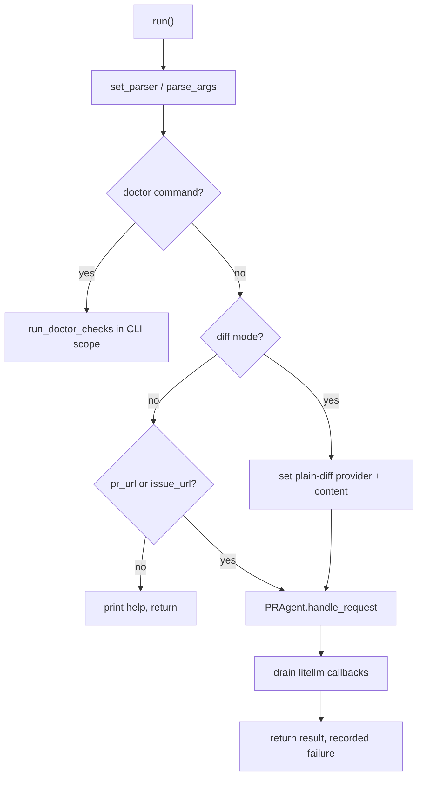
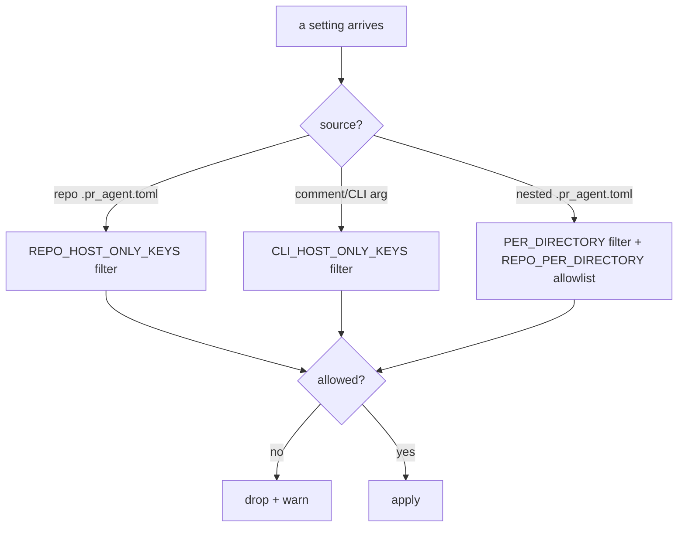

# The command line and configuration

Configuration is the security surface. Three files do the work: `cli.py` (command line parsing), `config_loader.py` (Dynaconf setup), and `config_security.py` (who may override what). A fourth, `custom_merge_loader.py`, replaces Dynaconf's own loader with a hardened one.

## The command line

`pr_agent/cli.py` (283 lines) builds an `argparse` parser (`set_parser`, `:116`). The command choices are the union of `commands` (from the dispatch table) and `DOCTOR_COMMANDS`. The key arguments:

- `--pr_url` and `--issue_url` target a pull request (PR) or issue (`:150-151`).
- `--config-branch` and `--extra_config_url` select alternate config sources (`:152-164`).
- `--stdin` and `--diff-file` enable plain-diff mode (`:165-168`).
- `--output` and `--json-output` write results to files (`:169-174`).

`run` (`:189`) is the entry. Plain-diff mode sets `config.git_provider = "plain-diff"`, stores the diff in `plain_diff.content`, and forces `config.publish_output = True` so the result is emitted rather than swallowed (`:221-229`). The doctor commands run inside `_cli_settings_scope` (`:46`), which installs a per-invocation deep copy of the settings and clears target-derived caches.

`_validate_output_options` (`:82`) enforces the placement and mode rules: `--output` only in plain-diff mode and only for markdown commands, `--json-output` only for review, improve, and describe with a PR URL (`:98-113`).

## The configuration loader

`pr_agent/config_loader.py` constructs the single `Dynaconf` object (`global_settings`, `:24`). Four decisions matter:

- `core_loaders: []` disables Dynaconf's default loaders; `loaders` lists only `pr_agent.custom_merge_loader` and the environment loader (`:9-12`).
- `load_dotenv=False` — dotenv files are not loaded, as a security choice (`:26`).
- `merge_enabled=False` — a section-level `set()` replaces a whole section instead of appending to lists (`:22`).
- `root_path` points at the settings folder so `find_file` resolves there (`:15`).

The settings files list is 24 explicit paths (`:27-52`), from `configuration.toml` through each tool prompt file to `.secrets.toml`. `get_settings(use_context=True)` (`:57`) returns the request-scoped settings from the context when one exists, otherwise the global object.

## The hardened TOML loader

`pr_agent/custom_merge_loader.py` replaces Dynaconf's loader with a security-first one. `load` (`:12`) caps a settings file at `MAX_TOML_SIZE_IN_BYTES = 100 * 1024 * 1024` (`:9`), allows only `.toml` files (`:62`), and rejects the `includes`/`preload` directives (`:46-55`). `validate_file_security` (`:108`) rejects a table of forbidden Dynaconf directives — `includes`, `preload`, merge controls, loader overrides, `settings_module`, and `envvar_prefix` (`:123-153`) — and caps nesting depth at 50 (`:119`). The load path replaces list and dict fields instead of appending, so a repo settings file cannot append to a host list.

## The override boundaries

`pr_agent/config_security.py` is the map of who may override what. It defines three layers:

1. `REPO_HOST_ONLY_KEYS_BY_SECTION` (`:42`) — keys a repository's `.pr_agent.toml` may never set: provider credentials and endpoints, `github.agent_login`, `config.extra_config_url`, `config.http_request_timeout`, and others. `is_repo_host_only_key` (`:116`) also treats any key ending in a connection suffix (`url`, `base_url`, `endpoint`, `org`, `key`, `token`, `secret`, `:31`) as host-only.
2. `REPO_OVERRIDABLE_KEYS_BY_HOST_SECTION` (`:24`) — whole sections that are host-only except a few allowlisted keys (`skills`, `push_outputs`, `prompt_fragments`, `bedrock`).
3. `CLI_HOST_ONLY_KEYS_BY_SECTION` (`:151`) — keys a comment argument or CLI `--section.key=value` may never override, even though the repo config may set them: `config.fallback_models`, `config.ai_timeout`, `pr_code_suggestions.max_number_of_calls`, and others.

A fourth layer, `REPO_PER_DIRECTORY_OVERRIDABLE_SECTIONS` (`:259`) plus `PER_DIRECTORY_HOST_ONLY_KEYS_BY_SECTION` (`:192`), governs nested `.pr_agent.toml` files, which are editable by any contributor and so get the narrowest surface.

`should_skip_config_key` (`:129`) drives the "relevant configurations" footer: it hides host-only keys and any key whose name contains `key`, `secret`, `token`, or `private` (`:136`).

## Aha moments

**Aha: dotenv is off on purpose.** `load_dotenv=False` (`pr_agent/config_loader.py:26`) closes a class of attacks where a repository could plant a `.env` file that Dynaconf would otherwise load. All environment influence is explicit.

**Aha: the same allowlist guards two entry points.** The `config_security.py` header states the intent: the allowlist is shared by repo-settings application and CLI argument validation "so the two entry points cannot drift" (`pr_agent/config_security.py:4-6`). One map, two gates.

**Aha: a repository cannot exfiltrate through config.** `push_outputs` has an empty override allowlist and `extra_config_url` is host-only (`pr_agent/config_security.py:26,103-112`), each with a comment spelling out the exfiltration or server-side request forgery (SSRF) it prevents. The security reasoning is written into the file, not just implied.

## Where to go next

Read [Servers and deployment](11-servers-and-deployment.md) for how the configured system runs as a service.
