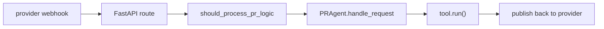

# Servers and deployment

`pr_agent/servers/` is how PR-Agent runs as a service: 17 Python files and 2 JavaScript Object Notation (JSON) manifests implement eleven entry points over shared helpers.

## The eleven servers

| Server | File | Kind |
|--------|------|------|
| `github_app.py` | GitHub App webhook | FastAPI app |
| `gitlab_webhook.py` | GitLab webhook | FastAPI app |
| `bitbucket_app.py` | Bitbucket app | FastAPI app |
| `bitbucket_server_webhook.py` | Bitbucket Server webhook | FastAPI app |
| `azuredevops_server_webhook.py` | Azure DevOps webhook | FastAPI app |
| `gerrit_server.py` | Gerrit webhook | FastAPI app |
| `gitea_app.py` | Gitea webhook | FastAPI app |
| `github_action_runner.py` | GitHub Action | command line |
| `github_polling.py` | GitHub polling | long-running loop |
| `github_lambda_webhook.py` | GitHub on Amazon Lambda | `lambda_handler` |
| `gitlab_lambda_webhook.py` | GitLab on Amazon Lambda | `lambda_handler` |

The two Atlassian Connect descriptors (`atlassian-connect.json`, `atlassian-connect-qodo-merge.json`) are the Bitbucket app manifests. The remaining files are shared: `github_common.py` (GitHub event parsing), `gunicorn_config.py` (worker sizing), `help.py` (usage text), `request_body_limit.py` (request size cap), and `utils.py`.

## The webhook shape

Every webhook server follows the same shape: a `handle_*` route parses the provider's webhook event, runs `should_process_pr_logic`, and dispatches the command through `PRAgent`. GitHub is the largest example: `handle_github_webhooks` (`github_app.py:60`), `handle_new_pr_opened` (`:179`), `handle_comments_on_pr` (`:124`), and `handle_pull_request_review_submitted` (`:248`) each map an event to an action. `_perform_auto_commands_github` (`:478`) runs the automatic commands from configuration.

Azure DevOps is the odd one out: it rebuilds `/ask_line` as a space-joined string to bypass the shell-style command parser and avoid argument injection (`azuredevops_server_webhook.py:181-187`).

## The polling loop

`github_polling.py` is the alternative to a webhook for hosts that cannot receive them. `polling_loop` (`:440`) reads GitHub notifications, validates each with `is_valid_notification` (`:285`), and runs comment commands through `process_comment` (`:275`). Work is queued and capped by `_start_queued_processes` (`:396`) with a `max_allowed_parallel_tasks` limit.

## The GitHub Action runner

`github_action_runner.py` runs PR-Agent inside a workflow. `run_action` (`:220`) reads the event payload, runs configured commands, and can fail the workflow through `_mark_action_failed` (`:97`) and `_inject_ci_conclusion` (`:556`). `_run_review_commands` (`:147`) and `_run_auto_tool` (`:133`) execute the tool set. The runner's settings come from both environment variables and the workflow's `with:` block via `get_setting_or_env` (`:48`).

## Worker sizing

`gunicorn_config.py` sizes the webhook workers for the deployment. `compute_workers` (`:145`) uses `available_cpus` (`:120`), which prefers the Linux cgroup central processing unit (CPU) limit via `_cgroup_cpu_limit` (`:90`) and CPU affinity via `_affinity_cpus` (`:112`), so a pod capped at a fraction of a node does not spawn workers for the whole node. `preload_app = True` (`:160`) imports the app once in the master and forks, so workers share the roughly 230 megabyte model stack. `timeout = 240` (`:162`).

The Prometheus multiprocess directory is provisioned in `when_ready` (`:276`), before any worker imports the Prometheus client, and `_prepare_prometheus` (`:286`) runs the `ensure_prometheus_multiproc_dir` from the telemetry package. `child_exit` (`:302`) and `post_fork` (`:316`) hook the worker lifecycle.

## The request body limit

`request_body_limit.py` provides `RequestBodyLimitMiddleware` and `get_max_request_body_size`, capping inbound webhook bodies. The MOSAICO server reuses the same middleware (`pr_agent/mosaico/server.py:120`), so the two servers share one limit policy.

## Aha moments

**Aha: the webhook and the action runner are the same agent, different transport.** Both end at `PRAgent.handle_request`. The webhook translates an event into a command string; the action runner translates a workflow into a command string. Everything downstream — policy, dispatch, tools, providers — is identical, which is why one bug fix fixes both.

**Aha: worker count is computed from the container, not the node.** `available_cpus` reads the cgroup quota and CPU affinity before falling back to the host CPU count (`gunicorn_config.py:90-128`), because gunicorn's own `cores * 2 + 1` formula would otherwise spawn far too many workers in a capped pod.

**Aha: `preload_app` is why the Prometheus client must import lazily.** The module docstring of `prometheus.py` explains it: the master imports the app before `when_ready` creates the multiprocess directory, so the client must be imported on the worker or at scrape time, never at module level (`pr_agent/telemetry/prometheus.py:13-23`).

## Where to go next

Read [Tools: review and describe](12-tools-review-and-describe.md) for the two largest tools that the servers dispatch.
