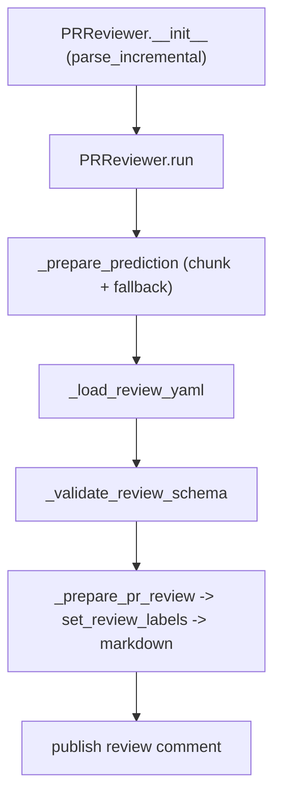

# Tools: review and describe

The two largest tools are the reviewer (91 KB) and the description generator (70 KB). Both follow the same constructor-plus-`run()` convention, but each has its own pipeline.

## The reviewer

`PRReviewer` (`pr_agent/tools/pr_reviewer.py:178`) is the workhorse. Its `__init__` (`:194`) takes `is_answer` and `is_auto` flags, so the same class serves `/review`, `/review_pr`, and `/answer`. The `run` method (`:304`) is long and orchestrates the whole flow; `parse_incremental` (`:295`) handles the `--incremental` argument.

The model interaction is `_prepare_prediction` (`:906`), which chunks a large PR, runs the model, and retries through fallback models. The chunk machinery has its own helpers: `_resize_pending_review_chunks` (`:1112`), `_include_newly_reviewable_files` (`:1150`), `_review_attempt_budget` (`:1180`), and `_merge_cached_review_chunks` (`:1188`).

The model returns YAML, and the reviewer validates it strictly. `_load_review_yaml` (`:1269`) parses, `_validate_review_schema` (`:1276`) checks the structure, and `_load_valid_review_yaml` (`:1322`) is the only entry that accepts the response. `_prepare_pr_review` (`:1329`) turns the validated data into the final review text.

Beyond the review text, `set_review_labels` (`:1728`) applies the review labels. `auto_approve_logic` (`:1802`) exists to approve the PR, but its only call site is commented out (`:334`), so it is dead code. Incremental review is gated by `_can_run_incremental_review` (`:1678`). The finding-state integration (`_prepare_review_finding_state` at `:806` and `_load_review_finding_state` at `:650`) bridges to the state file covered in the review pipeline chapter.

## The description generator

`PRDescription` (`pr_agent/tools/pr_description.py:66`) produces the PR title, type, summary, code walkthrough, and labels. Its `run` (`:154`) calls `_prepare_prediction` (`:358`) and then `_prepare_data` (`:823`), which assembles the description from the model output. `_require_usable_prediction` (`:818`) rejects an empty or malformed model response before publication.

Two smaller helpers round it out: `_get_description_coverage_footer` (`:624`) reports which files were covered, and `_write_json_output` (`:140`) writes the structured description when `--json-output` is set. The description tool supports the "only files" and "only description" prompt variants selected by settings (`pr_description_only_files_prompts.toml`, `pr_description_only_description_prompts.toml`).

## The shared `_prepare_prediction` contract

Every model-calling tool implements the same private method: build the prompt variables, construct a `TokenHandler`, fit the diff to the token budget, call the handler, and store the result. The reviewer's `_prepare_prediction` returns `None` and stores its result in `self.prediction`; the description's `_prepare_prediction` sets `self.prediction`, and its `_prepare_data` later builds `self.data`. The contract — not the implementation — is what the dispatch table relies on: `PRAgent._run_command` only ever calls `tool.run()`.

## Aha moments

**Aha: `/review`, `/review_pr`, `/answer`, and `/auto_review` are one class.** The dispatch table maps all four to `PRReviewer` (`pr_agent/agent/pr_agent.py:51-54`), and the constructor's `is_answer` flag changes the prompt and the publish target. Four commands, one pipeline.

**Aha: a malformed model response is rejected, not repaired.** `_require_usable_prediction` (`pr_agent/tools/pr_description.py:818`) and `_load_valid_review_yaml` (`pr_agent/tools/pr_reviewer.py:1322`) treat an invalid model output as an error to retry or report, rather than silently publishing a partial result.

**Aha: chunk resizing is two-way.** The reviewer both shrinks chunks that will not fit (`_resize_pending_review_chunks`) and re-includes files that become reviewable when a chunk frees budget (`_include_newly_reviewable_files`), so the token budget is spent and no file is dropped when it could have fit.

## Where to go next

Read [Tools: code suggestions and questions](13-tools-code-suggestions-and-questions.md) for the improve and ask families.
