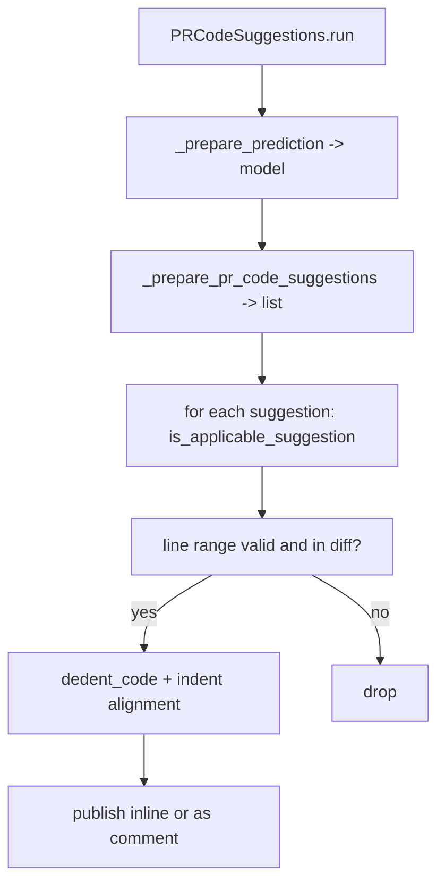

# Tools: code suggestions and questions

Three tools turn a pull request (PR) into code suggestions and answers: `PRCodeSuggestions` (135 KB, the largest tool), `PRQuestions`, and `PR_LineQuestions`.

## Code suggestions

`PRCodeSuggestions` (`pr_agent/tools/pr_code_suggestions.py:247`) powers `/improve`. Its `run` (`:374`) drives the model through `_prepare_prediction` (`:1014`) and then validates and publishes each suggestion. The result parsing is `_prepare_pr_code_suggestions` (`:1348`), and `generate_summarized_suggestions` (`:2338`) renders the self-review summary form.

Suggestion validation is the heart of the tool. A suggestion must be applicable before it is published: `is_applicable_suggestion` (`:1742`) and `_validate_suggestion` (`:1709`) check that the line range is in the diff (`_is_suggestion_line_range_in_diff`, `:1311`) and valid (`_is_suggestion_line_range_valid`, `:1288`). Indentation is corrected by `dedent_code` (`:1883`), `_shift_code_indentation` (`:1748`), and `_infer_space_indentation_unit` (`:1765`), while `_align_code_with_tabs` (`:1814`) handles tab-indented files. `validate_one_liner_suggestion_not_repeating_code` (`:1933`) rejects a suggestion that merely repeats the existing line.

The suggestions can be committed directly to the PR (`committable_code_suggestions`), pushed as inline comments, or gathered into a single comment. `_get_suggestions_coverage_footer` (`:622`) reports coverage, and `_limit_suggestions_per_file` (`:1436`) caps the output.

## The question tool

`PRQuestions` (`pr_agent/tools/pr_questions.py:43`) powers `/ask`. Its `run` (`:85`) parses the question argument with `parse_args` (`:82`), and `_prepare_prediction` (`:195`) sends the diff plus the question to the model. `_publish_answer` (`:136`) posts the answer, and `identify_image_in_comment` (`:166`) plus `_find_image_url` (`:184`) handle questions that embed an image. When the PR has no analyzable files, `_prepare_no_analyzable_files_answer` (`:300`) returns a plain explanation instead of calling the model.

## The line question tool

`PR_LineQuestions` (`pr_agent/tools/pr_line_questions.py:24`) powers `/ask_line` — a question about one line in a file. Its `run` (`:76`) reads the line from the command, and `_get_prediction` (`:218`) sends a line-scoped prompt. `_load_conversation_history` (`:167`) and `_fit_conversation_history` (`:244`) fold prior question-and-answer turns into the prompt when the provider supports line-question history.

## The image path

Both question tools route images through `PRQuestions.identify_image_in_comment`, which extracts an image URL from the trigger comment and passes it to the model. The model handler's `chat_completion` accepts an `img_path` parameter (`pr_agent/algo/ai_handlers/base_ai_handler.py:33`), so a question about a screenshot is answered with the image in context.

## Aha moments

**Aha: applicability is checked before indentation, not after.** `is_applicable_suggestion` runs the line-range and diff checks first (`pr_agent/tools/pr_code_suggestions.py:1742`), and only then does `dedent_code` fix indentation. The expensive correction work happens only for suggestions that will actually be published.

**Aha: the tabs case is handled separately from spaces.** `_align_code_with_tabs` (`:1814`) and `_shift_code_indentation` (`:1748`) are distinct because a tab-indented file needs its indentation unit inferred differently than a space-indented one, and a suggestion that misindents code is worse than no suggestion.

**Aha: a no-file question never reaches the model.** `_prepare_no_analyzable_files_answer` (`pr_agent/tools/pr_questions.py:300`) short-circuits before `_prepare_prediction`, so a question about an empty or binary-only PR returns a canned, correct answer without spending a model call.

## Where to go next

Read [Tools: docs, labels, help, and the rest](14-tools-docs-labels-and-help.md) for the remaining six tools.
