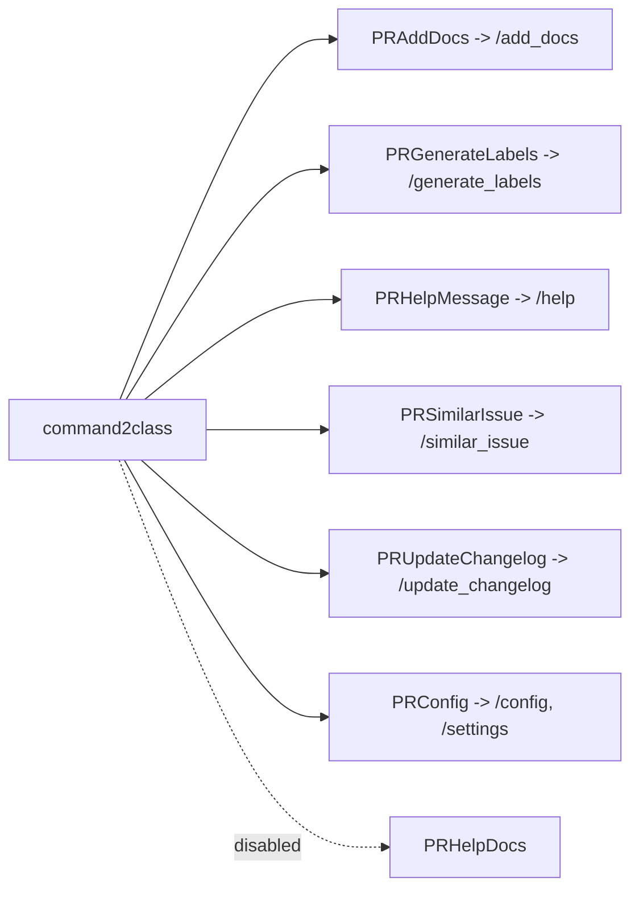

# Tools: docs, labels, help, and the rest

Seven tools fill out the command surface: six active and one disabled.

## Documentation generation

`PRAddDocs` (`pr_agent/tools/pr_add_docs.py:23`) powers `/add_docs`. Its `run` (`:54`) and `_prepare_prediction` (`:115`) generate docstrings for the changed code, and `push_inline_docs` (`:211`) publishes them as inline comments. `_prepare_pr_code_docs` (`:179`) parses the model output, and `dedent_code` (`:269`) aligns the generated docstring with the existing indentation. `_indent_reference_line` (`:261`) anchors the placement after the reference line.

## Label generation

`PRGenerateLabels` (`pr_agent/tools/pr_generate_labels.py:24`) powers `/generate_labels`. `run` (`:63`) and `_prepare_prediction` (`:121`) ask the model for labels, `_load_valid_labels_yaml` (`:215`) parses them, and `_prepare_labels` (`:225`) filters against the custom label definitions in `custom_labels.toml` and `pr_custom_labels.toml`.

## The help message

`PRHelpMessage` (`pr_agent/tools/pr_help_message.py:168`) powers `/help`. Unusually, it can answer without a model call: `run` (`:493`) renders the usage guides, and when no question is supplied it takes a static branch (`:555`) that returns built-in help instead of calling `_prepare_prediction` (`:181`). `_load_help_response` (`:195`) and `_render_prompts` (`:217`) handle the prompt-based path, while `_fit_prompts` (`:331`) and `_get_fitted_docs_files` (`:390`) fit the documentation files to the model budget. The static usage text lives in `pr_agent/servers/help.py` (`HelpMessage`, `:4`).

## Similar issue search

`PRSimilarIssue` (`pr_agent/tools/pr_similar_issue.py:219`) powers `/similar_issue`. Its `run` (`:505`) indexes issues and searches for near-duplicates. Unlike the other tools, it is not purely model-driven: it stores issue embeddings in a vector database — Qdrant, LanceDB, or Pinecone — chosen by the `vectordb` setting. `_update_qdrant_with_issues` (`:835`), `_update_table_with_issues` (`:731`), and `_record_similar_hit` (`:464`) are the storage paths, and `_select_similar_hits` (`:474`) ranks the results.

## Changelog update

`PRUpdateChangelog` (`pr_agent/tools/pr_update_changelog.py:52`) powers `/update_changelog`. `run` (`:113`) and `_prepare_prediction` (`:224`) generate the changelog entry, `_prepare_changelog_update` (`:295`) returns the new entry and its position, and `_push_changelog_update` (`:315`) commits it to the branch. `_get_changelog_file` (`:398`) locates the changelog file.

## Configuration display

`PRConfig` (`pr_agent/tools/pr_config.py:10`) powers `/config` and `/settings`. `run` (`:29`) and `_prepare_pr_configs` (`:39`) render the current configuration, redacting host-only keys via `should_skip_config_key`.

## The disabled help-docs tool

`PRHelpDocs` (`pr_agent/tools/pr_help_docs.py:428`) would answer documentation questions from a repository's own documents. It is present — 43 KB with `run` (`:480`), `_rank_docs_and_return_them_as_prompt` (`:728`), and a `PredictionPreparator` (`:373`) — but the dispatch entry is disabled with a `SECURITY` comment referencing issue 2445 (`pr_agent/agent/pr_agent.py:69-71`), so `/help_docs` is not reachable through the command table.

## Aha moments

**Aha: `/help` does not always call the model.** `PRHelpMessage.run` has a static branch for a question-less request (`pr_agent/tools/pr_help_message.py:555`), so a plain `/help` is answered from the built-in guides in `servers/help.py` without a model call.

**Aha: similar-issue search is a vector-database tool wearing a tool's shape.** It is the only tool with direct storage backends (`qdrant`, `lancedb`, `pinecone`), and those drivers are deliberately a dependency group rather than a published extra (`pyproject.toml` `[dependency-groups].similar-issue`), so a plain install never pulls them.

**Aha: the help-docs tool exists but is unreachable.** `PRHelpDocs` is fully implemented but its dispatch entry is commented out as a security measure (`pr_agent/agent/pr_agent.py:69-71`), a reminder that the dispatch table, not the tool file, is the public surface.

## Where to go next

Read [MOSAICO and A2A](15-mosaico-a2a.md) for the agent-to-agent protocol server.
