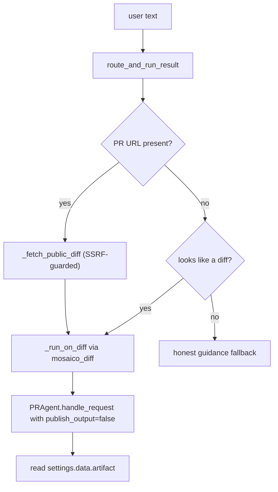

# MOSAICO and A2A

`pr_agent/mosaico/` is a separate entry point: an agent-to-agent (A2A) server that exposes PR-Agent as a solution agent on the MOSAICO protocol. Eleven files turn inbound natural language into a PR-Agent command and return the rendered markdown.

## The three routing paths

`dispatch.py` is the text router. `route_and_run_result` (`pr_agent/mosaico/dispatch.py:372`) handles three cases, documented at the top of the file:

1. A PR URL — fetch the public unified diff by appending `.diff`, then run through the token-free `mosaico_diff` provider.
2. A supplied unified diff — install it as `MOSAICO.INPUT` and run through `DiffInputProvider`.
3. Free text with no PR and no diff — return honest guidance, because `ask` needs a diff to answer.

The URL fetch is defensive: `_fetch_public_diff` (`:240`) is HTTPS-only and server-side request forgery (SSRF)-guarded, with a 20-second timeout, a 4 megabyte cap, and redirect validation via `with_safe_redirects` (`:270`). `route_and_run_result` never raises; every failure returns a fallback string.

Verb detection is a small state machine. `_detect_verb` (`:148`) finds an explicit verb, defaults to `review`, and prefers `ask` when the text reads like a question. `_diff_prose` (`:199`) strips the diff body before looking for verbs, so a question mark inside a ternary or a regular expression does not flip `review` into `ask`.

## The A2A server

`server.py` builds a plain Starlette app. `build_app` (`pr_agent/mosaico/server.py:97`) registers the A2A agent-card route, the JSON remote procedure call (JSON-RPC) routes, and a `/health` route, wrapped in three middleware: bearer authentication, a request body limit, and `RawContextMiddleware`.

The `RawContextMiddleware` is mandatory, not optional: the executor installs a request-scoped deep copy of the settings into the context, and without the scope it raises `ContextDoesNotExistError` (`server.py:5-6`). `start` (`:125`) configures the JSON logger and runs uvicorn on host `0.0.0.0`, port `9000` by default.

## The executor

`PRAgentExecutor` (`pr_agent/mosaico/executor.py:42`) is the bridge to PR-Agent. `execute` (`:97`) does three things in a careful order:

1. Publishes a working `Task` before the long-running route starts, so A2A cancellation can find it (`:112-125`).
2. Installs `copy.deepcopy(global_settings)` into the context (`:129`), so the tool run mutates only the per-request copy — the isolation that makes concurrency safe.
3. Always calls `add_artifact` before `complete` or `failed` (`:146-163`), because the A2A software development kit (SDK) raises "Agent should enqueue Task before TaskStatusUpdateEvent" otherwise.

`health_check` (`:175`) issues a single, non-retry-wrapped LiteLLM probe, bypassing `LiteLLMAIHandler.chat_completion` and its retries.

## The diff provider

`diff_provider.py` implements `DiffInputProvider` (`:147`), a `GitProvider` over a supplied diff with no host and no checkout. Its own `parse_unified_diff` (`:58`) splits on `diff --git a/<f> b/<f>` headers, reconstructs base and head file content best-effort, and honors `new file mode`, `deleted file mode`, and `rename from/to` for the edit type. The publish methods are safe no-op stubs (`:204-239`), because with `publish_output=false` the tools render into `get_settings().data` instead of calling the publish path.

## The agent card

`card.py` builds the A2A agent card. It advertises four skills — `review`, `improve`, `describe`, `ask` (`build_agent_card`, `:83`) — with `capabilities.streaming=False` (`:106`). That flag is load-bearing: the reference agent selects `message/send` versus `message/stream` from it. The observability extension is advertised with `required=True` because the AISP specification says so (`card.py:3-9`).

## Auth, environment, tasks, and observability

- `auth.py` implements `MosaicoAuthenticationBackend` (`:13`), which validates bearer tokens with constant-time comparison and makes the card route public. `MosaicoCallContextBuilder` (`:58`) strips the authorization header from the call context so credentials never reach SDK logs.
- `env_bridge.py` maps the MOSAICO environment contract onto Dynaconf settings (`apply_mosaico_env`, `:28`) and registers the Langfuse LiteLLM callback (`:65`).
- `task_store.py` implements `MosaicoTaskStore` (`:12`), a bounded, owner-scoped task store that reports evictions so the executor can drop follow-up indexes.
- `observability.py` parses the observability metadata tolerantly (`parse_observability_metadata`, `:19`) and opens a Langfuse span with the W3C trace transform (`langfuse_span`, `:72`).
- `provider_registration.py` registers `mosaico_diff` idempotently, so the registry is untouched on every other code path.

## Aha moments

**Aha: the whole server is a settings-deepcopy trick.** `PRAgentExecutor.execute` copies the global settings into the request context (`pr_agent/mosaico/executor.py:129`), and `get_settings()` resolves to the context copy. The MOSAICO server reuses PR-Agent's own request-scoping convention, so concurrent A2A requests cannot leak configuration into each other.

**Aha: the first A2A event must be an artifact.** Both success and failure paths call `add_artifact` before any status update (`pr_agent/mosaico/executor.py:146-163`), because the A2A SDK enforces artifact-first ordering. This is an SDK contract the code comments explicitly call out as a risk.

**Aha: the router never throws.** `route_and_run_result` wraps its whole body in try/except and returns a fallback string (`pr_agent/mosaico/dispatch.py:402-404`), so a malformed inbound message degrades to a readable error rather than crashing the A2A task.

## Where to go next

Read [Telemetry and observability](16-telemetry-and-observability.md) for the metrics and tracing that this server reports.
