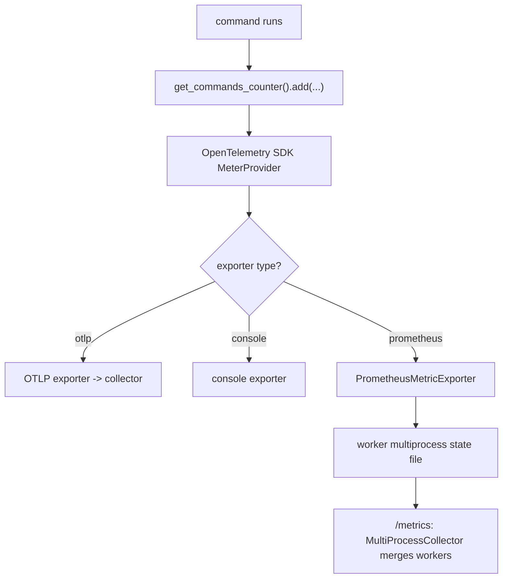

# Telemetry and observability

`pr_agent/telemetry/` is nine files of OpenTelemetry plumbing, plus a native Prometheus scrape endpoint. Telemetry is off by default and fails closed.

## The configuration

`config.py` reads and validates the telemetry settings. `get_otel_config` (`pr_agent/telemetry/config.py:13`) returns a disabled `TelemetryConfig` when `OTEL.IS_ENABLED` is false. It validates the exporter type against a closed set (`CONSOLE`, `OTLP`, `PROMETHEUS`, `NONE`) and the OTLP protocol against `HTTP` and `GRPC` (`:27-37`). Two fail-closed rules matter: a missing `service_name` or `environment` disables telemetry (`:39-45`), and an `otlp` exporter without an endpoint disables telemetry rather than falling back to another exporter (`:50-55`).

`TelemetryConfig` (`types.py:18`) carries the resolved values: `exporter_type`, `service_name`, `service_version`, `environment`, `otlp_endpoint`, `otlp_headers`, `otlp_timeout` (default 3 seconds), `otlp_protocol`, and `prometheus_multiproc_dir`.

## The tracer and the meter

`tracer.py` and `meter.py` are mirrors. Each is decorated with `@functools.lru_cache(maxsize=1)` and each creates a **local** provider, never the process-global one, so a host application embedding PR-Agent keeps control of its own telemetry (`tracer.py:28-30`, `meter.py:32`).

`get_tracer` (`tracer.py:16`) builds a `TracerProvider` with the service resource, attaches a `BatchSpanProcessor` with the configured exporter, registers it, and returns `provider.get_tracer("pr_agent")`. `get_meter` (`meter.py:16`) does the same with a `PeriodicExportingMetricReader`. Both fail soft: any exception logs a warning and returns a no-op tracer or meter.

The meter exposes three counters through cached helpers (`meter.py:85-107`):

```python
def get_commands_counter():  # "pr_agent.commands" — commands executed, unit "{command}"
def get_tokens_counter():    # "pr_agent.tokens"    — tokens consumed by token type
def get_ai_calls_counter():  # "pr_agent.ai_calls"  — successful AI calls
```

## The Prometheus exporter

When `OTEL.EXPORTER_TYPE = "prometheus"`, the `pr_agent.commands` counter stays an OpenTelemetry instrument, and `prometheus.py` translates the SDK's data points into `prometheus_client` metrics (`PrometheusMetricExporter`, `:121`). The exporter declares `DELTA` temporality for counters (`:130`) and translates sums, gauges, and (as skipped warnings) histograms (`:152`).

The `prometheus_client` import is deferred to the worker or to a scrape request, never at module level (`:53-62`), because gunicorn's master imports the app before `when_ready` creates the multiprocess directory. `attach_metrics_endpoint` (`:104`) adds a lazy `/metrics` route that imports nothing at registration time.



## The multiprocess directory

`prometheus_multiproc.py` creates and secures the shared state directory. `ensure_prometheus_multiproc_dir` (`:20`) sets `PROMETHEUS_MULTIPROC_DIR`, refuses a symlink, creates the directory with mode `0700`, and rejects a directory owned by another user (`:36-47`). The docstring explains why: the state files hold per-process identifier (PID) metric data that any local user with read access could observe.

## The registry and shutdown

`registry.py` holds `_ProviderRegistry` (`:4`), the list of providers PR-Agent itself created — the only ones its flush and shutdown may touch. `shutdown.py` registers an `atexit` handler (`register_shutdown_handler`, `:9`) and provides `flush_telemetry` (`:17`), which force-exports buffered telemetry at the request boundary for serverless platforms that freeze without running `atexit`.

## Aha moments

**Aha: telemetry fails closed, never open.** Two separate checks disable telemetry rather than redirect it: a missing service name or environment (`config.py:39-45`), and an OTLP exporter with no endpoint (`config.py:50-55`). The comment is explicit — opted-in content was consented for the OTLP destination only, so it is never redirected to console or Prometheus.

**Aha: the exporter choice is a closed set, validated before fallbacks.** `get_otel_config` checks the exporter type against `VALID_EXPORTER_TYPES` before the missing-config fallback can absorb a typo (`config.py:27-37`), so a misspelled exporter raises instead of silently becoming "disabled".

**Aha: the multiprocess directory is a security boundary.** `ensure_prometheus_multiproc_dir` refuses symlinks, enforces `0700`, and rejects foreign ownership (`prometheus_multiproc.py:36-47`) because a predictable path in a world-writable `/tmp` would otherwise let a local user read another user's metric state.

## Where to go next

Read [Packaging, CI, and tests](17-packaging-ci-and-tests.md) for how the code ships and is verified.
