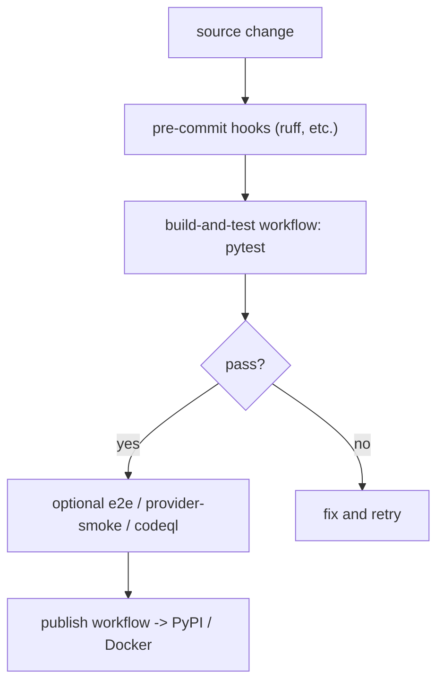

# Packaging, continuous integration, and tests

The repository ships as a Python package, is verified by 397 test files and nine workflows, and is built into containers.

## The package

`pyproject.toml` declares the package `pr-agent` version `0.49.0` (`:6-7`), requiring Python 3.12 or newer (`:20`), licensed under the Massachusetts Institute of Technology (MIT) license (`:22`). The single console script is `pr-agent = "pr_agent.cli:run"` (`:135-136`).

The base dependencies (`:34-74`) are deliberately bounded: security-sensitive packages use `>=patched,<next-major` ranges so `pip` consumers pull patches on their own cadence, while a few are exact pins because the code is tested against that version (`litellm==1.105.1`, `Jinja2==3.1.6`, `tiktoken==0.14.0`). The three OpenTelemetry packages and `prometheus-client` are pinned exactly for the same reason (`:66-73`).

Provider software development kits (SDKs) are optional extras, so a plain install does not pull every one (`[project.optional-dependencies]`, `:94-133`): `github`, `gitlab`, `bitbucket`, `azure`, `codecommit`, `gitea`, `google`, `mosaico`, `lambda`, `otel-grpc`, and `langchain`, with `all` aggregating the main ones.

## The build hook

`setup.py` subclasses setuptools' `build_py` to copy the external help corpus (`docs/docs/*.md` and `*.mdx`) into `pr_agent/_help_docs` as package resources (`BuildPy._help_docs_output_mapping`, `setup.py:17`). The help-message tool reads those packaged files, so the documentation ships inside the wheel.

## The test suite

`tests/` has four directories: `unittest`, `e2e_tests`, `health_test`, and `packaging`. There are 397 `test_*.py` files. Pytest runs in asynchronous mode automatically (`asyncio_mode = "auto"`, `pyproject.toml:185`), with `testpaths = ["tests/unittest"]` (`:187`).

## Continuous integration

`.github/workflows/` holds nine workflows:

- `build-and-test.yaml` — install and run the unit suite.
- `e2e_tests.yaml` — end-to-end tests against real providers.
- `provider-smoke.yaml` — smoke-test one provider.
- `codeql.yml` — CodeQL static security analysis.
- `publish.yml` — build and publish the package.
- `pre-commit.yml` — run the pre-commit hooks.
- `pr-agent-review.yaml` — run PR-Agent's own review on the repository's PRs, a self-hosted example.
- `docs-ci.yaml` — build the documentation.
- `release-drafter.yml` — draft releases from pull request labels.

Supporting files include `dependabot.yml` (dependency updates), `FUNDING.yml`, and the issue templates.

## Containers

`docker/` has two images. `Dockerfile` is the main webhook image; `Dockerfile.lambda` is the Amazon Lambda image (the `lambda` extra pins `mangum==0.22.0` for Python 3.14 compatibility, `pyproject.toml:119-124`). `docker/mosaico/` holds the MOSAICO agent's `docker-compose.pr-agent.yml` (which references a prebuilt external image rather than a third Dockerfile), its agent descriptor, environment example, license, and a smoke test.

## Tooling

Ruff lints with line length 120 and a rule set of pycodestyle, Pyflakes, flake8-bugbear, isort, pyupgrade, and refurb (`[tool.ruff]`, `pyproject.toml:163-176`). Pre-commit is configured in `.pre-commit-config.yaml`. Version bumps are scripted in `scripts/set_pyproject_version.py`, and `scripts/generate_config_reference.py` generates the configuration reference.

## Aha moments

**Aha: version detection is self-aware.** `get_version` (`pr_agent/algo/run_output.py:204`) first checks whether the current directory holds pr-agent's own `pyproject.toml` and only trusts it when `project.name == "pr-agent"` (`:217`). An unrelated project in the working directory cannot dictate the reported version.

**Aha: the help corpus ships inside the wheel.** `setup.py`'s `BuildPy` copies the Markdown and MDX help pages into `pr_agent/_help_docs` (`setup.py:17-26`), so the `/help` tool works from a pip install without the repository checkout.

**Aha: the version floor is a security decision.** The dependency block explains that security-sensitive packages use `>=patched,<next-major` ranges (`pyproject.toml:29-31`), so consumers pull security patches independently instead of waiting for a PR-Agent release.

## Where to go next

Read the [Glossary](18-glossary.md) for every abbreviation spelled out.
