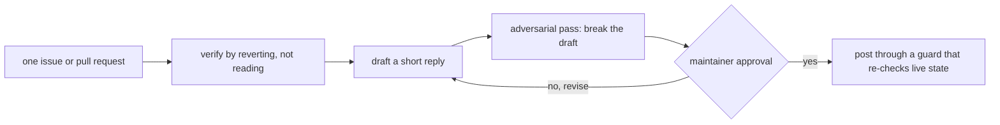

# Project Exploration: PR-Agent Skills

## Overview

`skills` is a small companion repository to [PR-Agent](https://github.com/The-PR-Agent/pr-agent). It holds exactly one skill, `pr-agent-maintainer`, written as a `SKILL.md` file that a Claude Code or Cursor agent loads when it helps a maintainer or reviewer work through PR-Agent's own issues and pull requests.

The one idea: running PR-Agent on another repository is a different job from maintaining PR-Agent itself. This skill is only for the second job. Its goal for any single item is a reply that is short, verified by running something rather than by reading something, and approved by the maintainer before it goes out.

See [Overview](markdown/00-overview.md).



## Repository

- **Location:** `/Users/darkvoid/GitSources/src.pr-agent/skills`
- **Remote:** `git@github.com:The-PR-Agent/skills.git` (commit `0cab892`)
- **Primary Language:** Markdown (one skill file)
- **License:** MIT
- **Author:** The-PR-Agent community (first commit by Ismael Martinez)

## Directory Structure

```
skills/
├── README                    (empty, zero bytes)
└── pr-agent-maintainer/
    └── SKILL.md              (the entire content, ~6 KB)
```

## The one skill in one minute

`pr-agent-maintainer` is a procedure, not a library. It turns "go triage that pull request" into a sequence with three fixed properties:

1. **Nothing goes out without the maintainer's word.** The agent drafts, shows, and waits. A green pipeline is not permission to merge, and `--auto` is never used.
2. **Verify by reverting, not by reading.** To prove a fix is real, merge the branch onto `main` in a scratch worktree, run the suite, then restore the source files the pull request touches and re-run only those tests. Red means the bug is real and the test covers it; green means `main` already fixes it or the test does not exercise the change.
3. **Every draft gets broken on purpose before it is shown.** A second agent is briefed to find errors rather than agree, returning `CORRECT`, `WRONG`, or `OVERSTATED` per claim with file and line evidence.

## The method, step by step

The skill folds twelve rules into a single review loop:

| Step | What it does |
|------|--------------|
| 1 | Pull live state, and always pass `--repo The-PR-Agent/pr-agent` |
| 2 | Verify the fix by reverting it, not by reading it |
| 3 | Run what the pull request exists to produce |
| 4 | Look for the smaller fix |
| 5 | Time every new regular expression |
| 6 | One fresh interpreter per settings probe |
| 7 | Read the bot reviews and the history before drafting |
| 8 | Draft, try to break the draft, then show it |
| 9 | Post through a guard that re-checks live state |
| 10 | Merging |
| 11 | Carry rather than ask, once the ask is small or the author is gone |
| 12 | Who owes the next move is a judgement, not a timestamp |

See [The maintainer skill](markdown/01-the-maintainer-skill.md) for the full walkthrough.

## The five most important ideas

1. **Approval covers exactly the text the maintainer saw.** An instruction to "close #123" approves the close, not the comment. A draft changed after it was shown is a new draft.
2. **A claim about a branch is not the branch.** Diff the head and read `pulls/{n}/files` before accepting, repeating, or arguing with any statement about what a pull request touches.
3. **Verification is a revert, not a read.** You prove a fix by removing it from the merged tree and watching the test go green — not by believing the code looks right.
4. **Length is a defect with a number on it.** A clean approve-and-merge is one sentence; anything else aims at about 80 words.
5. **The adversarial checker is not an oracle.** Its findings are walked against the draft one by one and each correction is reproduced before it is acted on.

## Verdict

A small but unusually disciplined skill. Its value is not in code but in a hard-won process for doing public, consequential, easily-reversible-wrongly actions (merging, closing, commenting) through an agent without letting the agent act alone. **Aha: every step exists to make a wrong action cost more than a correct one — the guard re-checks live state at the moment of posting, the revert re-runs against the merged tree, and the adversarial pass must fail to find anything material before the maintainer even sees the draft.**

## Grandfather review

Every claim above and in the markdown chapters was checked against the single source file `skills/pr-agent-maintainer/SKILL.md` at commit `0cab892`. The twelve step titles, the presentation format (item/action/confidence table, confidence from 0 to 10, two drafts at a time), the revert verification procedure, the `--repo The-PR-Agent/pr-agent` requirement, the regex timing example on issue #2622, the `CORRECT`/`WRONG`/`OVERSTATED` adversarial vocabulary, the merge command (`gh pr merge <n> --repo The-PR-Agent/pr-agent --squash`), and the `do not merge yet` project-direction label were all read verbatim. Nothing was executed; the repository was treated as untrusted.
