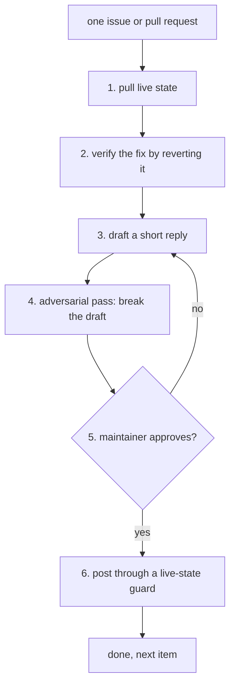

# What the PR-Agent skills repository is

`skills` is a companion repository to PR-Agent that holds exactly one skill: `pr-agent-maintainer`. A skill here is a single Markdown file (`SKILL.md`) that a coding agent (Claude Code or Cursor) loads when a task matches the skill's description. The skill is a procedure for maintaining PR-Agent itself, not for running PR-Agent on other repositories.

## Words on this page

| Word | Meaning |
|------|---------|
| Skill | A Markdown file of instructions an agent loads for one kind of task |
| Frontmatter | Key-value pairs at the top of a skill file that declare its name, description, and version |
| Pull request | A proposed change to a repository that waits for review and merge |
| Maintainer | A person with permission to merge, close, or comment on the repository |
| Verbatim | Exactly as written, with no change |

## What is in the skill file

The repository has two files. The `README` is empty (zero bytes). All the content is in `pr-agent-maintainer/SKILL.md`. The file opens with frontmatter (`SKILL.md:1-7`):

```yaml
---
name: pr-agent-maintainer
description: "Use when reviewing, triaging or replying to an issue or pull request on The-PR-Agent/pr-agent itself as one of its maintainers or reviewers: verify a fix by running it, draft a short reply for the maintainer to approve, and post or merge only on their word."
version: 1.0.0
author: The-PR-Agent community
license: MIT
---
```

The `description` line is the trigger. It names the exact situation — reviewing, triaging, or replying to an issue or pull request **on The-PR-Agent/pr-agent itself** — and then states the method in one sentence: verify a fix by running it, draft a short reply for the maintainer to approve, and post or merge only on their word.

**Aha: the trigger is the contract.** The description does not say "help with GitHub pull requests". It names one repository and one role, and it embeds the three rules of the method. An agent that loads this skill has already been told, before the body begins, that it must not post or merge on its own.

## The shape of the method

The skill is a loop with one gate. For every item the agent:

1. Pulls the live state of the item, never memory or an earlier survey.
2. Verifies the fix by reverting it, not by reading it.
3. Drafts a short reply in a fixed presentation format.
4. Hands the draft to a second agent briefed to break it, not agree with it.
5. Shows the draft to the maintainer and waits.
6. Posts only through a guard that re-checks live state at the moment of writing.



## Why this skill exists

PR-Agent's maintainers run a busy open-source project. Most pull requests carry a review from the project's own PR-Agent workflow, plus sometimes Copilot or CodeQL. A human maintainer has to decide, for each item, what to merge, what to close, what to reply to, and what to leave. The skill exists so that an agent can do the mechanical, repetitive, and easy-to-get-wrong part — verifying, drafting, re-checking — while the maintainer keeps every consequential decision.

The cost it guards against is asymmetry: a wrong merge or a wrong public comment is hard to undo and public forever, while a correct one is cheap. Every rule in the skill makes a wrong action cost more than a correct one.

## Where to go next

Read [The maintainer skill](01-the-maintainer-skill.md) for the ground rules, the presentation format, and all twelve review steps. Read [Glossary](02-glossary.md) for every term.
