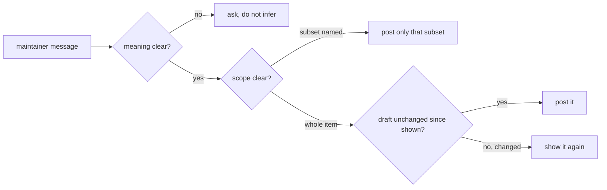
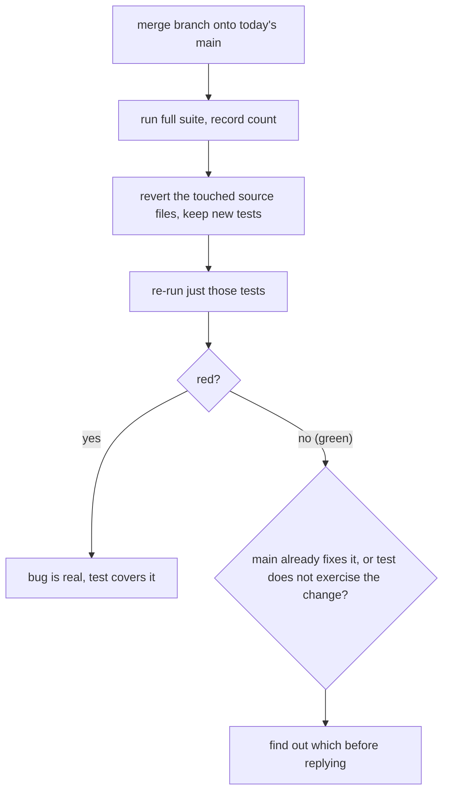
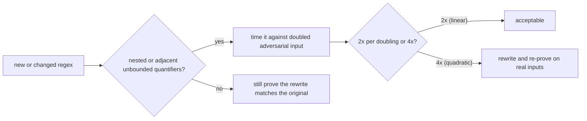
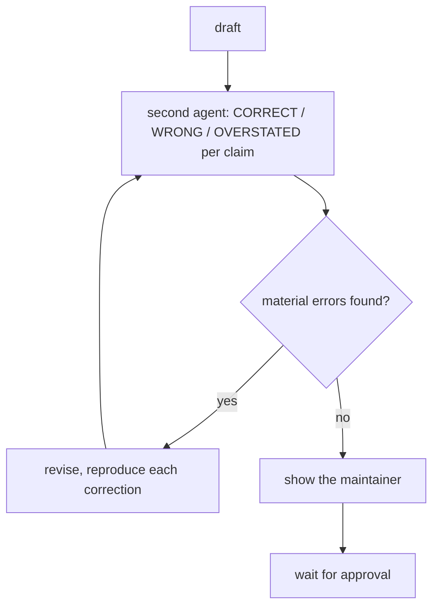

# The maintainer skill: ground rules, presentation, and twelve steps

The skill body (`SKILL.md:9-133`) is a procedure for one job: help a maintainer or reviewer of The-PR-Agent/pr-agent work through the project's own issues and pull requests. It is organized as two front sections (ground rules, presentation) followed by twelve numbered process steps, a subagent-sweep section, and a project-direction note.

## Words on this page

| Word | Meaning |
|------|---------|
| Pull request | A proposed change to a repository that waits for review and merge |
| Maintainer | A person with permission to merge, close, or comment on the repository |
| Worktree | A second checkout of the same repository, isolated from the main one |
| Baseline | The count of passing tests before a change, used as a reference |
| Adversarial pass | A review whose goal is to find errors, not to agree |
| Hunk header | A line in a diff that states the file position of a change |

## Ground rules: nothing goes out without the maintainer's word

The ground rules (`SKILL.md:15-21`) are absolute. The agent never merges, approves, closes, comments, or pushes to a contributor's branch on its own: it drafts, shows, and waits. A green pipeline is not permission to merge, and `--auto` is never used.

The sharpest rule is about what approval covers. Approval covers exactly the text the maintainer saw. An instruction to review, look at, or close something is not approval of the wording that goes with it: "close #123" approves the close, not the comment. A draft changed after it was shown — by a fact-check, a re-anchoring, or a cut for length — is a new draft, so it is shown again. A message naming a subset ("post #123 and #456") approves that subset and nothing else. When a message could mean more than one thing, the agent asks rather than infers.



**Aha: approval is scoped to the exact bytes, not the intent.** The reason is asymmetry — a public comment or a merge is hard to undo. By treating "close #123" as approval of the close only, the skill forces the agent to re-show any wording, so the maintainer never endorses text they did not read.

One more ground rule: a security finding of the agent's own never goes into a public issue or pull request. It goes to a private advisory, following `SECURITY.md` (`SKILL.md:21`).

## Presenting drafts

The presentation format (`SKILL.md:23-29`) is fixed so the maintainer can read many items fast. After a batch, the agent shows one table first (item, action, confidence), then the drafts two at a time, easiest first — clean approve-and-merge items before anything that carries an ask — and keeps a count of how many are left.

Each draft starts with:

- The action as something the maintainer can say yes to (approve and merge, COMMENT with two inline suggestions, close as duplicate, carry and merge, no reply owed).
- Whether the contributor has to do anything.
- A confidence from 0 to 10.

Then one or two plain sentences of reasoning, then the exact text between clear delimiters. Each inline comment is shown against its `path:line`.

```text
ACTION: approve and merge
CONTRIBUTOR ACTION: none
CONFIDENCE: 9/10

The change fixes the null check and the test covers it.

--- draft text ---
Thanks for the fix. Approving and merging.
--- end ---
```

**Aha: the action line answers "do they need to change something or not?" before anyone has to ask.** That one line is the whole triage signal; the rest of the draft is there to justify it.

## The process

The twelve steps (`SKILL.md:33-125`) are one loop, not a menu. They run in order for every item.

### Step 1 — Pull live state, and always pass the repo (`SKILL.md:33-45`)

Never work from memory or an earlier survey. Re-fetch the item before forming a view, because reviews land, authors force-push, and other maintainers act between sessions. Pass `--repo The-PR-Agent/pr-agent` on every `gh pr` and `gh issue` call, because `gh api` takes the full path instead, and a fork or worktree makes pull request numbers collide silently with upstream.

Two counting traps are named explicitly. The Search application programming interface (API) lags on recent closes, so queue sizes and throughput come from `repos/The-PR-Agent/pr-agent/pulls?state=all`, paginated and counted locally. And bots are filtered with the GraphQL `__typename == "User"` test rather than a list of names, because new applications get installed.

A claim about a branch is not the branch. Diff the head and read `pulls/{n}/files` before accepting, repeating, or arguing with any statement about what a pull request touches. Re-read the head Secure Hash Algorithm (SHA) value when you post, not only when you start.

### Step 2 — Verify the fix by reverting it, not by reading it (`SKILL.md:47-59`)

This is the core move of the whole skill. To prove a fix is real:

1. Merge the branch onto today's `main` in a scratch worktree, run the full suite, and record the count.
2. Restore only the source files the pull request touches with `git checkout upstream/main -- <paths>` (delete any source file the pull request adds), leaving its new tests in place.
3. Re-run just those tests.

Red means the bug is real and the test covers it. Green means either `main` already fixes it or the test does not exercise the change — so find out which before replying. Never simulate the old behaviour by hand-editing source, which proves something about the edit rather than about `main`. A collection error counts as red, since the test imports something only the branch has.

```bash
# merge the branch onto today's main, then run the suite
git merge-tree --write-tree upstream/main <branch>

# revert only what the pull request changed, keep its tests
git checkout upstream/main -- <paths>

# re-run just the touched tests
PYTHONPATH=. uv run pytest tests/unittest/<file>.py -q
```



**Aha: verification is subtraction, not inspection.** Reading a fix tells you it looks right; reverting it tells you it was doing the work. The revert also catches the two failure modes a read never does — a fix that `main` already shipped, and a test that passes regardless of the change.

The step closes with environment discipline. A suite pass is not corroboration: run it on `main` too, because equal counts on both sides mean no existing test covers the change. A local pass is not continuous integration (CI): a fork pull request whose runs sit at `action_required` has run nothing until a maintainer approves the workflows. Before a failing test becomes a finding, rule out the environment — run tests the way the repository's own `AGENTS.md` says (`PYTHONPATH=. uv run pytest ...`), which syncs to `uv.lock`. And never let two agents share one worktree; they silently measure each other's checkout.

### Step 3 — Run what the pull request exists to produce (`SKILL.md:61-65`)

A green suite says the code imports and does not crash, not that the thing the pull request was written for appears. Where the payoff is a log line, trigger it and read the output.

The skill names one concrete trap. PR-Agent logs through `loguru`, which formats with `str.format` and not `%`, so:

```python
get_logger().warning("dropped %d files: %s", n, paths)
```

prints the template verbatim and drops both arguments (`SKILL.md:65`).

### Step 4 — Look for the smaller fix (`SKILL.md:67-69`)

Once the fix is proven real, ask whether it could be much smaller: reuse an existing helper, widen one condition instead of adding a branch, delete rather than wrap. If a version under roughly half the lines passes the same tests, offer it as a committable suggestion with the line count. If the larger shape is genuinely needed, say why in one line. Moving code around is not simplification; the test is fewer lines or fewer concepts for the same behaviour.

### Step 5 — Time every new regular expression (`SKILL.md:71-73`)

The absence of a nested quantifier is not a safety proof: overlapping alternatives under one quantifier can still go exponential, and adjacent quantifiers polynomial. Watch especially for two unbounded quantifiers over the same character class on either side of an optional group, as in `[ \t]*(?:yaml|yml)?[ \t]*`.

The skill gives a worked, measured example from issue #2622: the pattern as pushed took about 4.4 seconds on a 32 kilobyte input; dropping the `$` that CodeQL flagged still grew 4x per doubling; moving the second quantifier inside the optional group, `(?:(?:yaml|yml)[ \t]*)?`, brought it to about 0.5 milliseconds. Measure by doubling an adversarial input (a long run of the matching class with no closing delimiter): roughly 2x per doubling is linear, roughly 4x is quadratic. Prove a rewrite matches the original on real inputs before suggesting it.



### Step 6 — One fresh interpreter per settings probe (`SKILL.md:75-77`)

Settings are process-global, so a value one case sets is still there for the next. Dynaconf merging is off (`merge_enabled` is `False` in `pr_agent/config_loader.py`), so a section-level `set()` replaces the whole section and a partial dict drops the section's other keys. Whenever a probe touches `get_settings()`, run each case in its own interpreter, driven by a small parent script.

### Step 7 — Read the bot reviews and the history before drafting (`SKILL.md:79-85`)

Bots comment on most pull requests, on the same page the contributor reads: the project's own PR-Agent workflow reviews every non-draft pull request a person opens, and Copilot or CodeQL reviews appear on some. List their findings and state before writing, credit them for what they found, add only what is yours, and never approve over a live finding without saying why. A finding judged a false positive still gets a sentence.

Search the open queue for the function name, not only the linked issue: two pull requests can fix the same line without either mentioning the other. The older author has the prior claim and is owed the reply first. Decide security relevance for every item; a security fix filed publicly gets one factual line pointing at the private reporting route in `SECURITY.md`.

### Step 8 — Draft, try to break the draft, then show it (`SKILL.md:87-97`)

Read the whole thread first and work out whether this is a first comment or a follow-up. Open with thanks for what the contributor actually did, worded differently each time. Apologise for a genuinely long wait and put it on the maintainers.

Length is a defect with a number on it. A clean approve-and-merge is one sentence. Anything else aims at about 80 words and needs a reason to pass 120. Lead with the verdict. Say what was checked and what held, never how. Delete every sentence that would not change what the contributor does next.

Comments are inline by default, and the suggestion is the comment. Every point that names a file and line goes on that line; where the fix is code it is a `suggestion` block with one sentence of why. The body holds only what cannot be anchored. GitHub rejects the whole review with `422 Line could not be resolved` when one anchor falls outside the diff, so map anchors from the hunk headers.

Then the adversarial pass. Hand the draft to a second agent briefed to find errors rather than agree, with a numbered list of its claims and the one the drafter is least sure of flagged, and ask for `CORRECT`, `WRONG`, or `OVERSTATED` per claim with file and line evidence. Repeat until a pass finds nothing material, at most three passes. Then walk its findings against the revised draft one by one, run anything the draft asserts about `main` or the repository's settings, and reproduce each correction before acting on it — the checker is not an oracle.



### Step 9 — Post through a guard that re-checks live state (`SKILL.md:99-109`)

Post with a script that checks each item before it writes: still open, the expected author, and the head SHA reviewed, passed as the review's `commit_id`. Refuse to post if anything moved.

A review that carries a suggestion or an ask is `COMMENT` or `REQUEST_CHANGES`, never an approval. A real nit is left out so the approval stays clean. Default to a pending review: omit `event` from `POST /repos/The-PR-Agent/pr-agent/pulls/{n}/reviews` and the review stays `PENDING`, visible only to its author and rendered as the contributor will see it. Create it with the maintainer's own token, and check they have no pending review on that pull request already, since GitHub allows one per user.

On a follow-up, check old suggestion threads first. A rebase can remap an unresolved suggestion onto lines it was never about, so read `reviewThreads { isResolved isOutdated startLine line }` at the current head and resolve any whose range drifted. An "LGTM" posted as an ordinary comment approves nothing, and a Copilot `APPROVED` review turns `reviewDecision` to `APPROVED` with no human approval — so read the approving reviews and confirm one comes from a `User` with write access.

### Step 10 — Merging (`SKILL.md:111-115`)

```bash
gh pr merge <n> --repo The-PR-Agent/pr-agent --squash
```

is the whole command. The repository merges by squash only, with the pull request title as the commit title and a blank body, so the description never becomes the commit message. Head branches in this repository are deleted on merge; fork branches are not. GitHub counts a Copilot `APPROVED` review towards the required approval, so call nothing approved until a person with write access has approved it, checking `collaborators/{user}/permission` for each approving `User`. A maintainer cannot approve their own pull request.

Before merging a batch, test the batch, because two pull requests each green on their own can break `main` together. Merge every approved head into one scratch worktree at today's `main`, run the full suite, and check the count equals the baseline plus each pull request's own delta; a shortfall is a semantic conflict. Merge in dependency order, then confirm with `gh run list --repo The-PR-Agent/pr-agent --branch main --event push --workflow Build-and-test`.

### Step 11 — Carry rather than ask, once the ask is small or the author is gone (`SKILL.md:117-121`)

When what is left is small or mechanical, or the author has been quiet for about two weeks, finish it rather than sending another round, with a one-line note. With competing pull requests for one fix, take the first and credit the later authors with `Co-authored-by` trailers.

Check `maintainer_can_modify` and the fork's owner type first, because GitHub does not offer maintainer edits on organisation-owned forks. Update the branch by merging `main` into it, never by rebasing, and apply only what the review asked for. Some contributors are automated accounts that never reply; review their pull requests on the merits and carry rather than nudge.

### Step 12 — Who owes the next move is a judgement, not a timestamp (`SKILL.md:123-125`)

Fold four event kinds into one timeline per item, because an answer can arrive as any of them: issue comments, reviews, review-thread comments, and pushes by the author. Drop bots by `__typename`, then read what the last event says. A contributor whose last word is "will check and come back" holds the ball; a maintainer who spoke last while waiting on a gated workflow that has since passed owes the move. Keep "they answered and nobody came back" apart from "nobody has ever replied".

## Sweeping the queue with subagents (`SKILL.md:127-129`)

For a sweep, give each subagent two or three items and its own worktree, today's baseline suite count, the instruction to run tests through `uv run`, the presentation format, and the rule that it posts nothing. Every draft that comes back gets the adversarial pass of step 8 before the maintainer sees it, and the table says that it ran. Drafts age while agents run, so re-fetch every head and mergeable state at the moment of posting, re-run cheap load-bearing measurements, and re-read each draft against what earlier items in the same batch merged or closed.

## Project direction (`SKILL.md:131-133`)

Until version 1 the focus is bug fixes and work aligned with what exists (Discussion #3147). Pull requests outside that line, such as ones adding a model call or a second pass, are parked with the `do not merge yet` label however good the engineering, and the review says the hold is about direction, not the code. Tool calling and Model Context Protocol (MCP) wait for the runtime that discussion is settling.

## Aha moments

**Aha: the skill encodes "expensive to be wrong" as a workflow.** Merge, close, and comment are cheap to do and hard to undo. Every rule — the scoped approval, the revert verification, the adversarial pass, the live-state guard — makes a wrong action cost one more check before it can happen.

**Aha: verification is a revert, not a read.** The one move that separates this skill from generic review guidance is `git checkout upstream/main -- <paths>` after merging. It turns "I believe this fixes it" into "removing this breaks it", which is the only claim that survives contact with a stale `main`.

**Aha: the adversarial checker is required, capped, and then not trusted.** Three passes at most, then show the maintainer what is still open — and even a pass must be reproduced claim by claim. The skill treats a second agent exactly as it treats a test: useful evidence, never an oracle.

## Where to go next

Read [Overview](00-overview.md) for the shape of the whole method. Read [Glossary](02-glossary.md) for every term.
