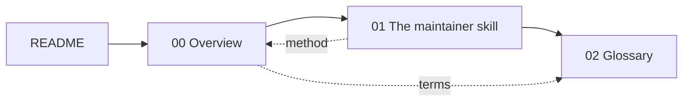

# PR-Agent Skills — Documentation Index

This documentation covers the `skills` companion repository to PR-Agent. It holds one skill, `pr-agent-maintainer`, for an agent that helps a maintainer or reviewer work through PR-Agent's own issues and pull requests.

| # | Document | What you learn |
|---|----------|----------------|
| 0 | [Overview](00-overview.md) | What the skill is, its frontmatter, and the shape of the whole method |
| 1 | [The maintainer skill](01-the-maintainer-skill.md) | The ground rules, the presentation format, and all twelve review steps |
| 2 | [Glossary](02-glossary.md) | Every term in one place |

## The one idea

Running PR-Agent on another repository is a different job from maintaining PR-Agent itself. This skill is only for the second job, and its goal for any single item is a reply that is short, verified by running something rather than by reading something, and approved by the maintainer before it goes out.

## How the documents connect

