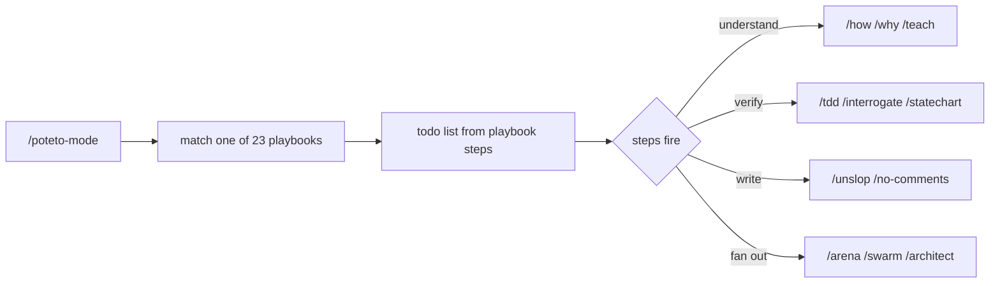
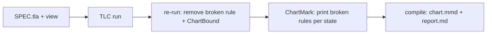

# Project Exploration: pstack, a plugin for rigorous agent workflows

## Overview

pstack is a Cursor and Claude Code plugin by Lauren Tan (poteto), version 0.15.36, under the MIT license. Its tagline is *if you want to go fast, go deep first — a working method for shipping quality software*. It packages 58 skills (24 principles plus 34 workflow skills), 2 subagents, 23 playbooks, and a statechart formal-verification tool.

The one idea: throughput without quality is not the goal. Write less, but higher-quality code, and get fearless parallelism by trusting an agent that holds a high bar. See [Overview](markdown/00-overview.md).

## The philosophy in one minute

The 24 principles are grouped into core (how to think), architecture (how to shape), verification (how to prove), delegation (how to fan out), and meta (make rules structure). Three through-lines hold them together: verify against the real artifact; structure beats prose; converge before you build. The `poteto-mode` skill indexes all 24 inline so a delegate reads every rule in one file. See [Philosophy and principles](markdown/01-philosophy-and-principles.md).

## The verification spine

A repeated theme runs through pstack: verify against the real artifact, not a proxy. `prove-it-works` states it; the verification skills make it a tool. `create-verification-skill` generates a project-local verify skill with a feature map; `create-formal-verification-skill` handles cases tests cannot reach — races, retries, and state machines — with a model checker; `statechart` checks a TLA+ model and draws the states that break a rule. See [Verification skills](markdown/05-verification-skills.md).

## The statechart tool

The most substantial component is a TypeScript tool that drives TLC (the TLA+ model checker), finds every state that violates an invariant, and draws a Mermaid statechart coloring `breaks` versus `mayBreak` states. It verifies the drawing against the model bidirectionally (`regionsLie`) and escapes Mermaid input as hostile text. See [The statechart tool](markdown/06-the-statechart-tool.md).

## Confidence as a first-class type

`why`'s `references/epistemics.md` turns epistemic honesty into five tiers — Direct, Supported, Inferred, Speculative, Unknown — each with its own phrasing. "Because" is banned in inference, "obviously" is banned outright, and "an honest we-don't-know is one of the most valuable outputs." See [Understanding and evidence](markdown/04-understanding-and-evidence.md).

## Concepts explained for a reader who does not know the stack

| Concept | Where |
|---------|-------|
| The 24 principles, grouped, and the three through-lines | [Philosophy and principles](markdown/01-philosophy-and-principles.md) |
| The mode skill, the five-part prompt, the 23 playbooks, the scripts | [poteto-mode and playbooks](02-poteto-mode-and-playbooks.md) |
| All 58 skills, the off-by-default flag | [The skill catalog](03-skill-catalog.md) |
| The five confidence tiers, `how`/`why`/`teach` | [Understanding and evidence](04-understanding-and-evidence.md) |
| The verify skill, feature map, `tdd`, `benchmark-checklist`, formal verification | [Verification skills](05-verification-skills.md) |
| The TLA+ tool: pipeline, passes, backends, frontends, the rule-marking trick | [The statechart tool](06-the-statechart-tool.md) |
| `arena`, `architect`, `swarm`, `figure-it-out`, the two subagents | [Parallelism, delegation, subagents](07-parallelism-delegation-subagents.md) |
| `unslop`, `technical-writing`, `no-comments`, `typescript-best-practices`, `correct` | [Writing and correctness](08-writing-and-correctness.md) |
| `automate-me`, `reflect`, `show-me-your-work`, `poteto-help` | [Personalization and setup](09-personalization-and-setup.md) |
| The ten-chapter first-task walkthrough | [The guide](10-the-guide.md) |
| The benny automation pack | [benny automation](11-benny-automation.md) |
| Two model families, budgets, `setup-pstack` | [Model routing](12-model-routing.md) |

## Document map

| Topic | Document |
|-------|----------|
| Overview | [00](markdown/00-overview.md) |
| Philosophy and principles | [01](markdown/01-philosophy-and-principles.md) |
| poteto-mode and playbooks | [02](markdown/02-poteto-mode-and-playbooks.md) |
| The skill catalog | [03](markdown/03-skill-catalog.md) |
| Understanding and evidence | [04](markdown/04-understanding-and-evidence.md) |
| Verification skills | [05](markdown/05-verification-skills.md) |
| The statechart tool | [06](markdown/06-the-statechart-tool.md) |
| Parallelism, delegation, subagents | [07](markdown/07-parallelism-delegation-subagents.md) |
| Writing and correctness | [08](markdown/08-writing-and-correctness.md) |
| Personalization and setup | [09](markdown/09-personalization-and-setup.md) |
| The guide | [10](markdown/10-the-guide.md) |
| benny automation | [11](markdown/11-benny-automation.md) |
| Model routing | [12](markdown/12-model-routing.md) |
| Critical assessment | [13](markdown/13-critical-assessment.md) |
| Glossary | [14](markdown/14-glossary.md) |

## The five most important ideas

1. **Confidence is a typed tier.** Five levels, each with phrasing rules, so a claim cannot sound more certain than its evidence.
2. **Structure beats prose.** `encode-lessons-in-structure` and the fix ladder (architecture → types → lint → test → docs) make the wrong thing impossible in the repo, not discouraged in a document.
3. **Verify against the real artifact.** A writeup reads as convincing whether or not it is true; the check must run the real thing.
4. **The cross-judge is a different family.** A judge from the parent's own model family shares its biases, so `arena` forces a different one.
5. **A real formal-verification tool ships in a skills plugin.** The statechart tool drives TLC, colors violating states, and honestly reports when a chart cannot be drawn faithfully.

## Verdict

A strong, coherent, opinionated method with real implementation behind it. The philosophy and the epistemics are portable and free to copy; the costs are a whole vocabulary (58 skills, 23 playbooks), hardcoded model slugs, and a high barrier to the formal-verification tool. **Aha: the plugin's credibility comes from the fact that its rules are backed by scripts that fail loudly — the statechart tool, `check-plan.mjs`, and `log.sh` are the proof of the prose.** See [Critical assessment](markdown/13-critical-assessment.md).

## Grandfather review

Each claim in chapters 00 to 14 was checked against the source in the `pstack` folder at commit `4dd1d05`. Counts (58 skills, 24 principles, 34 workflow skills, 23 playbooks, 2 subagents, 10 guide chapters, 17 TypeScript rules, 7 benchmark questions, 5 confidence tiers, 8 red flags, 7 control-adapter capabilities) were verified by direct file enumeration. Model identifiers and constants (`RERUN_STATES = 100_000`, `CHART_STATES = 500`, `PART = 1 << 24`, TLC `tla2tools@1.7.4` plus `java@temurin-25`) were read verbatim. Mermaid count is at least two in every chapter. Abbreviations are spelled out at their site of use.

Not verified: nothing was executed; the repository was treated as untrusted. The statechart tool's behavior was described from its source and test corpus, not from a live TLC run.
