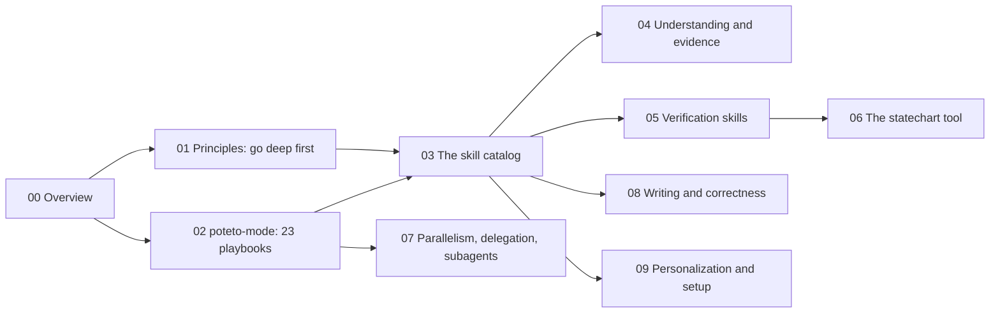
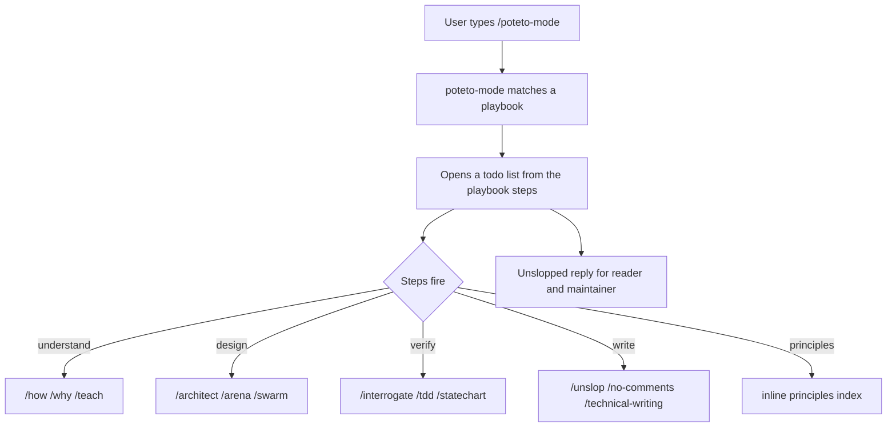

# pstack Overview: if you want to go fast, go deep first

pstack is a Cursor and Claude Code plugin by Lauren Tan (poteto). It packages 58 skills, two subagents, 24 principles, and a statechart/TLA+ formal-verification tool. The one idea is in the tagline: throughput without quality is not the goal; if you want to go fast, go deep first (`README.md:5-7`).

## How to read these docs

You do not need to know Cursor, Claude Code, or formal verification first. Each idea has one page that explains it from the beginning.

| If you need to understand | Read |
|---------------------------|------|
| The philosophy and the 24 principles, grouped | [Philosophy and principles](01-philosophy-and-principles.md) |
| The `poteto-mode` entry skill and the 23 playbooks | [poteto-mode and playbooks](02-poteto-mode-and-playbooks.md) |
| Every skill in one place | [The skill catalog](03-skill-catalog.md) |
| How to understand a subsystem and gather evidence | [Understanding and evidence](04-understanding-and-evidence.md) |
| Verification and formal-verification skills | [Verification skills](05-verification-skills.md) |
| The statechart tool that checks TLA+ models | [The statechart tool](06-the-statechart-tool.md) |
| Parallel work, delegation, and the two subagents | [Parallelism, delegation, subagents](07-parallelism-delegation-subagents.md) |
| Writing and correctness skills | [Writing and correctness](08-writing-and-correctness.md) |
| Making pstack yours | [Personalization and setup](09-personalization-and-setup.md) |
| The first-task walkthrough | [The guide](10-the-guide.md) |
| The benny automation pack | [benny automation](11-benny-automation.md) |
| Which model runs which role | [Model routing](12-model-routing.md) |
| Any single term, in alphabetical order | [Glossary](14-glossary.md) |

## Words you meet first

| Word | Meaning | Where it is explained |
|------|---------|-----------------------|
| Skill | A Markdown instruction file an agent loads to do one job well | [The skill catalog](03-skill-catalog.md) |
| Playbook | One of the 23 step-by-step plans `poteto-mode` picks to match a task | [poteto-mode and playbooks](02-poteto-mode-and-playbooks.md) |
| Principle | One short rule about how to engineer. There are 24 | [Philosophy and principles](01-philosophy-and-principles.md) |
| Subagent | A worker spawned by the main chat to do a slice of work | [Parallelism, delegation, subagents](07-parallelism-delegation-subagents.md) |
| Mode | A skill attached to a message, or kept across turns as a custom mode | [poteto-mode and playbooks](02-poteto-mode-and-playbooks.md) |
| Slop | Low-quality, verbose code or prose that an agent produced fast | [Philosophy and principles](01-philosophy-and-principles.md) |
| TLA+ | Temporal Logic of Actions, a language for specifying and checking concurrent systems | [The statechart tool](06-the-statechart-tool.md) |

## What pstack is

pstack is the author's own toolkit, opened as a plugin. Lauren Tan wrote it while shipping high-quality code at Cursor, after working with millions of lines of code at Meta, Netflix, and Cursor, and while helping build the React compiler (`README.md:3`).

The core idea has three parts (`README.md:7-11`):

1. **Go deep, not fast.** Throughput without quality is not a goal. pstack helps you write less, but higher-quality code.
2. **Fearless parallelism.** When you can trust one agent to write good, verifiable code, you can start several agents at once and trust them to hold the same bar.
3. **Use any model.** Every frontier model has strengths and weaknesses. pstack routes work to models by strength.

The plugin installs with `/add-plugin pstack` in Cursor, or with the plugin marketplace commands in Claude Code (`README.md:17-26`). In Claude Code, plugin commands are prefixed, so `/poteto-mode` is `/pstack:poteto-mode` (`README.md:30`).

## The two-step start

pstack's whole surface collapses to two steps (`README.md:34-43`):

1. Run `/setup-pstack`. Pick a reasoning budget and choose which models you want.
2. Use `/poteto-mode` whenever you are doing anything that needs rigor.

The other skills are situational. The mode skill routes to them as its steps need them.

## The skill map

The 58 skills split into three kinds:

| Kind | Count | Examples | Purpose |
|------|-------|----------|---------|
| Principles | 24 | `laziness-protocol`, `prove-it-works`, `type-system-discipline` | One rule each, indexed inline by the mode skill |
| Workflow skills | 34 | `poteto-mode`, `how`, `interrogate`, `statechart`, `unslop` | Do a job when a step needs it |
| Subagents | 2 | `poteto-agent`, `comment-sicko` | Wrappers for spawned workers |

The entry point `poteto-mode` carries 23 playbooks. It matches a task to a playbook, opens a todo list whose first items are the playbook's steps copied in verbatim, routes to the other skills as the steps fire, and writes replies framed for the reader and the maintainer (`README.md:98-103`).

## Model routing

pstack routes work by model strength. Code delegates (feature, refactoring, bug fix, performance, hillclimb) go to grok. The hardest changes, prose, and judgment go to opus 5.5. The default review panel is opus 5.5 plus grok (`README.md:43`). See [Model routing](12-model-routing.md).

## The verification spine

A repeated theme runs through pstack: verify against the real artifact, not a proxy. The `prove-it-works` principle states it directly. The verification skills make it a tool: `create-verification-skill` generates a project-local verify skill with a feature map; `create-formal-verification-skill` handles cases tests cannot reach, such as races and retries, with a model-checking tool; `statechart` checks a TLA+ model and draws the states that break a rule (`README.md`, skills table).

## Aha moments

**Aha: the mode skill indexes all 24 principles inline.** A delegate reads one file and gets every principle in one pass, instead of loading 24 files. This is the `guard-the-context-window` principle applied to the plugin's own design (`README.md:225`).

**Aha: "go deep first" inverts the usual agent advice.** The goal is explicitly not to maximize lines of code. pstack's success metric is fewer lines at higher quality, which is what makes parallel agents safe to trust (`README.md:7-9`).

**Aha: skills are routed, not typed.** The author rarely types `/how` or `/interrogate` directly. `poteto-mode` runs them as its steps need them. The skill files exist so a playbook can point at a named step, and so a human can reach one directly when they know the fit.

**Aha: a formal-verification toolchain ships inside a skills plugin.** Tests cannot reach the case that breaks a race, retry, or state machine, so pstack bundles a TypeScript tool that checks a TLA+ model and renders a Mermaid statechart of the violating states. See [The statechart tool](06-the-statechart-tool.md).

**Aha: rules become structure, not prose.** The `encode-lessons-in-structure` principle says to write a lint, a metadata flag, a runtime check, or a script instead of more text. The plugin practices it: many skills ship scripts (`statechart`, `poteto-mode`) that enforce what the prose describes.

## Where to go next

Read [Philosophy and principles](01-philosophy-and-principles.md) for all 24 principles. Read [poteto-mode and playbooks](02-poteto-mode-and-playbooks.md) for the entry skill. Read [Critical assessment](13-critical-assessment.md) for the verdict.
