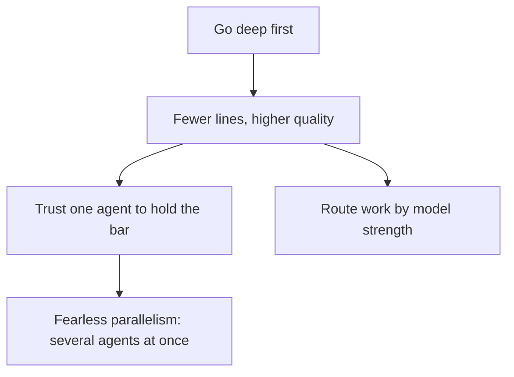
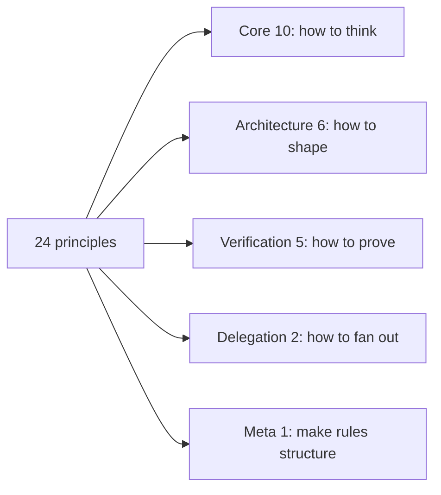

# Philosophy and principles: 24 rules that encode "go deep first"

pstack's philosophy is one sentence — *if you want to go fast, go deep first* — turned into 24 one-rule skills. The rules are grouped into core, architecture, verification, delegation, and meta, and the `poteto-mode` skill indexes all 24 inline so a delegate reads them in one pass.

## Words on this page

| Word | Meaning |
|------|---------|
| Principle | One short rule about how to engineer, written as a skill |
| Delegate | A subagent that does a slice of work on behalf of the main thread |
| Slop | Low-quality, verbose code or prose produced fast |
| Premise | An unstated assumption that two fixes share |
| Invariant | A property that must always hold |

## The philosophy

The tagline inverts the usual agent advice (`README.md:5-7`). The goal is explicitly not to maximize lines of code; it is to write less code at higher quality, which is what makes parallel agents safe to trust. The three parts:

1. **Go deep, not fast.** Throughput without quality is not a goal.
2. **Fearless parallelism.** Trust one agent to hold the bar, then start several at once.
3. **Use any model.** Route work to models by their strengths.

## The 24 principles

Each principle is a `principle-*` skill with `disable-model-invocation: true` — it runs only when the mode skill indexes it or the user asks, never on every turn.

### Core (10)

1. `laziness-protocol` — bias toward deletion and the smallest change; consolidate decisions behind one source of truth.
2. `foundational-thinking` — data structures first; scaffold before features; a concurrency corollary.
3. `redesign-from-first-principles` — integrate a new requirement as if it had been a day-one assumption.
4. `attack-the-premise` — when two or more fixes sharing one premise fail the same gate, write the premise down and test it before another fix.
5. `subtract-before-you-add` — remove dead code and redundant validators first, then build on the simpler base.
6. `minimize-reader-load` — count layers-to-trace and state-to-hold; collapse one-caller wrappers.
7. `outcome-oriented-execution` — converge on the target architecture; planned scoped breakage is acceptable.
8. `experience-first` — choose user delight over implementation convenience; ship fewer polished features.
9. `exhaust-the-design-space` — build two or three competing prototypes before committing.
10. `build-the-lever` — build the tool (codemod, script, generator, skill) that does or proves the work; the tool is the rerunnable artifact.

### Architecture (6)

11. `model-the-domain` — encode the domain in a data structure (state machine, discriminated union, registry) instead of scattered conditionals.
12. `boundary-discipline` — validation, narrowing, and error handling at boundaries; trust types inside; business logic in pure functions.
13. `type-system-discipline` — make illegal states unrepresentable; brand primitives; parse external data; exhaust variants; derive from schemas.
14. `make-operations-idempotent` — converge to the same end state regardless of partial prior runs; judge staleness by evidence.
15. `migrate-callers-then-delete-legacy-apis` — migrate callers and delete the old API in the same wave.
16. `separate-before-serializing-shared-state` — eliminate shared write targets first; serialize structurally only when one writer is a real invariant.

### Verification (5)

17. `prove-it-works` — verify against the real artifact, not a proxy or self-report; script the check.
18. `fix-root-causes` — fix the fault, not where it surfaced; guards hide bugs when the state should never exist.
19. `sequence-verifiable-units` — small units each ending in a verifiable state; failing-test-first commit shape.
20. `test-behavior-not-implementation` — assert observable behavior; survive internal refactors; catch real breaks.
21. `explain-the-number` — write the decision before running; ask "why not double?"; rule out that the number measured something else.

### Delegation (2)

22. `guard-the-context-window` — route bulk to subagents; keep summaries in the main thread.
23. `never-block-on-the-human` — proceed on reversible work; irreversible actions still need confirmation.

### Meta (1)

24. `encode-lessons-in-structure` — encode a recurring rule as a lint, metadata flag, runtime check, or script instead of more text.

## The through-lines

Three ideas repeat across the groups and hold the list together:

**Verify against the real artifact.** `prove-it-works` (17) says it directly; `test-behavior-not-implementation` (20) and `explain-the-number` (21) are its corollaries. A proxy or a self-report reads as convincing whether or not it is true, so the check must run the real thing.

**Structure beats prose.** `encode-lessons-in-structure` (24), `model-the-domain` (11), `type-system-discipline` (13), and `build-the-lever` (10) all push the same way: make the wrong thing impossible in the repo, not merely discouraged in a document.

**Converge before you build.** `exhaust-the-design-space` (9), `redesign-from-first-principles` (3), `foundational-thinking` (2), and `outcome-oriented-execution` (7) insist on getting the shape right first, because a wrong shape is more expensive than the extra thinking.

## Aha moments

**Aha: the mode skill indexes all 24 principles inline.** A delegate reads one file and gets every rule in one pass instead of loading 24 files. This is `guard-the-context-window` (22) applied to the plugin's own design (`README.md:225`).

**Aha: rules become structure, not prose.** `encode-lessons-in-structure` says to write a lint, a metadata flag, a runtime check, or a script instead of more text. The plugin practices it: many skills ship scripts that enforce what the prose describes.

**Aha: the principles are grouped to route.** Core answers "how to think", architecture "how to shape", verification "how to prove". The grouping is not for reading; it is so the mode skill can pull the right rule at the right step.

## Where to go next

Read [poteto-mode and playbooks](02-poteto-mode-and-playbooks.md) for the entry skill that applies these rules. Read [The skill catalog](03-skill-catalog.md) for every skill in one place.
