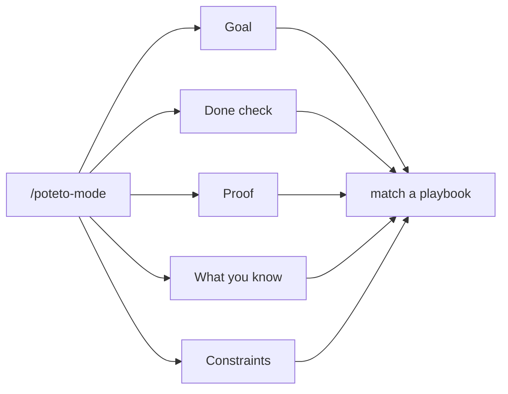
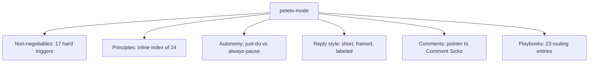
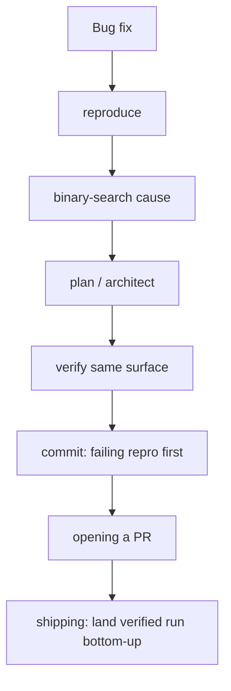

# `poteto-mode`: one entry skill, 23 playbooks

`poteto-mode` is the master skill. It matches a task to one of 23 playbooks, opens a todo list whose first items are the playbook's steps copied verbatim, routes to the other skills as the steps fire, and writes replies framed for both the reader and the maintainer.

## Words on this page

| Word | Meaning |
|------|---------|
| Mode skill | The entry skill a user invokes to start a rigorous task |
| Playbook | One step-by-step plan the mode skill picks to match a task |
| Routing phrase | Words in the request that select a playbook |
| Non-negotiable | A hard rule the mode skill never relaxes |
| Todo list | The visible task list the mode skill opens and works through |

## The five-part prompt anatomy

The guide teaches one prompt shape (`docs/guide/02-poteto-mode.md`): **goal, done check, proof, what-you-know, constraints**. The goal says what to build; the done check names the observable condition; the proof says how the result is shown true; what-you-know lists context; constraints bound the work. A task with all five parts routes cleanly; one missing a part gets the gap surfaced, not guessed.

## The skill's own rules

`skills/poteto-mode/SKILL.md` (150 lines) carries the frontmatter `name: poteto-mode`, `icon: crown`, `color: yellow`, and four sections.

**Non-negotiables** are 17 hard triggers: always read the mode skill first, always open a todo list, verify against real artifacts, never fabricate links, and label every claim as measured, inferred, or guessed. These are the floor the whole plugin rests on.

**Principles** is the inline index of all 24 rules, grouped core / architecture / verification / delegation / meta — so a delegate reads every rule in one file.

**Autonomy** splits actions into "Just do it" and "Always pause". Reversible work proceeds; irreversible writes pause for the user. Session overrides can change the split, and "No is an acceptable answer" — the agent may decline.

**Writing the reply** is a style contract: short declarative sentences, no long dash, no mid-sentence colon, frame impact for both the consumer and the maintainer, never fabricate links, and label measured versus inferred versus guessed.

## The 23 playbooks

Each playbook is a file in `skills/poteto-mode/playbooks/`. The mode skill holds a table mapping routing phrases to each.

| Playbook | What it is |
|----------|-----------|
| Investigation | Understand a codebase question before changing anything |
| Bug fix | Reproduce, binary-search the cause, fix, prove the same surface |
| Perf issue | Seven mantras from "don't do it" to "do it cheaper" |
| Hillclimb | Eight steps, one commit per win, a decision log |
| Runtime forensics | Find a fault in a running system |
| Trace forensics | Follow a request through traces |
| Feature | Eight steps with a throughput checkpoint |
| Refactoring | Change shape without changing behavior |
| Prototype | Build to learn, before committing to a design |
| Visual parity | Match a design exactly |
| Authoring a skill | Write a new pstack-style skill |
| Eval | Blind, non-negotiable evaluation of a change |
| Babysit | Nine steps to watch a pull request to merge |
| Shipping | Six steps to land a verified stack bottom-up |
| Autonomous run | A `/loop` wake with a self-checking task |
| Orchestrate | Coordinate multiple workstreams |
| Autopilot-full | A `/loop 1h` audit tick with swarm-verify-once |
| Autopilot-stack | The no-merge variant of autopilot-full |
| Session pickup | Rebuild context and resume in flight work |
| Pause safely | Stop mid-task without losing state |
| Multi-phase plan | A 155-line plan skeleton, validated by a script |
| Worktree cleanup | Classify and clean worktrees, never deleting |
| Opening a PR | Worktree, commits, description with six sections |

## Two playbooks in detail

**Bug fix** is six steps: reproduce → binary-search the cause → plan fix or architect → verify the same surface → stage commits with the failing reproduction first → opening a PR. The reproduction-first commit order is the `sequence-verifiable-units` principle in practice.

**Shipping** is six steps with independent per-PR verifiers whose verdicts are PASS, PASS+NOTES, or FAIL. A patch-id rule ensures a verified run is not silently replaced, the contiguous verified run lands bottom-up, and the merge stops at the ceiling — the first PR whose verification no longer holds.

## The scripts that enforce the playbooks

`poteto-mode` ships scripts, not just prose:

- `check-plan.mjs` (205 lines) validates `multi-phase-plan.md` — the "Tests alone are not sufficient verification" rule, the ten lanes, the required sub-blocks, the program markers, and the perf items. It bans long dashes, curly quotes, and mid-sentence colons, and exits 0 clean or 1 with problems.
- `bootstrap.ts` (62 lines) installs dependencies keyed by the hash of `package.json` plus `bun.lock`, so the tooling is reproducible.
- `worktree-audit.sh` (134 lines) classifies worktrees into safe / verify-recent-chat / hold-wip / hold-open-PR / review buckets, and never deletes.

## Aha moments

**Aha: the playbook steps become the todo list verbatim.** The mode skill copies the playbook's steps directly into the todo list. The agent is not paraphrasing a plan; it is executing named steps, so a reviewer can see exactly which step is in flight.

**Aha: "No is an acceptable answer."** The autonomy section grants the agent permission to decline. A tool that always complies cannot be trusted to hold a quality bar; one that can say no can also say "this is not verified".

**Aha: the plan is a validated artifact.** `check-plan.mjs` enforces the multi-phase plan's structure, so a plan that omits a required lane fails the build instead of shipping incomplete. Structure over prose, again.

## Where to go next

Read [The skill catalog](03-skill-catalog.md) for every skill the playbooks route to. Read [The guide](10-the-guide.md) for the first-task walkthrough.
