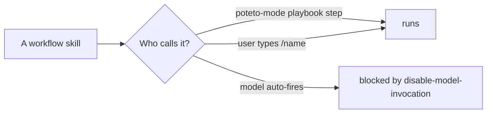
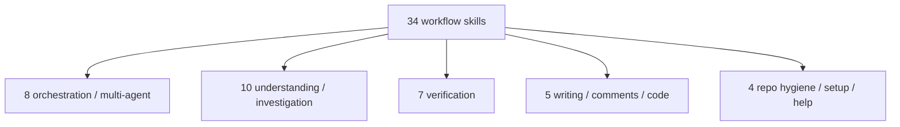

# The skill catalog: all 58 skills in one place

pstack ships 58 skills under `skills/`: 24 principles (covered in [Philosophy and principles](01-philosophy-and-principles.md)) and 34 workflow skills. This page catalogs the 34 workflow skills by group, with the deep-dive page for each.

## Words on this page

| Word | Meaning |
|------|---------|
| Skill | A Markdown instruction file an agent loads to do one job well |
| Workflow skill | A skill that does a job when a playbook step needs it |
| Frontmatter | The metadata block at the top of a skill, in YAML |
| Disable model invocation | A flag that stops a skill from auto-firing on every turn |

## The off-by-default rule

Every workflow skill except `setup-pstack` carries `disable-model-invocation: true`. The flag means a skill runs only when the mode skill invokes it or the user types its name — never as an automatic reaction to a message. `setup-pstack` is the one exception, because its whole job is to be triggered during model configuration.

## Orchestration and multi-agent (8)

| Skill | Purpose | Detail |
|-------|---------|--------|
| `poteto-mode` | The master mode skill: 23 playbooks, inline principles | [poteto-mode and playbooks](02-poteto-mode-and-playbooks.md) |
| `arena` | Spawn N parallel candidates, cross-judge, pick, graft | [Parallelism, delegation](07-parallelism-delegation-subagents.md) |
| `architect` | Sketch types and structure, synthesize, then implement | [Parallelism, delegation](07-parallelism-delegation-subagents.md) |
| `figure-it-out` | Design an auditable playbook when no narrower one fits | [Parallelism, delegation](07-parallelism-delegation-subagents.md) |
| `swarm` | Fan out N workers and return one report | [Parallelism, delegation](07-parallelism-delegation-subagents.md) |
| `interrogate` | Adversaries try to break a change; only run-proven findings survive | [Verification skills](05-verification-skills.md) |
| `automate-me` | Turn working conventions into a personal mode skill | [Personalization and setup](09-personalization-and-setup.md) |
| `reflect` | Mine the transcript for durable learnings, route to skill edits | [Personalization and setup](09-personalization-and-setup.md) |

## Understanding and investigation (10)

| Skill | Purpose | Detail |
|-------|---------|--------|
| `how` | Explain what code does and where it should live | [Understanding and evidence](04-understanding-and-evidence.md) |
| `why` | Gather design rationale from seven evidence categories | [Understanding and evidence](04-understanding-and-evidence.md) |
| `teach` | Weave `how` and `why` into one plain explanation | [Understanding and evidence](04-understanding-and-evidence.md) |
| `recall` | Rebuild recent working context from chat history | [Understanding and evidence](04-understanding-and-evidence.md) |
| `blast-radius` | Prove the one fact a change is safe because of, by running it | [Understanding and evidence](04-understanding-and-evidence.md) |
| `bro` | Restate the last message in plain language, no jargon | [Understanding and evidence](04-understanding-and-evidence.md) |
| `in-your-own-words` | Restate the user's goals and problem | [Understanding and evidence](04-understanding-and-evidence.md) |
| `ketchup` | Catch the user up on what changed since their last message | [Understanding and evidence](04-understanding-and-evidence.md) |
| `ketchup-video` | The same catch-up as a subtitled slide video | [Understanding and evidence](04-understanding-and-evidence.md) |
| `sharpen` | Rewrite a prompt deeper, not bigger | [Understanding and evidence](04-understanding-and-evidence.md) |

## Verification (7)

| Skill | Purpose | Detail |
|-------|---------|--------|
| `tdd` | Failing-test-first bug fix when a cheap local target exists | [Verification skills](05-verification-skills.md) |
| `benchmark-checklist` | Vet any performance number with seven questions | [Verification skills](05-verification-skills.md) |
| `create-verification-skill` | Generate a project-local verify skill with a feature map | [Verification skills](05-verification-skills.md) |
| `maintain-verification-skill` | Keep the verify skill in sync as the app changes | [Verification skills](05-verification-skills.md) |
| `create-formal-verification-skill` | Generate a skill for properties tests cannot reach | [Verification skills](05-verification-skills.md) |
| `maintain-formal-verification-skill` | Bring formal verification back in line after code changes | [Verification skills](05-verification-skills.md) |
| `statechart` | Check a TLA+ model and draw the violating states | [The statechart tool](06-the-statechart-tool.md) |

## Writing, comments, and code (5)

| Skill | Purpose | Detail |
|-------|---------|--------|
| `unslop` | Remove AI tells from any writing | [Writing and correctness](08-writing-and-correctness.md) |
| `technical-writing` | Four stacked documentation style layers | [Writing and correctness](08-writing-and-correctness.md) |
| `no-comments` | Spawn Comment Sicko and act on accepted findings | [Writing and correctness](08-writing-and-correctness.md) |
| `typescript-best-practices` | 17 TypeScript discipline rules | [Writing and correctness](08-writing-and-correctness.md) |
| `correct` | Make recurring agent mistakes impossible, structurally | [Writing and correctness](08-writing-and-correctness.md) |

## Repo hygiene, setup, and help (4)

| Skill | Purpose | Detail |
|-------|---------|--------|
| `show-me-your-work` | One append-only decision log with a helper script | [Personalization and setup](09-personalization-and-setup.md) |
| `setup-pstack` | Write the per-role model rule file | [Model routing](12-model-routing.md) |
| `poteto-help` | Route help questions to skills and guide pages | [Personalization and setup](09-personalization-and-setup.md) |
| `make-bot-ui` | Build a page whose buttons wake a Grok Bot | [Personalization and setup](09-personalization-and-setup.md) |

## Aha moments

**Aha: off-by-default is cost control, not laziness.** `disable-model-invocation: true` means a skill only runs when routed or typed, so the plugin never burns tokens auto-firing skills on a turn that does not need them. The one exception (`setup-pstack`) is the one skill that must fire during configuration.

**Aha: the catalog is exactly the playbook vocabulary.** Every skill name is a step a playbook can point at. The skills exist so a playbook can route to a named, reproducible step — and so a human can reach one directly when they know the fit.

## Where to go next

Read [Understanding and evidence](04-understanding-and-evidence.md) for the `how`/`why`/`teach` cluster. Read [Verification skills](05-verification-skills.md) for the verification spine.
