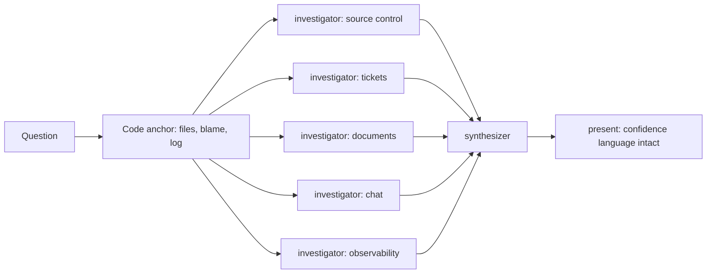
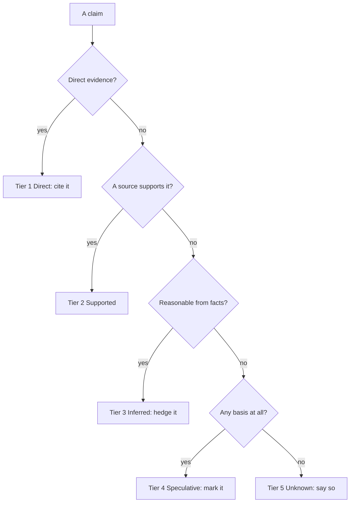

# Understanding and evidence: `how`, `why`, `teach`, and epistemic honesty

pstack's understanding skills split into two jobs: explain what code does (`how`), and explain why it is that way with evidence (`why`). `why` is the spine, and it carries the plugin's strongest idea — confidence as a first-class data type with phrasing rules per tier.

## Words on this page

| Word | Meaning |
|------|---------|
| Epistemics | The study of how you know what you claim to know |
| Confidence tier | One of five levels of certainty, each with its own phrasing |
| Investigators | Parallel read-only subagents that gather evidence from one source each |
| Synthesizer | The single agent that combines investigators' findings |
| Source | One evidence category, for example source control or a ticket tracker |

## `how`: what code does

`how` answers "what does this code do" and "where should it live". A simple question gets one explainer. A complex one fans out 2 to 4 parallel read-only explorers (`references/explorer-prompt.md`), then one explainer (`references/explainer-prompt.md`). The output has five fixed sections: Overview, Key Concepts, How It Works, Where Things Live, and Gotchas.

The model routing is by cognitive kind: `how explorer` defaults to the fast model for throughput-bound reading, `how explainer` to the judgment model for synthesis. See [Model routing](12-model-routing.md).

## `why`: evidence, not reasoning alone

`why` answers "why does X work this way / why did we pick Y". Its mechanism is five steps (`skills/why/SKILL.md`):

1. **Understand** the target and question, stating any interpretation if vague.
2. **Establish the code anchor** inline — file paths, line ranges, `git blame -L`, `git log --follow -p`, and pull-request-number extraction from merge-commit subjects.
3. **Spawn parallel investigators**, one per evidence category that has a matching Model Context Protocol (MCP) tool, all read-only against their source.
4. **Synthesize** with one judgment-model agent.
5. **Present** with light edits only — never rewrite the confidence language.

The seven evidence categories: source control, issue/ticket tracker, long-form documents, real-time team chat, infrastructure observability, error/exception tracking, and product analytics. Eight source playbooks give each investigator its method — `code-archaeology.md`, `linear.md`, `notion.md`, `slack.md`, `datadog.md`, `sentry.md`, `databricks.md`, and a cross-cutting `incident-postmortem.md`.

## Confidence as a first-class type

`references/epistemics.md` (72 lines) is the epistemic spine. It defines five tiers and their phrasing:

| Tier | Name | Phrasing |
|------|------|----------|
| 1 | Direct | "the code does X", backed by a citation |
| 2 | Supported | A claim with a named source |
| 3 | Inferred | "appears to", "likely", "suggests" |
| 4 | Speculative | Clearly marked as a guess |
| 5 | Unknown | An honest "we don't know" |

The rules that make it real:

- Confidence words — "because", "the reason is", "was designed to", "fixes" — require an adjacent citation and are never used for inferences.
- Hedges — "appears to", "likely", "suggests" — signal interpretation.
- Banned words: "obviously", "clearly", "of course", "I think".
- A hypothesis embedded in the question is a candidate, not a conclusion (the sycophancy trap).
- "An honest we-don't-know is one of the most valuable outputs."

**Aha: "because" is banned in inference.** The word "because" asserts a cause, so it is reserved for tier 1 and 2 where a citation exists. An inference must hedge. This exists because a confident-sounding answer on weak evidence is the exact failure `why` exists to prevent — and the synthesizer's quality gate checks that "What We Don't Know" is never empty.

## The other understanding skills

| Skill | One job |
|-------|---------|
| `teach` | Weave `how` and `why` into one plain explanation: no framing labels, smallest answer first, diagrams built up one part at a time, `why`'s confidence language kept intact, then `/unslop` |
| `recall` | Rebuild recent context from chat history, with a contract of Capsule (at most 5 bullets) → Threads (each with a status tag) → Problems (at most 5) → Next move |
| `blast-radius` | Prove the one fact a change is safe because of, by running it — five certainty steps from "you said so" (worthless) to "reproduced in the running app" |
| `bro` | Restate the last message in plain language, no jargon |
| `in-your-own-words` | Restate the user's goals and the problem being solved |
| `ketchup` | Catch the user up on what changed since their last message, pictures first, at most 100 words, about 30 words per item |
| `ketchup-video` | The same catch-up as a subtitled slide video, at most 10 slides |
| `sharpen` | Rewrite a prompt "deeper, not bigger" |

`blast-radius`'s five certainty steps are worth memorizing: (1) you said so — worthless, (2) pointed at the line, (3) showed the bad case cannot happen, (4) ran a script that fails loud, (5) reproduced in the running app. Step 4 is "usually one small script that imports the same library the app ships."

## Aha moments

**Aha: investigators gather, they do not conclude.** The investigator prompt says "resist the story", "mechanics are not motivation", and "gather, don't conclude". The synthesizer is the only agent allowed to connect findings, so the connection happens once, with all evidence on the table.

**Aha: a writeup reads as convincing whether or not it is true.** `blast-radius` collapses safety to a single load-bearing fact and requires it to be run, not written up — because prose persuasion is the failure mode, not the fix.

## Where to go next

Read [Verification skills](05-verification-skills.md) for how pstack proves against the real artifact. Read [The statechart tool](06-the-statechart-tool.md) for formal verification.
