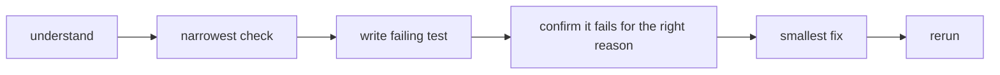
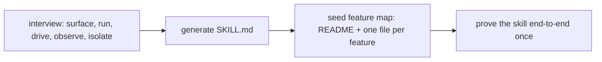
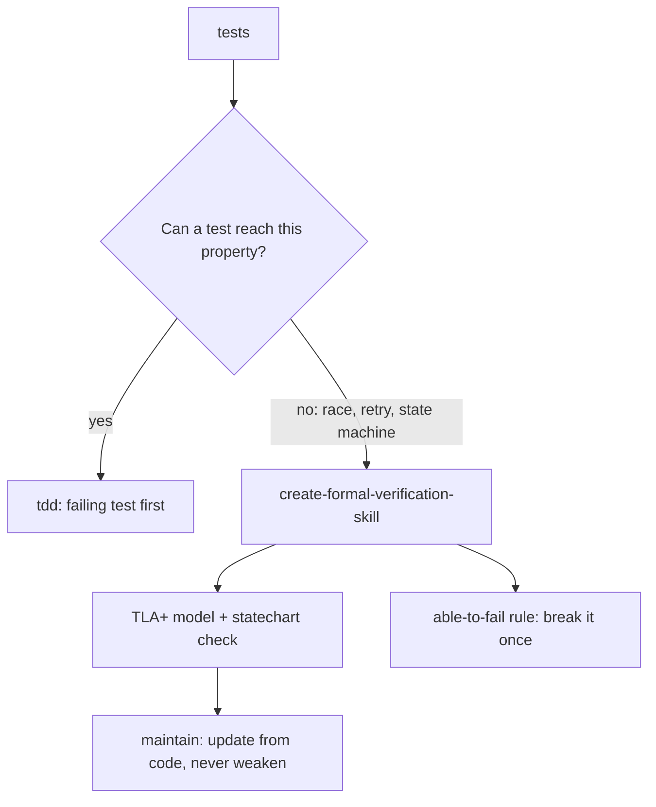

# Verification skills: prove against the real artifact

The verification spine runs through pstack. The skills here turn "verify against the real artifact, not a proxy" into tools: a failing-test-first discipline, a benchmark checklist, a project-local verify skill with a feature map, a formal-verification skill for properties tests cannot reach, and an adversarial `interrogate`.

## Words on this page

| Word | Meaning |
|------|---------|
| Feature map | One file per feature saying how to reach it and drive it like a user |
| Harness | A tool that launches, drives, and inspects the real app |
| Adversary | An agent whose job is to break a change, not praise it |
| Model checker | A tool that exhausts a state machine to find a violating path |
| Property | An invariant the model must always satisfy |

## `tdd`: failing test first, when it is cheap

`tdd` applies only when a cheap local test target exists. Six steps: understand → choose the narrowest check → write the failing test → confirm it fails for the right reason → smallest fix → rerun. Its explicit rule: "prefer no new test over a bad test." A test that fails for the wrong reason is worse than none.

## `benchmark-checklist`: seven questions for any number

`benchmark-checklist` vets any performance number before it is believed:

1. **Why not double?** Name the limiter.
2. **Was it tuned?**
3. **Did it break limits?** Check the arithmetic.
4. **Did it error?**
5. **Does it reproduce?** At least 5 runs alternating, report median and range.
6. **Does it matter?** What share of the end-to-end time is it.
7. **Did it even happen?** Confirm the work ran inside the timed region.

**Aha: the checklist exists because a number is a claim too.** "Why not double?" and "did it even happen?" catch the two most common lies a measurement tells — a number that is not the real limiter, and a number that measured nothing. The checklist is the `explain-the-number` principle made concrete.

## `create-verification-skill`: the verify skill and feature map

`create-verification-skill` generates a project-local `.cursor/skills/verify-<app>/SKILL.md`. It interviews the repo in five verbs — surface, run, drive, observe, isolate — then generates a skill with six sections: Launch, Doctor, Drive, Evidence, Cleanup, and Helpers.

It seeds a feature map at `.cursor/skills/verify-<app>/features/`: a README plus one file per feature, each with four headings — `Sub-features`, `How to get to it (user POV)`, `Driving it with <harness>`, and `Gotchas`. Then it proves the generated skill end-to-end once. A worked example (`feature-map-example/`) ships a Notes app with `create-note.md`, `search.md`, and a `control-notes` harness.

## `maintain-verification-skill`: keep the verify skill honest

The upkeep loop has five stages: index hygiene → source wave (one read-only subagent per feature) → reconcile → live pass → triage. The live pass enforces three invariants: health-check before driving, evidence survives cleanup, nothing started outlives usefulness. Triage labels each drift as doc drift, harness gap, or product gap, then ships one PR or reports clean or blocked. It never edits product code.

## `interrogate`: adversaries, then run the proof

`interrogate` turns the review inside out. Adversaries try to break a change or design, but only **run-proven findings survive** — a finding must come with a command, its output, and how it breaks the intent. The output has three parts: Intent, Findings (command + output + how it breaks intent), and Dropped. Everything that cannot be run is dropped.

## Formal verification: the case tests cannot reach

`create-formal-verification-skill` generates a project-local skill for the highest-cost property tests miss — races, retries, and state machines. The default model checker is TLA+ (Temporal Logic of Actions), usable in any language. Its "able to fail" rule requires showing each property failing on a broken variant, so the check is proven to have teeth.

The generated TLA+ skills read results with pstack's `statechart`, **referenced by name only** — never copying its commands or options, so the tool can change without breaking every generated skill.

`maintain-formal-verification-skill` brings verification back in line after code changes, with outcomes in sync / updated / bug / blocked. Two hard rules: it never weakens a property to pass, and it updates from the code, not from the result — then re-proves the check can still fail after a pass.

## Aha moments

**Aha: the feature map is a shared contract, not documentation.** The verify skill, the maintainer, and the agent all read the same feature map. When the app changes, the source wave reconciles the map against the source, so the map cannot drift into a stale claim.

**Aha: "able to fail" is the proof the proof has teeth.** A property that has never been shown to fail on a broken variant is not a property — it is a tautology that passes everything. The formal-verification skill requires breaking it once, the same way `tdd` requires a test to fail for the right reason.

## Where to go next

Read [The statechart tool](06-the-statechart-tool.md) for the TLA+ charting engine these skills reference. Read [Parallelism, delegation, subagents](07-parallelism-delegation-subagents.md) for `arena` and `swarm`.
