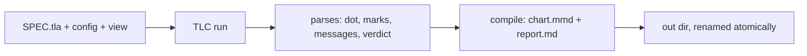
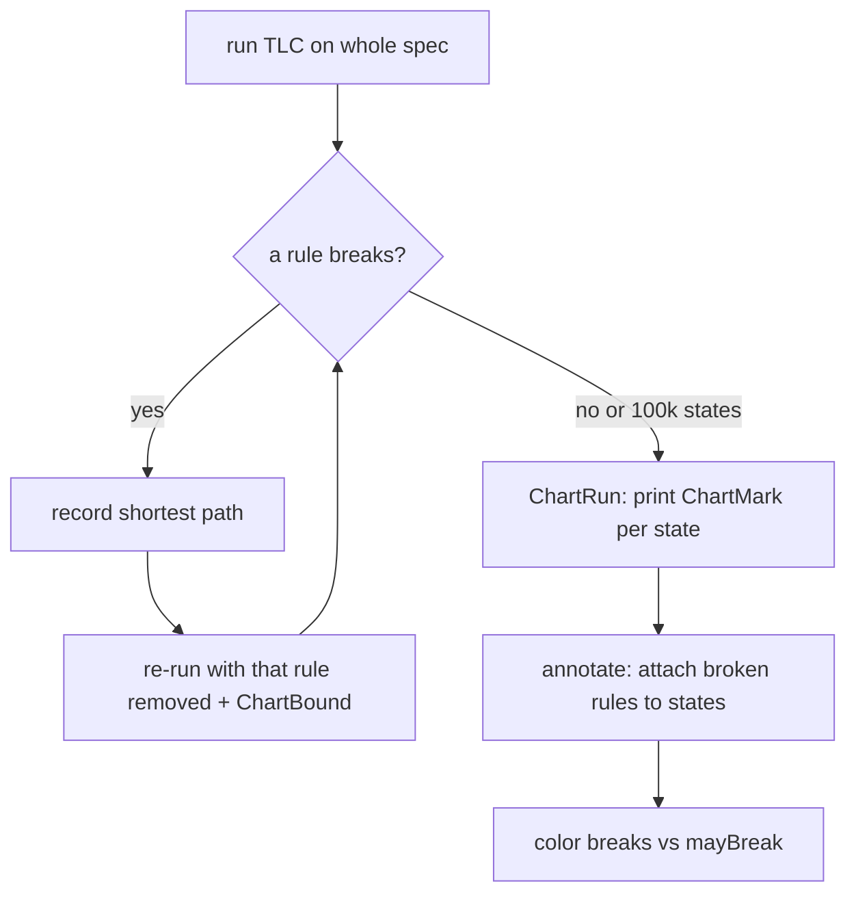
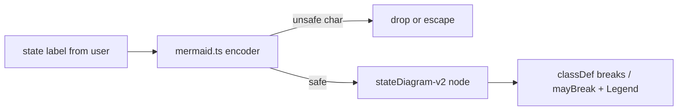

# The statechart tool: turn a TLA+ model into a picture of what breaks

The most substantial thing in pstack is a TypeScript tool that checks a TLA+ (Temporal Logic of Actions) model, finds every state that violates an invariant, and draws a Mermaid statechart coloring the states that break. It is why the plugin can promise formal verification in a skills plugin.

## Words on this page

| Word | Meaning |
|------|---------|
| TLA+ (Temporal Logic of Actions) | A language for specifying and checking concurrent systems |
| TLC | The TLA+ model checker the tool drives |
| SANY | The TLA+ syntax and type checker |
| Invariant | A property that must hold in every reachable state |
| View | A module the user writes to map model state to a readable picture |
| Region | One dimension of a view, drawn as parallel state sets |

## What the tool does

`skills/statechart/scripts/statechart.ts` (164 lines) is a command-line interface: `statechart SPEC.tla [--config FILE] [--view FILE] [--out DIR]`. It runs TLC on the spec, parses the output, and writes `chart.mmd` (the Mermaid diagram), `report.md` (the human-readable story), and `tlc.out`. Exit codes are 0 (clean) and 1 (a property broke), plus 2 for tool failure and 130/143 for signals.

The spec rules live in `skills/statechart/SKILL.md` (82 lines): one INVARIANT per reader rule, `Next` written as a disjunction, `NoDeadlock` or `CHECK_DEADLOCK`, and an end-state action. The view contract is five exports — `state(vars)` (returning a string for flat, an array for parent states, or an object for regions), `step(action, from, to)`, `group(vars)`, `colors`, and `title` — with a budget of about 20 arrows and 500 states per chart.

## The pipeline

The run stages into a temporary directory and renames it to the destination only when done, so a failed run never leaves a half-written output. A detached worker plus a janitor process own the stage.

1. **`run.ts` `check()`** (481 lines) finds `tlc` via mise (`TLC_TOOL = "http:tla2tools[...]@1.7.4"`, `JAVA_TOOL = "java@temurin-25"`), with pinned flags `["-workers","1","-fp","0","-lncheck","final"]`. It runs SANY, then a judge loop that groups rules and re-runs TLC.
2. **`ir.ts`** (547 lines) defines the intermediate representation — `Value`, `Rule`, `State`, `Step`, `Graph`, `Bug`, `Config`, and the TLC error-code map `EC`.
3. **`pipeline.ts` `project()`** (76 lines) orchestrates walk → drawOrder → ask(view) → draw → regionsLie → asParents fallback → loopCheck → lift, then `compile()` writes the files.

The passes, backends, and frontends each have one job:

| Group | Files | Job |
|-------|-------|-----|
| Passes | `reach.ts`, `annotate.ts`, `label.ts`, `regions.ts`, `region-check.ts`, `loop-check.ts`, `lift.ts`, `paths.ts` | Walk the graph, attach broken rules, label states, draw regions, verify the drawing, lift arrows |
| Backends | `mermaid.ts`, `report.ts`, `plain-text.ts`, `cfg.ts` | Emit the diagram, the report, the text, and the generated TLC config modules |
| Frontends | `config.ts`, `dot.ts`, `value.ts`, `marks.ts`, `messages.ts`, `spec.ts`, `trace.ts`, `verdict.ts`, `view.ts`, `worker.ts` | Parse TLC's config, dot, values, marks, messages, spec, traces, and verdicts |

## The rule-marking trick

The core mechanism is subtle. TLC normally stops at the first broken invariant. The tool needs *every* rule and *every* state colored, so it does two things:

First, the judge loop re-runs TLC repeatedly, removing each broken rule and adding a `ChartBound` constraint, collecting further breaks until no rule breaks or it hits `RERUN_STATES = 100_000`.

Second, a separate `ChartRun` adds an invariant `ChartMark` that is always false, but whose side effect prints a marker tuple for every state. `ChartBroken` is the union of the rule names that break in that state, so each printed mark carries the exact set of rules broken there.

`readMarks` parses those tuples, and `annotate.mark` attaches each broken rule to its state. This is why the chart can color states `breaks` (a rule breaks in every member of that chart state) versus `mayBreak` (it breaks in some but not all), and why `report.md` can give the **shortest path to each break** — rebuilt from the `via` map in `reach.ts`.

**Aha: the tool turns a model checker into a shortest-path and coloring engine.** Instead of one run that stops at the first break, the tool re-runs TLC repeatedly and prints broken-rule sets as the side effect of an always-false invariant, so every state can be labeled with exactly which rules it breaks.

## The "regions lie" honesty check

`region-check.ts` `regionsLie` does not just draw the user's view — it verifies the drawing against the model bidirectionally. It checks start-state coverage, that every drawn arrow's condition is expressible (rejecting `tuples`), and both directions of movement: the chart must not allow a move the model forbids, and must show every move the model allows.

If the view cannot be drawn honestly, the tool falls back to parent-state flattening (`asParents`) and says so in the report: "the chart draws parent states in place of regions." The chart never silently misrepresents the model.

## The Mermaid encoder is adversarial

`mermaid.ts` (201 lines) treats view-supplied text as hostile input. It escapes and drops unsafe characters — `[[`, `C4Container`, `direction LR`, marker-end quotes, control characters, and curly quotes — per codepoint, because a user's state label must not break or inject Mermaid syntax. The output nests parent states, attaches `classDef` for `breaks` and `mayBreak` with distinct colors, and adds a Legend.

## Aha moments

**Aha: a formal-verification toolchain ships inside a skills plugin.** Tests cannot reach the case that breaks a race, retry, or state machine, so pstack bundles a tool that checks a TLA+ model and draws the violating states. The plugin's own philosophy — structure over prose — is what makes it possible: the skill is a wrapper around a runnable checker, not a paragraph of advice.

**Aha: the chart is honest about its own limits.** `regionsLie` and the parent-state fallback mean the picture can say "I cannot draw this faithfully" instead of drawing a lie. The report states the budget cutover too: above 500 states, "the chart draws only the bug paths."

## Where to go next

Read [Parallelism, delegation, subagents](07-parallelism-delegation-subagents.md) for `arena`, `architect`, and `swarm`. Read [Critical assessment](13-critical-assessment.md) for the verdict.
