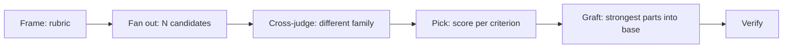
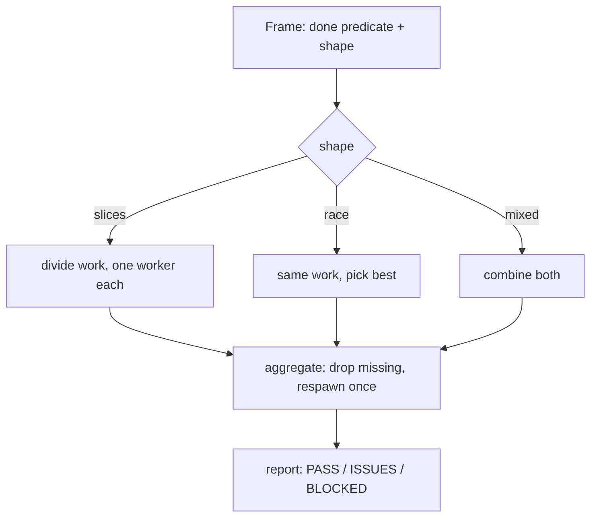
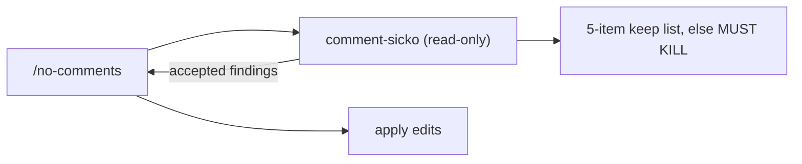

# Parallelism, delegation, and the two subagents

pstack's "fearless parallelism" rests on skills that fan out workers and on two subagent wrappers. The fan-out skills differ by their decision rule: `arena` picks the best and grafts, `swarm` aggregates into one report, `architect` sketches before implementing, and `figure-it-out` designs an auditable loop.

## Words on this page

| Word | Meaning |
|------|---------|
| Fan out | Start several workers in parallel on the same or sliced work |
| Candidate | One worker's complete answer to a brief |
| Rubric | A list of gradeable criteria a judge scores against |
| Graft | Folding the strongest parts of losers into the winner by hand |
| Background | A subagent that runs without blocking the main thread |

## `arena`: N candidates, one winner, grafted

`arena` spawns N parallel candidates on the same brief, picks a base, and grafts the strongest parts of losers into it. Its phases:

- **Frame** — write a rubric of 3 to 6 gradeable criteria.
- **Fan out** — run candidates in background, each in its own worktree or temporary directory.
- **Cross-judge** — one read-only judge from a model family **different from the parent's**, so a judge cannot rubber-stamp its own family's biases.
- **Pick** — score criterion by criterion.
- **Graft** — fold by hand, per `redesign-from-first-principles`.
- **Verify** — prove the grafted result still passes.

The runner and cross-judge pools are model lists, defaulting to the judgment and throughput families. See [Model routing](12-model-routing.md).

## `architect`: sketch first, implement after agreement

`architect` forbids jumping to code when it would "lock in the wrong shape". Its phases: **Ground** (run `how`, optionally `why`), **Sketch** (run `arena` with a runner prompt, requiring at least two structurally distinct candidates), **Agree** (an opt-in checkpoint), **Implement**, and **Scrap**.

Candidates are screened against `references/design-red-flags.md` — eight red flags:

1. Shallow module — a module that is just a bag of functions with no cohesion.
2. Information leakage — one module reaching into another's internals.
3. Temporal decomposition — splitting by when code runs, not by what it owns.
4. Pass-through method — a method that only forwards to another.
5. Split ownership — two places owning one thing.
6. Two ways to do one task.
7. Importable internals — internals exposed for import.
8. Hand-synced list — two lists that must be kept in step by hand.

A `rationale-template.md` forces the architect to write the synthesis decision, tradeoffs accepted, alternatives considered, and open questions — so the shape is a decision with a record, not an accident.

## `swarm`: fan out and report

`swarm` fans out N workers and returns one report. Its Frame step declares a done predicate and a shape — **slices** (divide the work), **race** (same work, pick a winner, with `first pass`, `rank all`, or `best-of`), or **mixed**. Fan-out uses background cloud workers; Aggregate drops results missing the required hashes or method and respawns once; Report uses PASS, ISSUES, or BLOCKED.

## `figure-it-out`: an auditable loop for the unplanned

When no narrower playbook fits — a large migration, a multi-part change, work reviewed after stepping away — `figure-it-out` designs one. Phases: **Frame** (a falsifiable done-predicate, quantified scope, rigor level), **Design** (risk-first sequencing, the verification harness before features), **Run the loop** (hypothesis → smallest change → measure → keep or revert, with verdicts VERIFIED / NOT VERIFIED / INCONCLUSIVE), **Keep an audit trail** (via `show-me-your-work`), and **Verify and hand back**.

## The two subagents

`agents/poteto-agent.md` (9 lines) is the delegate wrapper: `is_background: true`, and it must read `skills/poteto-mode/SKILL.md` in full before any work. It resolves the plugin path and picks the highest version from the plugin manifest, so a delegate always runs the installed skill, not a stale copy.

`agents/comment-sicko.md` (32 lines) is the read-only comment reviewer. It keeps only five things — legal headers; behavior forced by an external dependency; lint or formatter suppressions only when the rule is faulty; public API doc comments; issue or request-for-comments links. Everything else dies, and refactor targets are marked `MUST KILL`. It never writes application code; the `no-comments` skill acts on its findings.

## Aha moments

**Aha: the cross-judge is forced to be a different family.** A judge from the same model family as the parent would share its blind spots and biases. `arena` orders the judge pool so a judge is never the parent's family — a structural fix for sycophancy, not a prose request.

**Aha: `architect` requires at least two structurally distinct candidates.** The `exhaust-the-design-space` principle is enforced as a gate: one sketch is not a design space, so the skill refuses to proceed on a single candidate.

**Aha: `figure-it-out` verifies before features.** The loop's design step builds the verification harness first, so every later step can be measured against a done-predicate instead of a feeling.

## Where to go next

Read [Writing and correctness](08-writing-and-correctness.md) for `no-comments` and the code discipline. Read [Model routing](12-model-routing.md) for which model runs each role.
