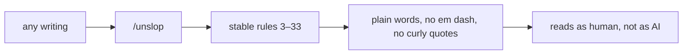
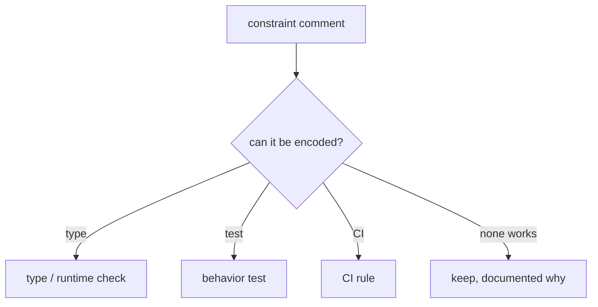
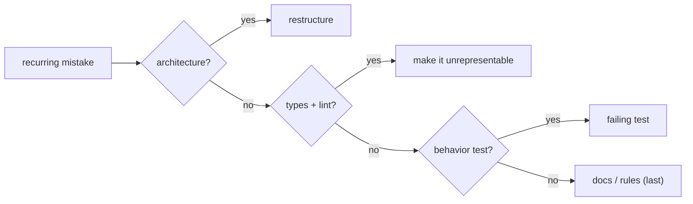

# Writing and correctness: unslop, technical writing, and structural fixes

pstack treats prose and code with the same discipline. `unslop` removes AI tells from writing, `technical-writing` stacks four style layers, `no-comments` kills comments with a reviewer, `typescript-best-practices` encodes 17 code rules, and `correct` makes mistakes structurally impossible.

## Words on this page

| Word | Meaning |
|------|---------|
| Slop | Low-quality, verbose prose or code produced fast |
| AI tell | A phrase or pattern that marks text as machine-written |
| Diátaxis | A documentation framework of four modes |
| Constraint comment | A comment that tells a future reader what not to do |
| Ladder | A ranked order of fixes, most structural first |

## `unslop`: stable rule numbers, a banned-word list

`unslop` removes AI tells from any writing. Its rule numbers are stable — other skills cite them, so a removed rule leaves a gap, never a renumber. The ranges: content 3 and 5; language 7–12; style 13–19; communication artifacts 20 and 22; filler 23–25; jargon 26; plain speech 27–33.

Three rules show the precision:

- Rule 13 bans em dashes entirely — periods or commas only.
- Rule 19 bans curly quotes.
- Rule 26 gives a concrete abstract-metaphor-to-plain-word list: "substrate" → "base", "vector" → "way/method", "ratchet" → "the mechanism's real name or a limit that only tightens", "endgame" → "the last phase".

## `technical-writing`: four stacked layers

`technical-writing` (106 lines) stacks four layers, then applies `/unslop` to everything it touches:

1. **Diátaxis structure** — one mode per document (tutorial, how-to, reference, or explanation), picked by two questions: doing versus thinking, and learning versus work.
2. **Google developer style** — sentences to the reader, command formatting, condition before instruction, sentence-case headings.
3. **Simplified Technical English (STE) instruction rules** — one instruction per sentence, about 20 words per instruction and 25 per sentence, the warning before the step it guards.
4. **Global English syntax** — keep "only" and "not" adjacent, no semicolons, replace em dashes, one name per thing everywhere.

Three rules sit above the layers: cut every word that does no work; use the short everyday word; when a rule makes a sentence worse, fix it another way.

## `no-comments` and Comment Sicko

`no-comments` spawns Comment Sicko (see [Parallelism, delegation, subagents](07-parallelism-delegation-subagents.md)) and acts on accepted findings. It rejects application-code edits, scope escapes, and exception-protected deletions; it runs `how` and `why` before accepting a thin `IMPORTANT` or `do not remove` kill; and it reports the deletion count, restores, reruns, encodings, and unenforced constraints.

The telling rule is what happens to a **constraint comment** — "do not remove", "do not change wording", "talk to X". The skill offers the cheapest in-scope encoding: a type, a runtime check, a test, or a continuous integration (CI) rule. A comment that only says "do not break this" is the weakest possible encoding, and `no-comments` replaces it with structure.

## `typescript-best-practices`: 17 rules

`typescript-best-practices` (31 lines) applies `type-system-discipline` first, then 17 rules: discriminated unions; branded types (validate once at the boundary, brand from a verifying guard `input is AgentId`, never `as`); constructive modeling (`[T, ...T[]]` for non-empty, `[T, T][]` for even length); the simplest total type; `unknown` over `any`; schemas before guards; no `as` casts; a narrowing hierarchy (discriminant switch, then `in`, then `typeof`/`instanceof`, then a guard, then `as`); type guards must verify; exhaustiveness (`const _exhaustive: never = x`); `satisfies` over `as`; boundary validation; schema-derived types; object arguments; real tests; structured telemetry.

The ordering is the lesson: `as` is last, not first, and a guard must actually verify — `isX` and `hasX` are names that promise a check.

## `correct`: the fix ladder

`correct` makes recurring agent mistakes impossible. For each class of mistake, fix at the highest level that works:

1. **Architecture** — remove the possibility.
2. **Types, then a lint whose error names the fix.**
3. **A behavior test.**
4. **Docs or agent rules, last.**

Each new check must be proven to fail on a real past mistake, and a rule table pairs each rule with its enforcer.

**Aha: the instruction is the symptom.** `encode-lessons-in-structure` states it: "If the fix is structural, only use the structural fix." Agents copy the nearest example and take the shortest path that compiles, so the repo must make the wrong thing impossible — not the prose.

## Aha moments

**Aha: `unslop` bans "ratchet" not because it is fancy but because it hides the mechanism.** The rule demands the mechanism's real name or a limit that only tightens. Removing the metaphor forces the writer to say what actually happens.

**Aha: the four writing layers are stacked, not mixed.** Diátaxis picks the document mode, Google style the sentence shape, STE the instruction shape, and Global English the word order — each layer owns one decision, and a rule that makes the sentence worse is overridden, not obeyed.

## Where to go next

Read [Personalization and setup](09-personalization-and-setup.md) for `automate-me` and `reflect`. Read [Model routing](12-model-routing.md) for which model writes and which judges.
