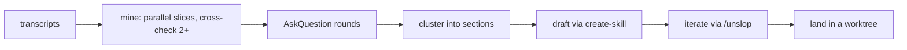
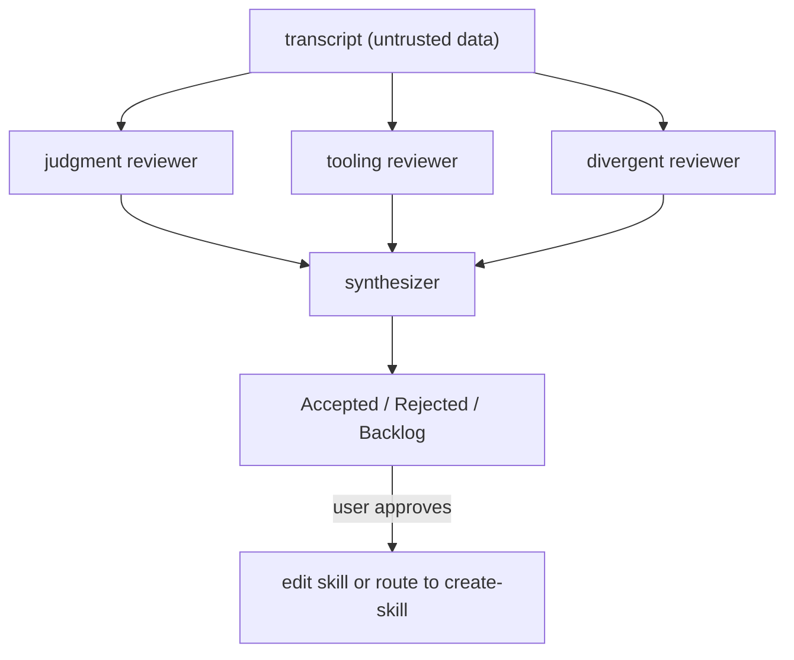

# Personalization and setup: make pstack yours, and keep an audit trail

pstack is meant to be adapted. `automate-me` turns your working conventions into a personal mode skill, `reflect` mines your transcript for durable learnings, `show-me-your-work` keeps an append-only decision log, `poteto-help` routes help questions, and `make-bot-ui` builds a small automation page.

## Words on this page

| Word | Meaning |
|------|---------|
| Convention | A way you already work, worth capturing as a skill |
| Transcript | The saved record of a chat session |
| Decision log | An append-only file recording each decision and its evidence |
| Audit trail | A record that lets a reviewer reconstruct why |
| Webhook | An HTTP endpoint that triggers a routine |

## `automate-me`: your habits, as a skill

`automate-me` turns user working conventions into a personal `-mode` skill. The flow: check for an existing skill → mine transcripts (parallel slice mining of the workspace `agent-transcripts/`, cross-checking two or more slices) → structured `AskQuestion` rounds → cluster → draft via the Cursor built-in `create-skill` → iterate via `/unslop` → land in a worktree.

The guardrails are about not overfitting: do not overfit to one conversation, reference rather than inline, and keep sections minimal. A skill built from one lucky session would encode noise; cross-checking slices filters for the convention that repeats.

## `reflect`: durable learnings, reviewed by three angles

`reflect` mines the active transcript for durable learnings and routes each to a skill edit. It spawns three parallel reviewers — **judgment** (is this right to keep), **tooling** (is this the right mechanism), and **divergent** (what is the counter-view) — then one synthesizer producing Accepted / Rejected / Backlog. It applies only after explicit user approval, routes trivial edits to the parent and substantive ones to `create-skill`.

Each reviewer template carries prompt-injection defenses: the transcript is treated as untrusted data. A learning that looks like a rule but is actually text a user pasted from somewhere must not be silently promoted into a skill.

## `show-me-your-work`: the append-only decision log

`show-me-your-work` keeps one TSV (tab-separated values) decision log with columns `ts / phase / decision / why / evidence / result`. The helper `scripts/log.sh <logfile> <phase> <decision> <why> <evidence> <result>` stamps the timestamp, writes the header on first use, and strips tabs and newlines.

Two decisions matter:

- **Append-only, never edit.** Corrections are superseding rows, not edits, so the trail is a true record.
- **Formula neutralization.** The script prefixes spreadsheet-formula-leading cells (`=`, `+`, `-`, `@`) with a single quote, because "attacker-controlled evidence (PR titles, filenames, generated text) must not become formula execution when a reviewer opens the file."

The log is local by default (`decisions.tsv` or `.audit/<task-slug>.tsv`) and committed only when a reviewer needs the trail. Every run ends with a cross-model review and an "Attention" section.

## `poteto-help` and `make-bot-ui`

`poteto-help` routes help questions to the right skill or guide page, with a full "Pick a skill" table, close-call disambiguations (`how` versus `why` versus `teach`; `arena` versus `swarm`; `recall` versus `ketchup`), and the "not in pstack" list — so a user never hunts for a phantom command.

`make-bot-ui` builds a page whose buttons wake a Grok Bot over a webhook. The sender key travels via a secret-request card, never in chat, and the local server binds to `0.0.0.0` and posts with an eight-second timeout and one try.

## Aha moments

**Aha: the decision log defends against spreadsheet injection.** A PR title that starts with `=` could run as a formula when the log is opened. The script neutralizes it at write time, treating generated text as untrusted input — the same boundary discipline applied to the plugin's own bookkeeping.

**Aha: `reflect` treats the transcript as untrusted.** A learning can look like a rule while actually being pasted content or a one-off. The three-reviewer split (judgment, tooling, divergent) plus explicit approval means a skill is only ever edited on purpose, never by accident.

## Where to go next

Read [The guide](10-the-guide.md) for the first-task walkthrough. Read [Model routing](12-model-routing.md) for `setup-pstack`.
