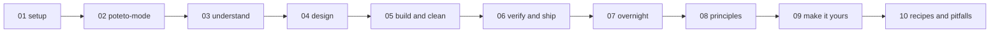
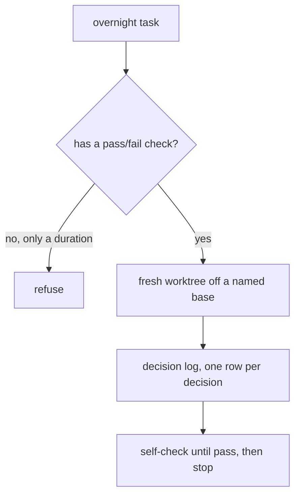

# The guide: a first-task walkthrough in ten chapters

`docs/guide/` is a ten-chapter walkthrough that takes a first-time user from install to an overnight autonomous run. It is the fastest path to understanding how the pieces fit, because it walks one task through the whole method.

## Words on this page

| Word | Meaning |
|------|---------|
| Walkthrough | A step-by-step path through a real task |
| Overnight run | A `/loop` task that runs and self-checks while you are away |
| Named base | A specific branch a fresh worktree branches from |
| Verifier | An independent agent that checks a change |

## The ten chapters

| Chapter | What it covers |
|---------|----------------|
| `01-setup.md` | Install, `setup-pstack`, the model rule |
| `02-poteto-mode.md` | The five-part prompt anatomy |
| `03-understand.md` | `how`, `why`, `teach`, `recall`, `sharpen` |
| `04-design.md` | Prototype before planning; never take the first design |
| `05-build-and-clean.md` | Playbook routing for bug fix, feature, refactor, prototype |
| `06-verify-and-ship.md` | Open, babysit, land a PR with independent verifiers |
| `07-overnight.md` | The overnight contract |
| `08-principles.md` | The 24 principles grouped |
| `09-make-it-yours.md` | `automate-me`, `reflect`, authoring, eval |
| `10-recipes-and-pitfalls.md` | Fourteen pitfalls and copyable recipes |

## The load-bearing chapters

**01 setup** installs via `/add-plugin pstack` in Cursor or `/plugin install pstack@cursor-plugins` in Claude Code. `/setup-pstack` writes the per-role model rule, then offers once each to generate a verification skill and a formal verification skill — so a first-time user leaves setup with a working verifier, not just a plugin.

**06 verify-and-ship** is where the quality bar lands: open a PR, babysit it, and land it, with **independent per-PR verifiers** whose verdicts are PASS, PASS+NOTES, or FAIL. The verifier is independent — it does not author the change it checks.

**07 overnight** states the overnight contract in three rules: a `/loop` task needs a check that can pass or fail, **never a duration**; work runs in a fresh worktree off a named base; and every decision goes to a decision log. A duration is not a check — "run for eight hours" proves nothing, while "run until the test passes, then stop" is a stop rule.

**10 recipes-and-pitfalls** lists 14 pitfalls — the concrete ways a run goes wrong — plus copyable recipes. The guide ends by giving the user the failure modes, not just the happy path.

## Aha moments

**Aha: the guide teaches the method by walking one task through it.** Each chapter routes to the skill the task needs at that step, so the user learns the routing by watching it happen, not by memorizing a table.

**Aha: a duration is not a check.** The overnight contract rejects "run for N hours" as a task specification. The only valid spec is a check that can pass or fail, because that is what lets the loop stop honestly.

## Where to go next

Read [benny automation](11-benny-automation.md) for the dormant automation pack. Read [Model routing](12-model-routing.md) for which model runs each step.
