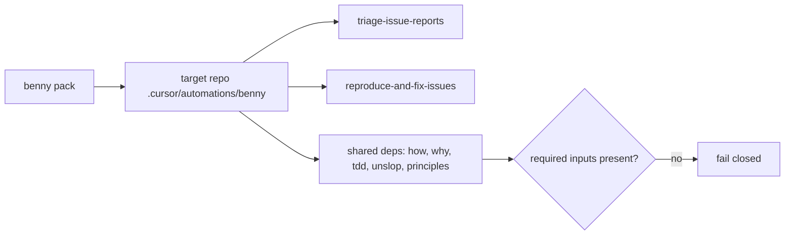
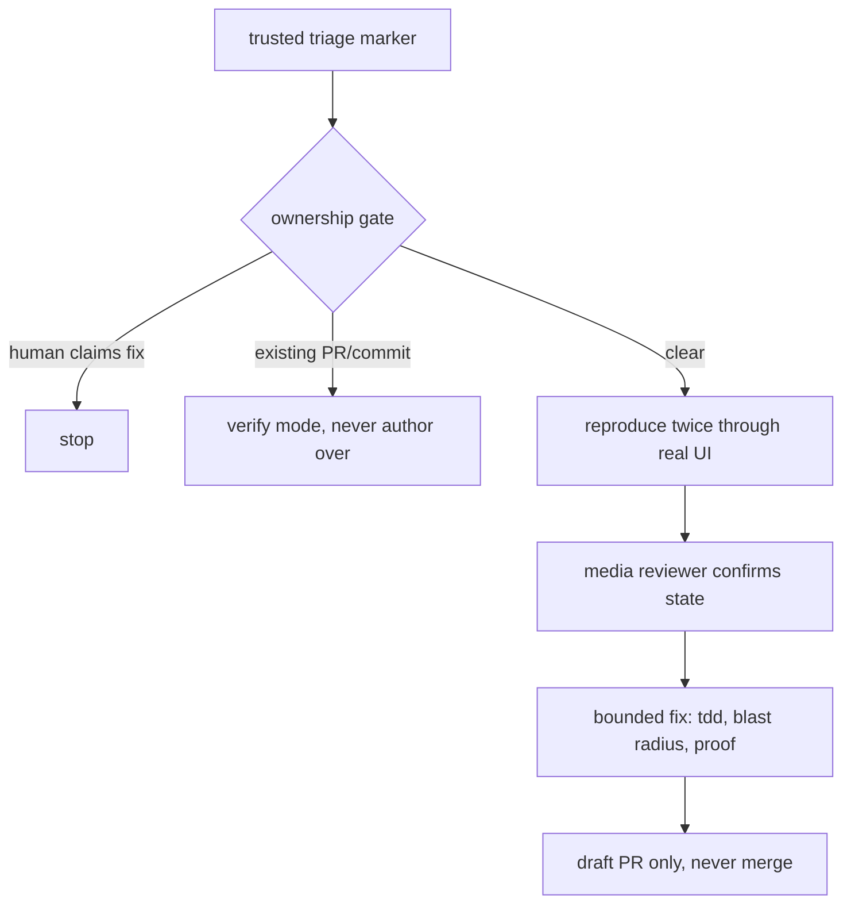

# benny: a fail-closed automation pack for a Slack issue channel

Benny is a dormant automation pack — two Cursor automations that triage and fix issues reported in a Slack channel. It is not a slash skill; it is copied into a target repository and wired to a channel. Its defining trait is that it fails closed and grants exactly one agent the power to post.

## Words on this page

| Word | Meaning |
|------|---------|
| Automation | A Cursor routine triggered by an event, such as a webhook |
| Coordinator | The one agent allowed to post to the channel |
| Control adapter | The target repo's tool for driving its own app like a user |
| Routing map | A table deciding which class of report pings whom |
| Fail closed | Stop and report rather than act when a required input is missing |

## The install model

The pack is copied to `<target-repo>/.cursor/automations/benny/`. pstack is enabled for that repo only for the shared dependencies — `how`, `why`, `tdd`, `unslop`, plus the principle skills `separate-before-serializing-shared-state`, `minimize-reader-load`, `guard-the-context-window`, `sequence-verifiable-units`, `fix-root-causes`, and `prove-it-works`. User config, feature maps, routing maps, and secrets live **outside** the copied pack.

Everything fails closed: if coordinates, tracker, control adapter, or feature map are missing, the automation stops and reports rather than guessing.

## Automation 1: `triage-issue-reports`

The triage automation freezes its source coordinates (channel plus thread timestamp) as immutable, reads the whole report and attachments, traces the cause via `how` (and `why` for regressions), and classifies each report as Bug / Performance / Feature request / Question or feedback / Reroute. It applies a routing map (pings off by default), dedupes against the tracker, and creates a ticket only for a clear net-new bug.

It posts exactly one thread-only verdict ending in `[benny:bug]`, `[benny:performance]`, or `[benny:other]`, and never posts a source-channel root message.

**Aha: the coordinator is the only Slack poster.** Every child prompt explicitly bans `SendSlackMessage`, `PostToSlack`, `chat.postMessage`, and all Slack writes. A delegated worker cannot post — only the coordinator can. This exists because a bot that posts confidently to the wrong thread is worse than one that stops.

## Automation 2: `reproduce-and-fix-issues`

The reproduce automation waits for a trusted triage marker (the author is the configured triage identity, and exactly one marker is present). Its ownership gates: stop if a person claims the fix; an existing PR or commit switches the run to verify mode and never authors over it.

It reproduces the exact symptom **twice through the real UI** via the control adapter, captures screenshots, video, and read-only state, and has a media reviewer confirm the discriminating state. A bounded fix happens only after a confirmed reproduction and a rejection window, using `tdd` when cheap, a blast-radius smoke, and before-and-after proof. It opens a **draft** pull request only — it never merges or deploys.

## The control-adapter contract

`references/control-adapter.md` requires seven capabilities of the target's adapter: bring up, drive the UI, drive mapped features and states, inspect state (read-only), screenshot, recording, and cleanup. The automation cannot run against an app it cannot drive; the contract makes that a stated requirement, not an assumption.

`verify-existing-fix.md` sets the proof bar for a claimed fix: the baseline must reproduce twice, and the patched build must resolve twice, with outcomes Confirmed / Insufficient fix / Inconclusive.

## Budgets and status

`templates/configuration.example.yaml` sets default budgets — poll 45 seconds, verdict wait 45 minutes, triage follow-up 10 minutes, triage total 30 minutes, reproduction 60 minutes, rejection window 10 minutes, fix 90 minutes, operations follow-up 45 minutes — and status emoji strings (👀 seen, 🔎 reproducing, ✅ reproduced, ⚪ could_not_reproduce, ⛔ blocked, 🛠️ fixing, ❌ fix_failed, 🔗 pull_request_opened). Models are chosen from the user's available slugs, never guessed.

## Aha moments

**Aha: fail-closed is the default posture.** A missing feature map or control adapter stops the run, because a bot that guesses coordinates or authors over a human's fix is worse than a bot that reports "blocked". The pack's whole design is oriented around the costs of being wrong in public.

**Aha: repro twice, fix once, draft only.** The reproduce-twice rule, the rejection window, and the draft-only PR all bound the blast radius of a mistake. The automation is allowed to be useful, not powerful.

## Where to go next

Read [Model routing](12-model-routing.md) for how pstack assigns models. Read [Critical assessment](13-critical-assessment.md) for the verdict.
