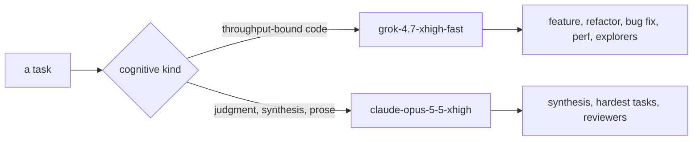
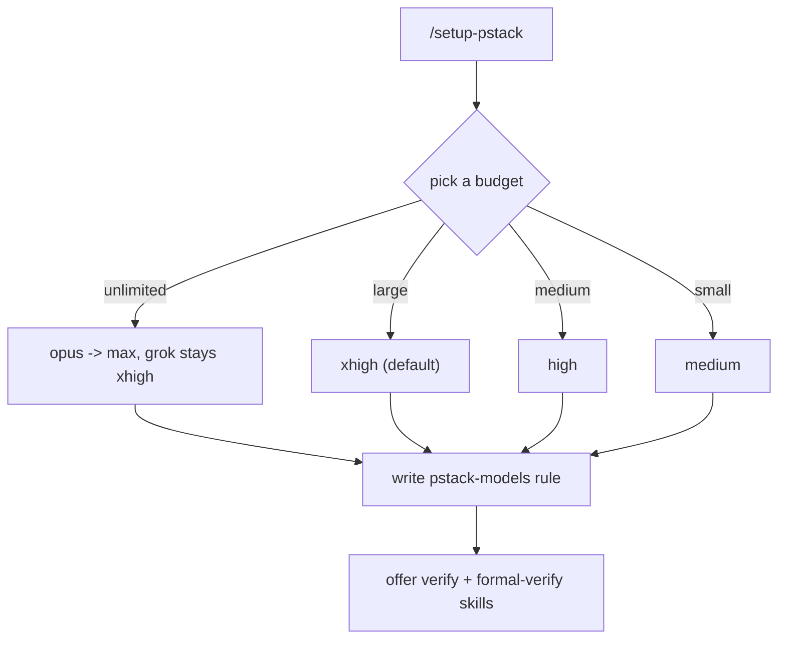

# Model routing: two families, by cognitive kind

pstack routes work by cognitive kind, not by task name. One family does throughput-bound code work; the other does judgment, synthesis, and prose. The separation is deliberate, and `setup-pstack` writes it into a rule file the harness applies on every turn.

## Words on this page

| Word | Meaning |
|------|---------|
| Cognitive kind | The type of thinking a task needs — throughput versus judgment |
| Family | A model lineage, so a judge is never the parent's own family |
| Panel role | A list of models, one subagent per entry |
| Effort budget | A chosen rung on the reasoning ladder, from low to max |
| Rule file | A file the harness reads on every turn to assign models |

## The default split

The defaults (`skills/setup-pstack/SKILL.md:49-65`, and `skills/poteto-mode/SKILL.md:96`):

| Role | Default model |
|------|---------------|
| Code delegates (feature, refactor, bug fix, perf, hillclimb) | `grok-4.7-xhigh-fast` |
| Prose and judgment (hardest tasks, synthesis) | `claude-opus-5-5-xhigh` |
| Swarm workers | `grok-4.7-xhigh-fast` |
| `how` explorer / `why` investigators | `grok-4.7-xhigh-fast` |
| `how` explainer / `why` synthesizer | `claude-opus-5-5-xhigh` |

## Panel roles and the cross-judge rule

Panel roles are **lists** — one subagent per entry. `arena runners`, `architect runners`, and `interrogate reviewers` default to two entries (`claude-opus-5-5-xhigh`, `grok-4.7-xhigh-fast`). The `arena cross-judge pool` is ordered, and a judge is **never the parent's family** — so a judge cannot rubber-stamp its own family's biases.

The effort budget default is `xhigh` (which is the maximum for opus, and the top of the range for grok).

## `setup-pstack`: the one skill without the off-switch

`setup-pstack` (79 lines) writes `~/.cursor/rules/pstack-models.mdc` with `alwaysApply: true`. It is the only skill without `disable-model-invocation: true`, because its whole job is to run during model configuration.

Budgets map to effort tokens on the ladder `max > xhigh > high > medium > low`:

| Budget | Effort | Effect |
|--------|--------|--------|
| unlimited | max reasoning | `claude-opus-5-5-xhigh` → `claude-opus-5-5-max`; grok stays `xhigh` |
| large (default) | xhigh reasoning | The defaults above |
| medium | high reasoning | A lower rung |
| small | medium reasoning | `claude-opus-5-5-medium`, `grok-4.7-medium-fast` |

`inherit-parent` and `auto` are always valid aliases — a role runs on the parent chat model, and in a panel list an alias entry still counts toward the fan-out. Every real slug must be confirmed in the detected-available set; a slug is never guessed. After writing the rule, it offers once each to generate a verification skill and a formal verification skill.

## The harness adapter

`docs/harness/claude-code.md` (67 lines) maps Cursor concepts to Claude Code: a Cursor Task is a Claude Code Agent, `generalPurpose` is `general-purpose`, `poteto-agent` is `pstack:poteto-agent`, readonly is Explore, and `environment: cloud` is `isolation: worktree`. The model rule file becomes `~/.claude/rules/pstack-models.md` in Claude Code.

## Aha moments

**Aha: routing is by cognitive kind, not task name.** "Fix a bug" and "write an explainer" are both tasks, but one is throughput-bound and the other is judgment-bound. Assigning models by the type of thinking — not the task label — is what makes the two-family split stable across every skill.

**Aha: a slug is never guessed.** `setup-pstack` confirms every model slug against the detected-available set before writing it, because a rule file that names a model the user does not have fails on every turn. The configuration is itself verified against the environment.

## Where to go next

Read [Critical assessment](13-critical-assessment.md) for the verdict. Read [Glossary](14-glossary.md) for every term in one place.
