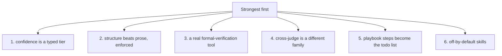
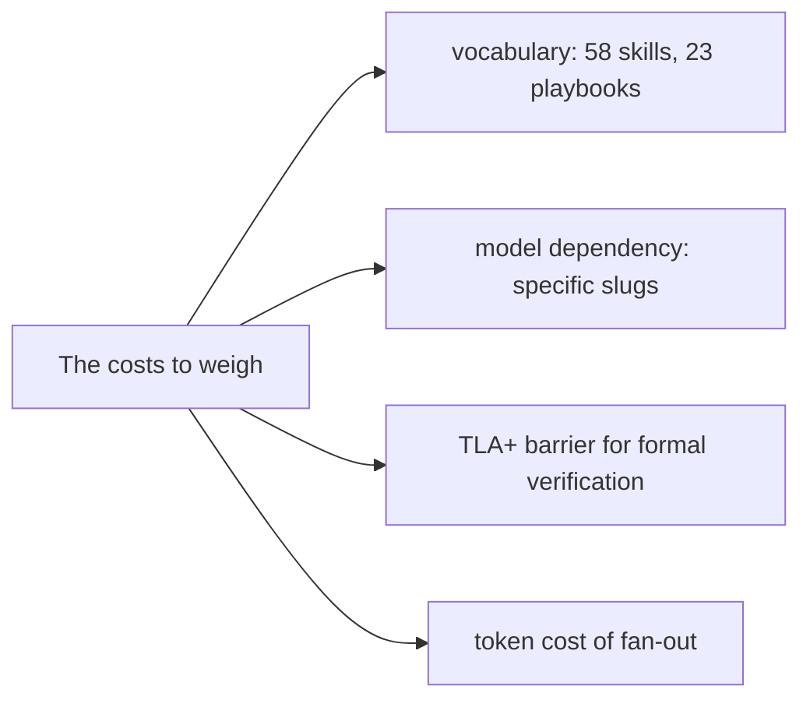

# Critical assessment: what pstack gets right, and its costs

pstack is a serious, opinionated toolkit by an engineer who has shipped at scale. Its best ideas are portable and worth copying; its costs are complexity, a heavy model dependency, and a high barrier to the formal-verification tooling.

## The verdict in one line

The philosophy — go deep, verify against the real artifact, encode lessons in structure — is strong and coherent. The implementation is real (it ships a working TLA+ charting tool, not prose about rigor). The price is that pstack is a whole method with its own vocabulary, its own model routing, and its own toolchain, and it expects you to adopt all three.

## Strengths, ranked

1. **Confidence as a first-class type.** `epistemics.md` turns epistemic honesty into five tiers with per-tier phrasing rules — "because" is banned in inference, "obviously" is banned outright, and "an honest we-don't-know is one of the most valuable outputs." This is the single most transferable idea in the plugin, and it costs nothing to adopt.

2. **Structure beats prose, and it is enforced.** `encode-lessons-in-structure` and `correct`'s ladder (architecture → types → lint → test → docs last) are applied to the plugin itself: skills ship scripts (`statechart`, `check-plan.mjs`, `worktree-audit.sh`, `log.sh`) that enforce what the prose describes.

3. **A real formal-verification tool, not advice about it.** The statechart tool drives TLC, colors violating states, verifies the drawn chart against the model (`regionsLie`), and escapes Mermaid input adversarially. Tests cannot reach races and retries; this tool can.

4. **The cross-judge is a different family.** `arena` forces its judge to come from a model family other than the parent's, structurally preventing a model from rubber-stamping its own biases.

5. **Playbook steps become the todo list verbatim.** The mode skill copies playbook steps directly into the todo list, so execution follows named, reproducible steps rather than a paraphrase.

6. **Off-by-default skills.** `disable-model-invocation: true` everywhere except `setup-pstack` means the plugin never burns tokens auto-firing skills a turn does not need.

## Weaknesses

1. **It is a whole method, not a tool.** 58 skills, 23 playbooks, a 2,374-line pull-request watcher, a formal-verification toolchain, and its own guide. A user who wants one idea (say, `unslop`) has to wade through the entire vocabulary. The entry cost is high.

2. **The defaults name specific model slugs.** `grok-4.7-xhigh-fast` and `claude-opus-5-5-xhigh` are hardcoded as defaults. `setup-pstack` verifies slugs against the available set, but the routing is opinionated and vendor-specific; a rename or a pricing change breaks the defaults.

3. **The formal-verification path has a steep barrier.** To use the statechart tool a user writes TLA+ and a view module. Most engineers will not. The tool is excellent for the few who can; it is out of reach for the many who cannot.

4. **Cursor-first.** Custom modes, automations, and `~/.cursor` paths are native; Claude Code support is a 67-line adapter. The plugin works in Claude Code, but it is a guest, not a citizen.

## Risks

1. **Fearless parallelism is expensive.** The whole method fans out subagents, cross-judges, and reviewers. A user who adopts the philosophy without the budget will see large token bills before they see the quality gain.

2. **Model routing ages.** Hardcoded model IDs are a bet on the current frontier. When the frontier moves, the defaults lag — and the plugin's advice (which model to trust for judgment) is exactly the thing that most needs updating.

3. **"Never block on the human" can over-run.** The autonomy split proceeds on reversible work without asking. The boundary between reversible and irreversible is a judgment call, and an agent that misjudges it acts without confirmation.

4. **Cargo-culting the method.** The playbooks are prescriptive and well-reasoned, but a user who follows them without understanding the principles gets the ceremony without the judgment. The tooling does not replace the engineer; it assumes one.

## What to copy, what to leave

| Copy | Leave |
|------|-------|
| The five confidence tiers and their phrasing rules | The full 58-skill vocabulary |
| The fix ladder (architecture → types → lint → test → docs) | The hardcoded model slugs |
| Structure over prose, with a script that enforces it | The Cursor-specific automations |
| The cross-judge-different-family rule | The TLA+ toolchain, unless you need it |
| A `next`-style action vocabulary in agent-facing tools | The 23 playbooks, until you have the scale |

## Aha moments

**Aha: the plugin's best ideas are free to copy.** Confidence tiers, the fix ladder, and structure-over-prose are pure method — they cost nothing to adopt and improve any workflow, with or without pstack.

**Aha: rigor is implemented, not described.** The reason pstack is credible is not the principles; it is that the principles are backed by scripts that fail loudly. The statechart tool, `check-plan.mjs`, and `log.sh` are the proof of the prose.

## Where to go next

Read [Glossary](14-glossary.md) for every term in one place. Return to [Philosophy and principles](01-philosophy-and-principles.md) for the mental model.
