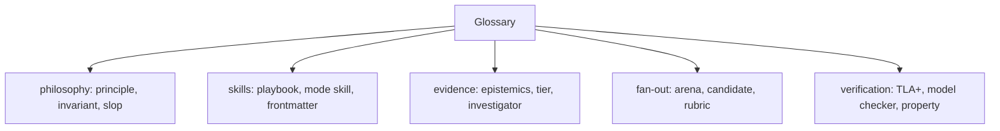

# Glossary

Every term used in this exploration, in alphabetical order, with the page that explains it in full.

## Philosophy and principles

| Term | Meaning | Page |
|------|---------|------|
| Invariant | A property that must always hold | [Philosophy and principles](01-philosophy-and-principles.md) |
| Premise | An unstated assumption that two fixes share | [Philosophy and principles](01-philosophy-and-principles.md) |
| Principle | One short rule about how to engineer, written as a skill | [Philosophy and principles](01-philosophy-and-principles.md) |
| Slop | Low-quality, verbose code or prose produced fast | [Philosophy and principles](01-philosophy-and-principles.md) |

## Skills and playbooks

| Term | Meaning | Page |
|------|---------|------|
| Disable model invocation | A flag stopping a skill from auto-firing on every turn | [The skill catalog](03-skill-catalog.md) |
| Frontmatter | The metadata block at the top of a skill file, in YAML | [The skill catalog](03-skill-catalog.md) |
| Mode skill | The entry skill a user invokes to start a rigorous task | [poteto-mode and playbooks](02-poteto-mode-and-playbooks.md) |
| Non-negotiable | A hard rule the mode skill never relaxes | [poteto-mode and playbooks](02-poteto-mode-and-playbooks.md) |
| Playbook | One step-by-step plan the mode skill picks to match a task | [poteto-mode and playbooks](02-poteto-mode-and-playbooks.md) |
| Routing phrase | Words in the request that select a playbook | [poteto-mode and playbooks](02-poteto-mode-and-playbooks.md) |
| Skill | A Markdown instruction file an agent loads to do one job well | [The skill catalog](03-skill-catalog.md) |
| Todo list | The visible task list the mode skill opens and works through | [poteto-mode and playbooks](02-poteto-mode-and-playbooks.md) |
| Workflow skill | A skill that does a job when a playbook step needs it | [The skill catalog](03-skill-catalog.md) |

## Understanding and evidence

| Term | Meaning | Page |
|------|---------|------|
| Confidence tier | One of five levels of certainty, each with its own phrasing | [Understanding and evidence](04-understanding-and-evidence.md) |
| Epistemics | The study of how you know what you claim to know | [Understanding and evidence](04-understanding-and-evidence.md) |
| Investigator | A parallel read-only subagent gathering evidence from one source | [Understanding and evidence](04-understanding-and-evidence.md) |
| Model Context Protocol (MCP) | The protocol that gives an agent tools to query a system | [Understanding and evidence](04-understanding-and-evidence.md) |
| Source | One evidence category, for example source control or a tracker | [Understanding and evidence](04-understanding-and-evidence.md) |
| Synthesizer | The single agent that combines investigators' findings | [Understanding and evidence](04-understanding-and-evidence.md) |

## Verification

| Term | Meaning | Page |
|------|---------|------|
| Adversary | An agent whose job is to break a change, not praise it | [Verification skills](05-verification-skills.md) |
| Feature map | One file per feature saying how to reach it and drive it like a user | [Verification skills](05-verification-skills.md) |
| Harness | A tool that launches, drives, and inspects the real app | [Verification skills](05-verification-skills.md) |
| Model checker | A tool that exhausts a state machine to find a violating path | [The statechart tool](06-the-statechart-tool.md) |
| Property | An invariant the model must always satisfy | [Verification skills](05-verification-skills.md) |
| SANY | The TLA+ syntax and type checker | [The statechart tool](06-the-statechart-tool.md) |
| Temporal Logic of Actions (TLA+) | A language for specifying and checking concurrent systems | [The statechart tool](06-the-statechart-tool.md) |
| TLC | The TLA+ model checker the statechart tool drives | [The statechart tool](06-the-statechart-tool.md) |
| View | A module mapping model state to a readable picture | [The statechart tool](06-the-statechart-tool.md) |

## Parallelism and delegation

| Term | Meaning | Page |
|------|---------|------|
| Arena | The skill that spawns candidates, cross-judges, picks, grafts | [Parallelism, delegation](07-parallelism-delegation-subagents.md) |
| Background | A subagent that runs without blocking the main thread | [Parallelism, delegation](07-parallelism-delegation-subagents.md) |
| Candidate | One worker's complete answer to a brief | [Parallelism, delegation](07-parallelism-delegation-subagents.md) |
| Delegate | A subagent that does a slice of work on behalf of the main thread | [Parallelism, delegation](07-parallelism-delegation-subagents.md) |
| Fan out | Start several workers in parallel on the same or sliced work | [Parallelism, delegation](07-parallelism-delegation-subagents.md) |
| Graft | Folding the strongest parts of losers into the winner by hand | [Parallelism, delegation](07-parallelism-delegation-subagents.md) |
| Rubric | A list of gradeable criteria a judge scores against | [Parallelism, delegation](07-parallelism-delegation-subagents.md) |

## Writing and correctness

| Term | Meaning | Page |
|------|---------|------|
| AI tell | A phrase or pattern that marks text as machine-written | [Writing and correctness](08-writing-and-correctness.md) |
| Constraint comment | A comment telling a future reader what not to do | [Writing and correctness](08-writing-and-correctness.md) |
| Diátaxis | A documentation framework of four modes | [Writing and correctness](08-writing-and-correctness.md) |
| Ladder | A ranked order of fixes, most structural first | [Writing and correctness](08-writing-and-correctness.md) |

## Setup, model routing, automation

| Term | Meaning | Page |
|------|---------|------|
| Automation | A Cursor routine triggered by an event, such as a webhook | [benny automation](11-benny-automation.md) |
| Cognitive kind | The type of thinking a task needs — throughput versus judgment | [Model routing](12-model-routing.md) |
| Control adapter | The target repo's tool for driving its own app like a user | [benny automation](11-benny-automation.md) |
| Coordinator | The one agent allowed to post to a channel | [benny automation](11-benny-automation.md) |
| Decision log | An append-only file recording each decision and its evidence | [Personalization and setup](09-personalization-and-setup.md) |
| Effort budget | A chosen rung on the reasoning ladder, from low to max | [Model routing](12-model-routing.md) |
| Fail closed | Stop and report rather than act when a required input is missing | [benny automation](11-benny-automation.md) |
| Family | A model lineage, so a judge is never the parent's own family | [Model routing](12-model-routing.md) |
| Overnight run | A `/loop` task that runs and self-checks while you are away | [The guide](10-the-guide.md) |
| Panel role | A list of models, one subagent per entry | [Model routing](12-model-routing.md) |
| Transcript | The saved record of a chat session | [Personalization and setup](09-personalization-and-setup.md) |
| Webhook | An HTTP endpoint that triggers a routine | [Personalization and setup](09-personalization-and-setup.md) |
| Worktree | An isolated checkout for parallel work | [The guide](10-the-guide.md) |

## Where to go next

Return to [Critical assessment](13-critical-assessment.md) for the verdict, or [The overview](00-overview.md) for the map.
