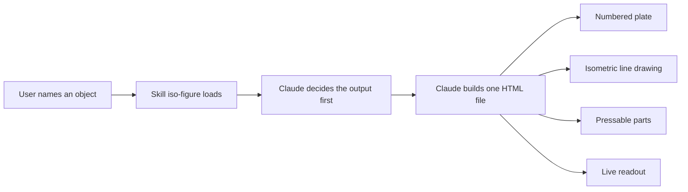
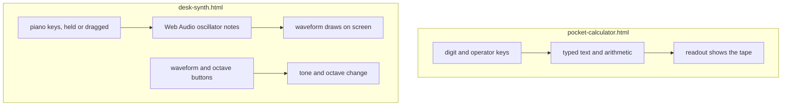

# 00 -- Purpose and Trigger: Name an Object, Get a Working Figure

The skill turns a named object into one working drawing. The key idea is the rule that comes
before any drawing: **the object must do something real.** A switch toggles. A key depresses. A
screen shows what was typed. A synthesizer key makes sound. A figure that only animates is
decoration. A figure where pressing a part produces output is the point. This document states
what the skill is, when it fires, and which of its claims are true when checked against the
source.

The skill is small. One file, `skills/iso-figure/SKILL.md`, holds the whole instruction set. Two
shipped examples show the output: a pocket calculator and a desk synthesizer. The rest of the
repository is packaging and previews.

## What the skill produces

The user names an object. The skill has Claude return one self-contained HyperText Markup
Language (HTML) file. The file holds:

- One rounded panel, captioned like a textbook plate.
- One isometric line drawing of the object, drawn as inline Scalable Vector Graphics (SVG).
- Parts that work when pressed.
- A live readout that changes on every interaction.

No libraries, no canvas, no three-dimensional (3D) engine. Plain SVG does the drawing. About
fifteen lines of JavaScript (JS) do the projection. The file must run when opened straight from
disk.



The contract is exact: one request in, one self-contained file out. The file is a figure, not an
app to deploy. The skill description states the purpose in its frontmatter block.

```yaml
# skills/iso-figure/SKILL.md, lines 1-4
---
name: iso-figure
description: Build an interactive isometric line-art "figure" (Fig N style) of an object in a single HTML/SVG file: monochrome technical-illustration look, parts you can press that produce real output, live state readout. Use for hero illustrations, interactive diagrams, product figures, and playable desk objects (computer, synth, calculator).
---
```

The description lists the allowed uses: hero illustrations, interactive diagrams, product
figures, and playable desk objects. The phrase "parts you can press that produce real output"
is the trigger condition, not a suggestion.

## When the skill fires

A skill fires when a user request matches its description. The description names the shape of
the request: an object, drawn isometrically, with working parts. The project README gives two
example prompts.

```text
# README.md, lines 42-43
iso figure of a kitchen timer with minute buttons and a display that counts down
fig 6, a wall light switch that turns a lamp on and off
```

Both prompts name an object and a part to press. The timer has buttons and a display. The
switch turns a lamp on and off. That pattern is what the description matches. A request for a
static poster or a logo would not match, because nothing in it can be pressed.

## The claims, checked

The summary claims six things. Each one is checked here against the source.

1. **One self-contained HTML file.** True, with one note. The two examples embed all JS, CSS,
   and SVG inline. The only external reference is a font stylesheet (Google Fonts) in the
   document head. The drawing still works without it, because the font stack falls back to any
   monospace font. No external script is loaded. The skill rule "No external scripts; the file
   must run opened from disk" is at `skills/iso-figure/SKILL.md`, line 113.
2. **A hairline drawing.** True. Faces use `stroke-width:1` and
   `vector-effect:non-scaling-stroke`, so strokes stay one unit thick even where the projection
   skews them. The rule is at `skills/iso-figure/SKILL.md`, lines 54 and 62.
3. **A numbered plate.** True. Each figure caption starts `Fig N`, in the top-left corner. The
   two examples are `Fig 5` (calculator) and `Fig 4` (synthesizer). See
   `examples/pocket-calculator.html`, line 60, and `examples/desk-synth.html`, line 64.
4. **Pressable parts.** True. Every pressable part is a group with class `press`. Pressing adds
   class `down`, which moves the part and flashes its stroke. See
   `examples/pocket-calculator.html`, lines 45-51.
5. **About fifteen lines of projection code.** True. The kernel is fourteen lines of code plus
   two comment lines, from `skills/iso-figure/SKILL.md`, lines 22-37. Document 01 reads it line
   by line.
6. **No libraries.** True. No script tag loads a library. Everything runs on the built-in
   Document Object Model (DOM), SVG, and Web Audio application programming interfaces (APIs).

```html
<!-- examples/pocket-calculator.html, lines 59-63 -->
<figure>
  <div class="cap"><span class="hi">Fig 5</span><span>Pocket calculator</span></div>
  <svg id="stage" viewBox="0 0 575 372" tabindex="0" role="img" aria-label="Isometric pocket calculator. Press its keys with the mouse, touch, or your keyboard to calculate."></svg>
  <div class="cap"><span>Press the keys · it calculates</span><span class="hi" id="readout">ready</span></div>
</figure>
```

The snippet shows the whole plate: the top caption row, the empty SVG stage that the script
fills, and the bottom caption row. The bottom-right readout starts at `ready`. The SVG carries
an accessible name that states how to operate it.

## The two shipped examples

The repository ships two finished figures. Both obey the "output first" rule.

- **Pocket calculator** (`examples/pocket-calculator.html`, 144 lines). Pressing digit and
  operator keys types real arithmetic. The display shows the result. The readout shows the last
  calculation, for example `12.5 × 8 = 100`.
- **Desk synthesizer** (`examples/desk-synth.html`, 193 lines). Pressing keys plays real notes
  through the Web Audio API. Holding several keys plays a chord. Dragging across keys works. A
  live waveform draws on the screen.



Both files embed the same projection kernel, identical apart from the `OX`/`OY` origin; the comments are stripped. Document 01 reads it in full.

## The four things that make it work

The skill states four design points before any code, at `skills/iso-figure/SKILL.md`, lines
14-17:

1. **Everything is a flat two-dimensional (2D) shape placed on a 3D plane.** Never hand-compute
   skewed polygons. Draw ordinary rectangles, text, and paths in a face's local coordinates,
   then let one SVG matrix place them on the plane. Text and rounded corners then sit in correct
   projection for free.
2. **Objects are boxes; a box is its three visible faces.** Complex objects are boxes plus flat
   detail drawn on their faces.
3. **Interaction is class toggles on SVG groups.** One `state` object and one `render()` drive
   it. Cascading Style Sheets (CSS) does the motion.
4. **The frame sells it.** Four monospace corner captions: `Fig N` (top-left), the object name
   (top-right), the instruction (bottom-left), and a live readout (bottom-right).

The second rule gives the whole method its ceiling: any object reduces to boxes and face
detail. There is no mesh, no lighting, and no depth buffer. Paint order alone decides what
covers what.

## What the skill refuses

The "Don'ts" section closes the skill, at `skills/iso-figure/SKILL.md`, lines 111-115. The
refusals are as important as the rules:

- No real company logos, product silhouettes, or trademarked marks.
- No hand-written skewed polygon coordinates. If a face needs point lists, use `plane()`.
- No external scripts. The file must run opened from disk.
- Do not build something the user only watches. If the user cannot press it and get output,
  pick a different object.
- Give the SVG `role="img"`, `tabindex="0"`, and an `aria-label` that states what it is and how
  to operate it.

## The Aha Moment

**Aha:** The skill is not a drawing tutorial with a few interactive tricks bolted on. It is an
interaction spec with a drawing attached. The first real decision is "what does pressing a part
produce", and every rule after that — boxes, class toggles, the readout, even the frame captions
— exists to make that output visible and reachable. A beautiful isometric drawing with nothing
to press is a failed figure.

## Cross-References

- The projection kernel, read line by line: [01-projection.md](./01-projection.md).
- How the one HTML file is assembled: [02-assembly.md](./02-assembly.md).
- How the request becomes a verified figure: [05-request-to-figure.md](./05-request-to-figure.md).

Continue to [01-projection.md](01-projection.md).
