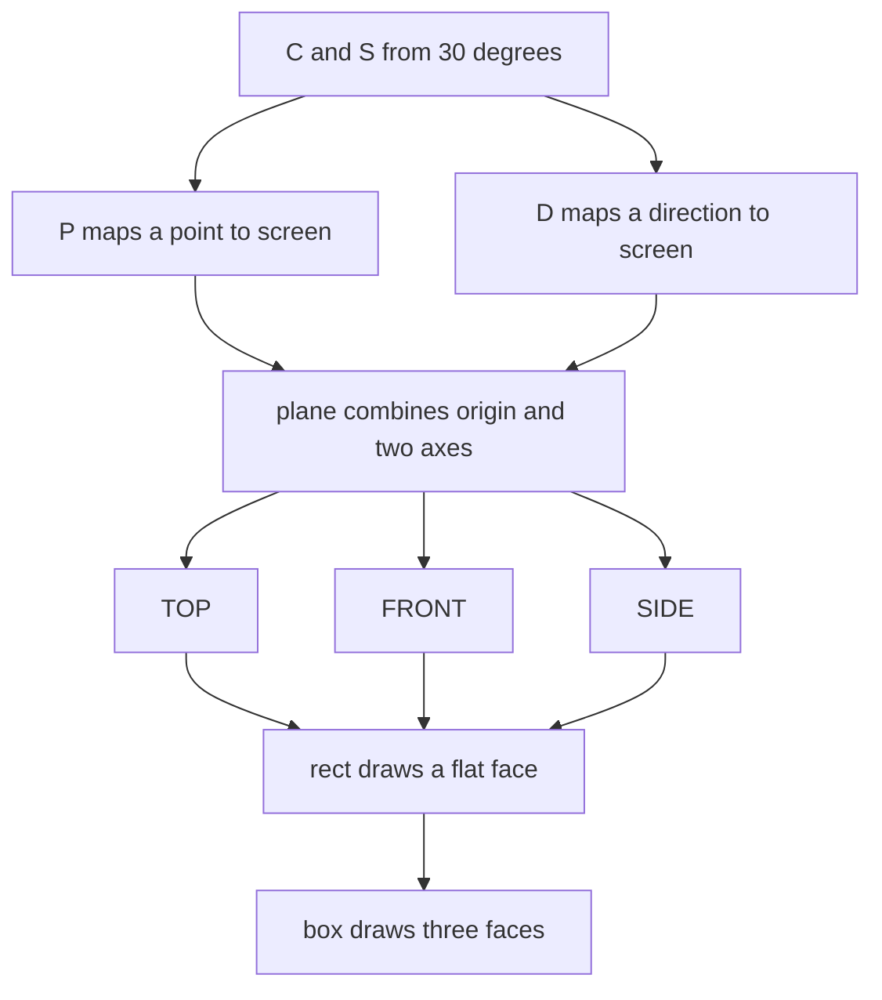
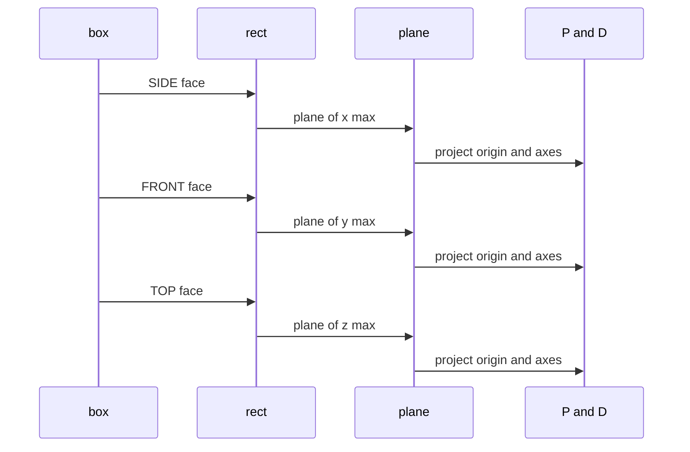

# 01 -- Projection Math: The Small Kernel That Puts Flat Shapes in Space

The key idea is that a face is a matrix, not a polygon. The skill never hand-computes skewed
point lists. It draws ordinary rectangles, text, and paths in a face's own flat coordinates,
then lets one Scalable Vector Graphics (SVG) `matrix()` transform place the whole face on the
correct isometric plane. Text, glyphs, and rounded corners then land in correct projection for
free. This document reads the projection kernel line by line and shows the arithmetic.

The kernel is fourteen lines of code plus two comment lines. The nine code lines are
identical in both example files, but the comments are stripped there.

```js
// skills/iso-figure/SKILL.md, lines 22-37
const C = Math.cos(Math.PI/6), S = Math.sin(Math.PI/6), OX = 465, OY = 300; // where the 3D origin lands in the viewBox
const P = (x,y,z) => [(x-y)*C + OX, (x+y)*S - z + OY];   // point: 3D -> screen
const D = (x,y,z) => [(x-y)*C, (x+y)*S - z];              // direction only
// plane = origin O + in-plane axes U,V. Anything inside a <g> with this transform lies flat on that plane.
const plane = (O,U,V) => { const o=P(...O), u=D(...U), v=D(...V);
  return `matrix(${u[0]} ${u[1]} ${v[0]} ${v[1]} ${o[0]} ${o[1]})`; };
const TOP   = (x,y,z) => plane([x,y,z],[1,0,0],[0,1,0]);   // z = const
const FRONT = (x,y,z) => plane([x,y,z],[1,0,0],[0,0,-1]);  // y = const (faces lower-left); pass its top-left corner
const SIDE  = (x,y,z) => plane([x,y,z],[0,-1,0],[0,0,-1]); // x = const (faces lower-right); pass its top-left corner
const rect = (t,w,h,r=0,cls='face') =>
  `<g transform="${t}"><rect class="${cls}" width="${w}" height="${h}" rx="${r}"/></g>`;
// box at (x,y,z), size w along x, d along y, h along z
const box = (x,y,z,w,d,h,r=0) =>
  rect(SIDE(x+w,y+d,z+h), d,h,Math.min(r,h/4)) +
  rect(FRONT(x,y+d,z+h), w,h,Math.min(r,h/4)) +
  rect(TOP(x,y,z+h), w,d,r,'face top');
```

Two functions do all the work. `P` turns a point into screen coordinates. `D` turns a direction
into screen coordinates without the origin offset. Everything else is a combination of them.

## The two functions P and D

`C` is the cosine of thirty degrees, about `0.866`. `S` is the sine of thirty degrees, exactly
`0.5`. These are the classic isometric ratios.

The three world axes point as follows. The `+x` axis runs down-right. The `+y` axis runs
down-left. The `+z` axis runs up. On screen, the unit vectors are:

- `x = (1,0,0)` lands at `(C, S)` = `(0.866, 0.5)` — down and right.
- `y = (0,1,0)` lands at `(-C, S)` = `(-0.866, 0.5)` — down and left.
- `z = (0,0,1)` lands at `(0, -1)` — straight up.

`P` is the sum of those three, weighted by the point's coordinates, plus an origin offset:

```
screen_x = (x - y) * C + OX
screen_y = (x + y) * S - z + OY
```

`D` is the same sum without `OX` and `OY`. It is used for direction vectors, where only the
difference between two points matters.



## The plane function

`plane(O,U,V)` takes an origin `O` and two in-plane axis vectors `U` and `V`. It projects `O`
with `P` and each axis with `D`, then writes an SVG `matrix()`.

The SVG transform `matrix(a b c d e f)` maps a point `(u,v)` to:

```
screen_x = a*u + c*v + e
screen_y = b*u + d*v + f
```

The kernel writes `matrix(u[0] u[1] v[0] v[1] o[0] o[1])`. The first two numbers are axis `U`
as a screen vector. The next two are axis `V`. The last two are the projected origin. So a face
drawn in local `(u,v)` coordinates lands at `o + u*U + v*V` on screen. A group with this
transform makes everything inside it lie flat on that plane.

The three named planes are three calls to `plane` with fixed axes:

| plane | origin passed | U axis | V axis | meaning |
|---|---|---|---|---|
| `TOP` | `(x,y,z)` | `(1,0,0)` = +x | `(0,1,0)` = +y | the `z` = constant face, the top |
| `FRONT` | `(x,y,z)` | `(1,0,0)` = +x | `(0,0,-1)` = up | the `y` = constant face, facing lower-left |
| `SIDE` | `(x,y,z)` | `(0,-1,0)` = -y | `(0,0,-1)` = up | the `x` = constant face, facing lower-right |

`FRONT` and `SIDE` use the negative z axis as their vertical axis, so a larger local `y` in the
face means higher on the object. Their origin must be passed as the face's top-left corner.
`box` does exactly that: `FRONT(x, y+d, z+h)` and `SIDE(x+w, y+d, z+h)`.

## The rect and box functions

`rect(t,w,h,r,cls)` writes one `<g>` with a `<rect>` inside. The group carries the plane
transform; the rectangle is drawn in flat face units with width `w` and height `h`.

`box(x,y,z,w,d,h,r)` composes one box from three faces:

1. `SIDE` face at `x = x+w`, width `d` (the depth), height `h`.
2. `FRONT` face at `y = y+d`, width `w`, height `h`.
3. `TOP` face at `z = z+h`, width `w`, height `d`.

The order matters. The `TOP` face is written last, so it paints on top. The side and front faces
use a clamped radius, `Math.min(r, h/4)`, so a thin slab does not become a lens. The top face
uses `r` unchanged and gets the extra class `top`.

The same kernel is copied into both examples, but not byte for byte. The nine code lines are
identical apart from the `OX`/`OY` origin; the comments are stripped.

```js
// examples/pocket-calculator.html, lines 69-77
const C = Math.cos(Math.PI/6), S = Math.sin(Math.PI/6), OX = 334, OY = 46;
const P = (x,y,z) => [(x-y)*C + OX, (x+y)*S - z + OY];
const D = (x,y,z) => [(x-y)*C, (x+y)*S - z];
const plane = (O,U,V) => { const o=P(...O), u=D(...U), v=D(...V); return `matrix(${u[0]} ${u[1]} ${v[0]} ${v[1]} ${o[0]} ${o[1]})`; };
const TOP = (x,y,z) => plane([x,y,z],[1,0,0],[0,1,0]);
const FRONT = (x,y,z) => plane([x,y,z],[1,0,0],[0,0,-1]);
const SIDE = (x,y,z) => plane([x,y,z],[0,-1,0],[0,0,-1]);
const rect = (t,w,h,r=0,cls='face') => `<g transform="${t}"><rect class="${cls}" width="${w}" height="${h}" rx="${r}"/></g>`;
const box = (x,y,z,w,d,h,r=0) => rect(SIDE(x+w,y+d,z+h),d,h,Math.min(r,h/4)) + rect(FRONT(x,y+d,z+h),w,h,Math.min(r,h/4)) + rect(TOP(x,y,z+h),w,d,r,'face top');
```

The calculator uses `OX = 334, OY = 46`. The synthesizer uses `OX = 211, OY = 122`, in
`examples/desk-synth.html`, lines 73-81.



## Detail on a face

To add detail, open a group with the face transform and draw in face-local units. The origin is
the face's top-left. The skill shows a display glass and text drawn on a `FRONT` face.

```js
// skills/iso-figure/SKILL.md, lines 45-48
svg += `<g transform="${FRONT(70,190,240)}">
  <rect class="face glass" x="28" y="31" width="124" height="104" rx="12"/>
  <text x="38" y="112" font-size="8.5">&gt; hello</text>
</g>`;
```

The rectangle and the text use ordinary flat coordinates. The single `FRONT(70,190,240)`
transform skews them both onto the `y = 190` plane. The rounded corners and the glyphs need no
manual correction.

## Why the hairline survives the skew

A `matrix()` that skews a face would normally thicken and thin its strokes, because the stroke
is scaled along the face axes. One Cascading Style Sheets (CSS) rule stops that:

```css
/* skills/iso-figure/SKILL.md, lines 54-59 */
.face   { fill:var(--body); stroke:var(--line); stroke-width:1; vector-effect:non-scaling-stroke; stroke-linejoin:round; }
.face.top { fill:var(--deck); }
.detail { fill:none; stroke:var(--detail); stroke-width:1; vector-effect:non-scaling-stroke; }
.press { cursor:pointer; transition:transform 60ms ease-out; }
.press.down { transform:translateY(4px); }
.press.down .face { stroke:var(--live); }
```

`vector-effect:non-scaling-stroke` makes the stroke one unit thick on screen no matter how the
matrix distorts the shape. The skill calls it not optional: without it the matrix skews stroke
widths and the hairline look is lost.

## The Aha Moment

**Aha:** The entire "three-dimensional" drawing is a change of basis, not a renderer. `P` and `D`
turn three unit vectors into two screen vectors, and `plane()` packs those vectors into a
standard SVG `matrix()`. After that, the browser's own transform engine does the projection for
every rectangle, glyph, and corner radius. The skill never triangulates, never sorts triangles,
and never touches a canvas. Fourteen lines replace a three-dimensional (3D) engine because the
one thing a matrix does perfectly is map a flat plane into screen space.

## Cross-References

- How the planes are assembled into one file and one scene: [02-assembly.md](./02-assembly.md).
- How the projected scene is framed with `OX`, `OY`, and `viewBox`: [02-assembly.md](./02-assembly.md).
- What the skill is and where the kernel lives: [00-purpose-trigger.md](./00-purpose-trigger.md).

Continue to [02-assembly.md](02-assembly.md).
