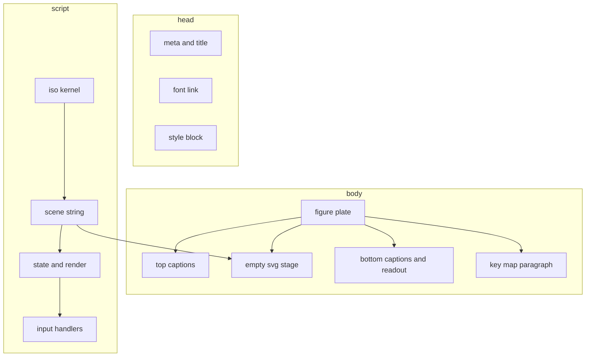
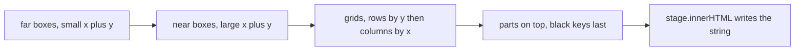

# 02 -- File Assembly: One Document, Painted Back to Front

The key idea is that the whole file is built as one string, in one order. First the document
skeleton, then the scene, then the script that wires it. Inside the scene, order is the only
depth sorting: later Scalable Vector Graphics (SVG) elements paint on top of earlier ones. The
skill emits boxes back to front so nearer faces cover farther faces with no depth buffer. This
document shows the skeleton and the scene construction.

The output is one self-contained HyperText Markup Language (HTML) file. Its shape is fixed:
head with metadata and styles, body with a plate, and one script with everything else.

## The document skeleton

Every figure starts from the same skeleton. The head sets the character set, the viewport, the
title, a font link, and the full style block. The body holds a plate with an empty SVG stage and
a paragraph that documents the keys.

```html
<!-- examples/pocket-calculator.html, lines 1-8 -->
<!doctype html>
<html lang="en">
<head>
<meta charset="utf-8">
<meta name="viewport" content="width=device-width, initial-scale=1">
<title>Pocket Calculator</title>
<link rel="stylesheet" href="https://fonts.googleapis.com/css2?family=DM+Mono:wght@400;500&display=swap">
<style>
```

The font link is the only external reference in the file. It is a Cascading Style Sheets (CSS)
file, not a script. The font stack in the style block falls back to any monospace font if the
link cannot load, so the file still runs opened from disk. The script itself loads nothing.

The body is one `figure` element. The SVG stage starts empty; the script fills it later.

```html
<!-- examples/pocket-calculator.html, lines 57-65 -->
<body>
<main>
  <figure>
    <div class="cap"><span class="hi">Fig 5</span><span>Pocket calculator</span></div>
    <svg id="stage" viewBox="0 0 575 372" tabindex="0" role="img" aria-label="Isometric pocket calculator. Press its keys with the mouse, touch, or your keyboard to calculate."></svg>
    <div class="cap"><span>Press the keys · it calculates</span><span class="hi" id="readout">ready</span></div>
  </figure>
  <p>From your keyboard: digits and <kbd>.</kbd>, then <kbd>+</kbd> <kbd>-</kbd> <kbd>*</kbd> <kbd>/</kbd>, <kbd>Enter</kbd> for equals, <kbd>%</kbd> for percent, <kbd>Backspace</kbd> to delete a digit, <kbd>Esc</kbd> to clear.</p>
</main>
```

The plate is the `figure` element. Its four captions are two rows: the number and the name on
top, the instruction and the live readout below. The `viewBox` sets the coordinate space. The
`aria-label` states what the figure is and how to operate it. The script fills `#stage` with
generated SVG at the very end of its scene section.



## The scene string

The script builds one string, `svg`, by concatenating boxes and face groups. At the end it
writes the string into the stage with `stage.innerHTML = svg`. The calculator scene is small:
one slab, one glass display group, and a grid of keys.

```js
// examples/pocket-calculator.html, lines 79-94
// ---- scene ----
const H = 18, KH = 7;
let svg = box(0,0,0, 232,338,H, 12);
svg += `<g transform="${TOP(16,16,H)}">
  <rect class="face glass" width="200" height="64" rx="6"/>
  <text id="ind" class="ind" x="10" y="17"></text>
  <text id="lcd" class="lcd" x="190" y="50" font-size="32">0</text>
</g>`;
const ROWS = [['C','±','%','÷'],['7','8','9','×'],['4','5','6','−'],['1','2','3','+'],['0','0','.','=']];
ROWS.forEach((row,r) => row.forEach((k,c) => {
  if (k === '0' && c === 1) return;                                   // zero is double width
  const w = k === '0' ? 92 : 42, x = 16 + c*50 + (c === 3 ? 8 : 0), y = 96 + r*46;
  const op = '÷×−+='.includes(k);
  svg += `<g class="press${op ? ' op' : ''}" data-k="${k}">${box(x,y,H, w,38,KH, 5)}<g transform="${TOP(x,y,H+KH)}"><text x="${w/2}" y="25">${k}</text></g></g>`;
}));
const stage = document.getElementById('stage'); stage.innerHTML = svg;
```

Two facts matter here. First, the calculator is one box plus flat detail, exactly as the skill
promises: a slab `box(0,0,0,232,338,18,12)` and a glass rectangle drawn on its `TOP` plane.
Second, the key grid is a loop. Rows increase `y`, columns increase `x`, and each key is its own
`<g class="press">` wrapping the box and the label on its top plane. The double-width zero is
one key that skips a grid cell.

The synthesizer scene is the same idea with more boxes and detail on a `FRONT` face.

```js
// examples/desk-synth.html, lines 83-101
// ---- scene, back to front ----
const W = 420, DECK = 26, SW = 200, SH = 48;
let svg = box(0,0,0, W,192,DECK, 6);                                   // body
svg += box(0,0,DECK, W,60,70, 5);                                      // riser
svg += `<g transform="${FRONT(0,60,DECK+70)}">
  <rect class="face glass" x="18" y="11" width="${SW}" height="${SH}" rx="5"/>
  <path class="detail" d="M18 ${11+SH/2}h${SW}"/>
  <polyline id="scope" class="scope" points="18,${11+SH/2} ${18+SW},${11+SH/2}"/>
  <text id="note" class="lcd" x="236" y="38" font-size="22">--</text>
  <text id="hz" class="lcd" x="237" y="53" font-size="8.5" opacity=".7">press a key</text>
  ${Array.from({length:9},(_,i)=>`<path class="detail" d="M${340+i*7} 14v42"/>`).join('')}
</g>`;
const BTNS = [['sine','1'],['square','2'],['sawtooth','3'],['triangle','4'],['oct-','z'],['oct+','x']];
const LABEL = {sine:'SIN',square:'SQR',sawtooth:'SAW',triangle:'TRI','oct-':'OCT−','oct+':'OCT+'};
BTNS.forEach(([id],i) => { const x = 20 + i*46 + (i>3 ? 104 : 0);
  svg += `<g class="press btn" data-btn="${id}">${box(x,67,DECK, 38,16,5, 3)}<g transform="${TOP(x,67,DECK+5)}"><text class="lbl" x="19" y="10.5">${LABEL[id]}</text></g></g>`; });
const WHITE = [0,2,4,5,7,9,11,12,14,16], BLACK = {0:1,1:3,3:6,4:8,5:10,7:13,8:15};
WHITE.forEach((semi,i) => svg += `<g class="press key wk" data-semi="${semi}">${box(20+i*38,92,DECK, 34,90,8, 2)}</g>`);
for (const i in BLACK) svg += `<g class="press key bk" data-semi="${BLACK[i]}">${box(20+(+i+1)*38-12,92,DECK+2, 20,54,13, 2)}</g>`;
const stage = document.getElementById('stage'); stage.innerHTML = svg;
```

The synth decomposes into two boxes (body and riser), then a `FRONT`-face display group, then a
row of buttons, then white keys and black keys. The comment on the first line states the rule:
"scene, back to front".

## Paint order is the depth sort

There is no depth buffer and no z-buffer. SVG paints in document order, so the emit order is the
depth sort. The skill states the rule at `skills/iso-figure/SKILL.md`, line 68:

- Smaller `x + y` first, lower `z` first. This paints far boxes before near ones.
- For grids, loop rows by increasing `y`, then columns by increasing `x`.
- Parts that sit on top of others (black piano keys over white) go after everything beneath them.

The synth obeys all three: the body comes before the riser, the white keys before the black
keys, and the black keys start at a higher `z` (`DECK+2`) so they rest above the whites.



## Framing the scene

The kernel's `OX` and `OY` place the three-dimensional origin in the viewBox. The skill rule, at
`skills/iso-figure/SKILL.md`, line 70, says to frame numerically: project the scene's extreme
corners with `P`, then set `OX`, `OY`, and the `viewBox` for roughly eight to fifteen percent
margin on every side. Eyeballing clips tall objects.

The two examples show the result. The calculator body is `232` wide and `338` deep and fits a
`viewBox` of `575 372` with `OX = 334, OY = 46`. The synth is `420` wide and fits a `viewBox` of
`620 450` with `OX = 211, OY = 122`. Both leave margin and clip nothing.

## The Aha Moment

**Aha:** The file is one long string concatenation, and that is the entire depth engine. There is
no scene graph and no render pass. Because SVG paints later elements on top, the author controls
depth only by choosing the order of string pieces: far first, near last, top layers last. The
"scene, back to front" comment is not a style note; it is the z-buffer. Remove the ordering and
the nearer faces disappear behind the farther ones.

## Cross-References

- The kernel functions that produce each piece of the string: [01-projection.md](./01-projection.md).
- The plate captions, state, and render loop that finish the file: [03-plate-and-parts.md](./03-plate-and-parts.md).
- The palette classes that give the faces their colour: [04-palette-theming.md](./04-palette-theming.md).

Continue to [03-plate-and-parts.md](03-plate-and-parts.md).
