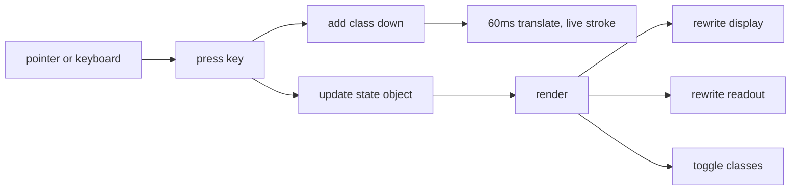
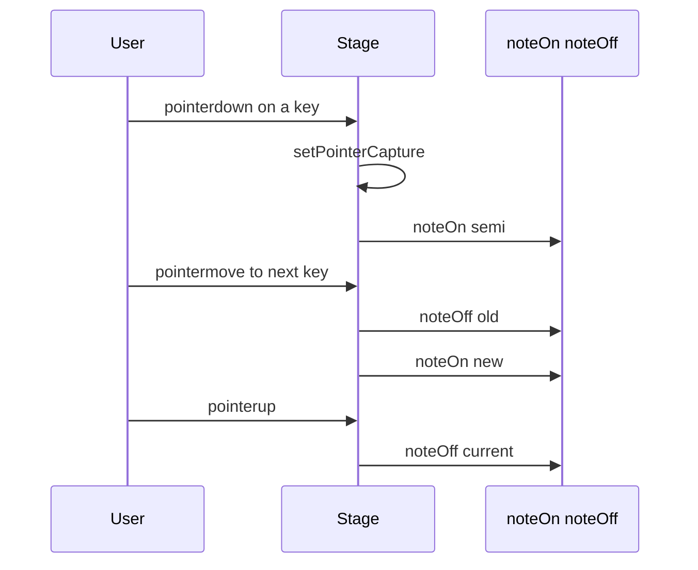

# 03 -- Plate and Parts: State, Render, and Input on the Numbered Plate

The key idea is that interaction is one `state` object and one `render()` function. Pressing a
part never moves pixels directly. It updates `state`, toggles a Cascading Style Sheets (CSS)
class, and calls `render()`. CSS does the motion, and `render()` rewrites the display and the
readout. This document reads the plate, the press mechanics, and the input patterns.

The figure sits on a plate: one `figure` element with four monospace corner captions. The plate
is the frame that makes a drawing look like a textbook figure.

## The four captions

The skill states the captions at `skills/iso-figure/SKILL.md`, lines 17 and 73:

- Top-left: `Fig N`, the figure number.
- Top-right: the object name.
- Bottom-left: the instruction, such as "Press the keys · it calculates".
- Bottom-right: the live readout.

The readout is terse, lowercase, and dot-separated. It changes on every interaction. The
calculator readout starts at `ready`, then shows the running tape, for example `12.5 × 8 = 100`.
The synthesizer readout starts at `saw · oct 4 · silent` and shows the waveform, the octave, and
the held notes. The caption rows use flex layout so they survive phone width.

```html
<!-- examples/pocket-calculator.html, lines 59-63 -->
<figure>
  <div class="cap"><span class="hi">Fig 5</span><span>Pocket calculator</span></div>
  <svg id="stage" viewBox="0 0 575 372" tabindex="0" role="img" aria-label="Isometric pocket calculator. Press its keys with the mouse, touch, or your keyboard to calculate."></svg>
  <div class="cap"><span>Press the keys · it calculates</span><span class="hi" id="readout">ready</span></div>
</figure>
```

The readout is a span with `id="readout"`. `render()` writes its text. The Scalable Vector
Graphics (SVG) stage is one focusable, accessible image with an `aria-label` that names the
object and its operation.

## The press mechanics

Every pressable part is its own group: `<g class="press" data-…>`. The group wraps the part's
box and its label. Because the label is drawn on the part's `TOP` plane inside the same group,
it moves with the part when pressed.

Pressing adds the class `down`; a 60 ms transition moves it down, and the class is removed after about 110 ms. CSS translates the group down by four
pixels and flashes its stroke to the live colour. The skill's required CSS:

```css
/* skills/iso-figure/SKILL.md, lines 57-59 */
.press { cursor:pointer; transition:transform 60ms ease-out; }
.press.down { transform:translateY(4px); }
.press.down .face { stroke:var(--live); }
```

Four pixels straight down on screen equals `-z` in the isometric axes, so the part looks like it
sank into the object. The transition runs 60 milliseconds. The examples add a
`prefers-reduced-motion` override that removes the transition.



## One state, one render

The calculator holds all its state in one object and rewrites the view in one function.

```js
// examples/pocket-calculator.html, lines 97-100
const st = { disp:'0', acc:null, op:null, fresh:true, tape:'' };
const fmt = n => { if (!isFinite(n)) return 'Error';
  let s = String(parseFloat(n.toPrecision(10))); if (s.replace(/[-.]/g,'').length > 10 || s.includes('e')) s = n.toExponential(4); return s; };
const calc = (a,b,o) => o === '+' ? a+b : o === '−' ? a-b : o === '×' ? a*b : b === 0 ? NaN : a/b;
```

Five fields hold everything: the display string, the accumulator, the pending operator, a flag
for a fresh entry, and the readout tape. The `input()` function mutates only these fields, then
calls `render()`.

```js
// examples/pocket-calculator.html, lines 127-132
function render() {
  const lcd = $('lcd'); lcd.textContent = st.disp; lcd.setAttribute('font-size', st.disp.length > 9 ? 23 : 32);
  $('ind').textContent = st.op || '';
  keys.forEach((el,k) => el.classList.toggle('armed', k === st.op && st.fresh));
  $('readout').textContent = st.tape || (st.op ? `${fmt(st.acc)} ${st.op}` + (st.fresh ? '' : ` ${st.disp}`) : st.disp === '0' ? 'ready' : st.disp);
}
```

`render()` does four things: it writes the display, writes the operator indicator, toggles the
`armed` class on the pending operator key, and writes the readout. There is no other place that
touches the view.

## Keyboard and pointer share one handler

The skill's input pattern routes both inputs through one `press()` function.

```js
// skills/iso-figure/SKILL.md, lines 81-91
const keys = new Map([...stage.querySelectorAll('.key')].map(k => [k.dataset.key, k]));
function press(k) {
  const el = keys.get(k); if (!el) return false;
  el.classList.add('down'); setTimeout(() => el.classList.remove('down'), 110);
  /* …update state… */ render(); return true;
}
stage.addEventListener('click', e => { const k = e.target.closest('.key'); if (k) press(k.dataset.key); });
window.addEventListener('keydown', e => {
  if (e.metaKey || e.ctrlKey || e.altKey) return;
  if (press(e.key.length === 1 ? e.key.toLowerCase() : e.key)) e.preventDefault();
});
```

The `keys` map indexes elements by their `data-key` value. `press()` finds the element, flashes
the `down` class, updates state, renders, and reports success. The click handler resolves the
nearest `.key` element. The keydown handler ignores modifier combinations and lowers single
characters.

The calculator adds a key map for symbols, because the physical keys differ from the glyphs.

```js
// examples/pocket-calculator.html, lines 133-140
function press(k) { const el = keys.get(k); if (el) { el.classList.add('down'); setTimeout(() => el.classList.remove('down'), 110); } input(k); }
stage.addEventListener('pointerdown', e => { const el = e.target.closest('.press'); if (el) { e.preventDefault(); press(el.dataset.k); } });
const KEYMAP = { '*':'×', 'x':'×', '/':'÷', '-':'−', '+':'+', 'Enter':'=', '=':'=', 'Escape':'C', 'c':'C', '%':'%', ',':'.', 'Backspace':'⌫' };
window.addEventListener('keydown', e => {
  if (e.metaKey || e.ctrlKey || e.altKey) return;
  const k = /^[0-9.]$/.test(e.key) ? e.key : KEYMAP[e.key];
  if (k) { press(k); e.preventDefault(); }
});
```

The calculator uses `pointerdown`, not `click`, so the response is instant. The `KEYMAP` object
translates `*`, `/`, `Enter`, `Escape`, and others into the glyphs the scene drew.

## Held parts: drag and touch

Tapped keys are simple. Held parts need pointer capture, so a finger that slides across piano
keys keeps working. The skill rule is at `skills/iso-figure/SKILL.md`, line 94. The synth
implements it.

```js
// examples/desk-synth.html, lines 165-180
const pointers = new Map();                                            // pointerId -> semi
const keyAt = e => { const el = document.elementFromPoint(e.clientX, e.clientY)?.closest?.('.key'); return el ? +el.dataset.semi : null; };
stage.addEventListener('pointerdown', e => {
  const b = e.target.closest('.btn'); if (b) { button(b.dataset.btn); return; }
  const semi = keyAt(e); if (semi === null) return;
  e.preventDefault(); stage.setPointerCapture?.(e.pointerId); pointers.set(e.pointerId, semi); noteOn(semi);
});
stage.addEventListener('pointermove', e => {
  if (!pointers.has(e.pointerId)) return;
  const was = pointers.get(e.pointerId), now = keyAt(e);
  if (now === was) return;
  if (was !== null) noteOff(was);
  pointers.set(e.pointerId, now); if (now !== null) noteOn(now);
});
const lift = e => { if (!pointers.has(e.pointerId)) return; const s = pointers.get(e.pointerId); pointers.delete(e.pointerId); if (s !== null) noteOff(s); };
stage.addEventListener('pointerup', lift); stage.addEventListener('pointercancel', lift);
```

`keyAt` uses `document.elementFromPoint` to find the key under the pointer, so the pointer can
leave one key and enter another mid-drag. `setPointerCapture` keeps the pointer attached to the
stage. `pointermove` releases the old key and presses the new one. The keyboard path calls the
same `noteOn` and `noteOff` functions, and window `blur` releases everything.



## Text and sound outputs

The skill names two output details that the examples obey. For text typed onto a screen, show
only the tail of the buffer, clip with a `<clipPath>` matching the glass rectangle, and escape
`&` and `<` before writing into the SVG (`skills/iso-figure/SKILL.md`, line 96).

For sound, create the `AudioContext` inside the first press handler, because browsers block it
before a gesture. Route through one master gain into an `AnalyserNode`, then draw the
analyser's time-domain data as a polyline on the screen face each frame, starting from a rising
zero crossing so the trace holds still (`skills/iso-figure/SKILL.md`, line 98).

```js
// examples/desk-synth.html, lines 107-116
let ctx, master, analyser, buf;
function audio() {
  if (ctx) { if (ctx.state === 'suspended') ctx.resume(); return true; }
  try {
    ctx = new (window.AudioContext || window.webkitAudioContext)();
    master = ctx.createGain(); master.gain.value = 0.16;
    analyser = ctx.createAnalyser(); analyser.fftSize = 2048; buf = new Float32Array(analyser.fftSize);
    master.connect(analyser); analyser.connect(ctx.destination); return true;
  } catch { ctx = null; return false; }
}
```

The audio context is created lazily, inside the first press. The gain caps the volume. The
analyser feeds the waveform polyline. If the context fails, `audio()` returns false and the
figure still works silently.

## The Aha Moment

**Aha:** Pressing is a rename, not an animation. The press adds a class, updates one plain
object, and calls one function that rewrites a handful of text nodes and toggles classes. The
motion is pure CSS, and the sound and the pointer capture are both just inputs to the same two
functions. Because every path — mouse, touch, drag, keyboard — ends in the same `state` plus
`render()`, the figure can never show a state it has not rendered, and the readout can never
fall out of sync with the picture.

## Cross-References

- How the state and readout are wired into the full procedure: [05-request-to-figure.md](./05-request-to-figure.md).
- How the scene string is built before the input is attached: [02-assembly.md](./02-assembly.md).
- The colours the `down` and `armed` classes flash to: [04-palette-theming.md](./04-palette-theming.md).

Continue to [04-palette-theming.md](04-palette-theming.md).
