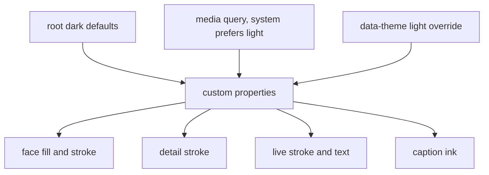
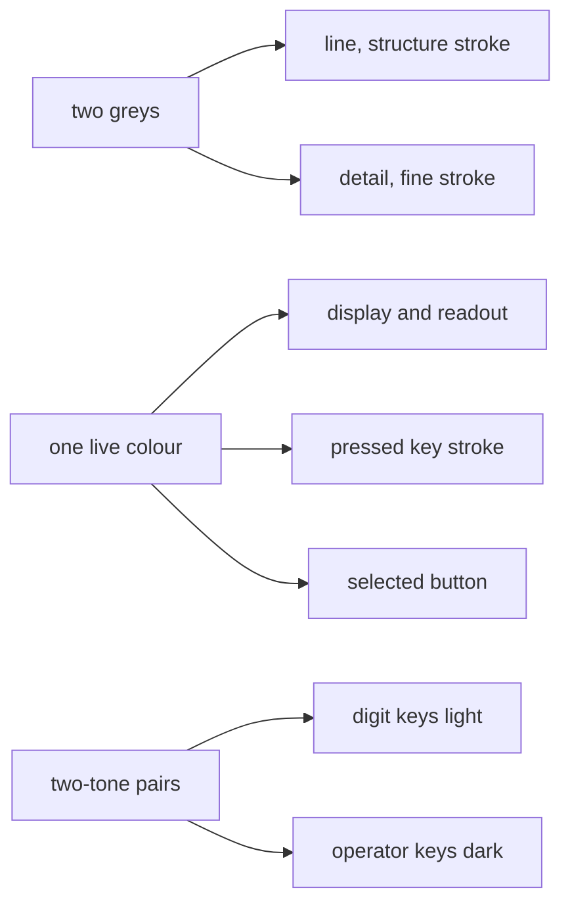

# 04 -- Palette and Theming: Two Greys and One Live Colour

The key idea is restraint. Every colour is a Cascading Style Sheets (CSS) custom property, and
there are two sets: one dark and one light. Two greys do all the linework. One near-white colour
— near-black in the light theme — is reserved for whatever is live. That single contrast is the
whole effect. The skill forbids hue, gradients, and shadows. This document reads the colour
tokens and the rules that use them.

The rule is at `skills/iso-figure/SKILL.md`, lines 102-103: define every colour as a custom
property and provide a dark and a light set. Dark uses panel `#141516` on page `#0c0d0e`. Light
uses panel `#f6f6f5` on page `#e9eaea`.

## The dark set

Both examples open their style block with the same dark palette.

```css
/* examples/pocket-calculator.html, lines 10-17 */
:root {
  color-scheme: dark;
  --bg:#0c0d0e; --panel:#141516; --edge:#222426;
  --line:#3d4144; --detail:#2b2e30; --body:#17181a; --deck:#1b1d1f;
  --ink:#868b8f; --ink-hi:#e6e8e9; --live:#f4f5f5;
  --kn:#24272a; --kn-line:#565b5f; --ko:#d9dcde; --ko-line:#5a5f63; --ko-ink:#16181a; --glass:#0b0c0c;
  --mono:"DM Mono",ui-monospace,"SF Mono",Menlo,Consolas,monospace;
}
```

The tokens split by role. `--bg` is the page. `--panel` and `--edge` are the plate and its
border. `--line` is the structure stroke, `--detail` the finer detail stroke: these are the two
greys. `--body` and `--deck` are the fills for side and top faces. `--ink` and `--ink-hi` are
the caption text and its highlight. `--live` is the one reserved colour. The `--kn` and `--ko`
tokens give the calculator its two-tone keys, and `--glass` darkens the display window.

## The light set

The light set appears twice: once under a media query, once under an explicit data attribute.

```css
/* examples/pocket-calculator.html, lines 18-31 */
@media (prefers-color-scheme: light) { :root:not([data-theme="dark"]) {
  color-scheme: light;
  --bg:#e9eaea; --panel:#f6f6f5; --edge:#d6d8d8;
  --line:#8e9397; --detail:#c3c6c8; --body:#ececeb; --deck:#f3f3f2;
  --ink:#6a6f73; --ink-hi:#16181a; --live:#0c0d0e;
  --kn:#ffffff; --kn-line:#7b8084; --ko:#2a2c2e; --ko-line:#0c0d0e; --ko-ink:#f4f5f5; --glass:#e2e4e4;
} }
:root[data-theme="light"] {
  color-scheme: light;
  --bg:#e9eaea; --panel:#f6f6f5; --edge:#d6d8d8;
  --line:#8e9397; --detail:#c3c6c8; --body:#ececeb; --deck:#f3f3f2;
  --ink:#6a6f73; --ink-hi:#16181a; --live:#0c0d0e;
  --kn:#ffffff; --kn-line:#7b8084; --ko:#2a2c2e; --ko-line:#0c0d0e; --ko-ink:#f4f5f5; --glass:#e2e4e4;
}
```

The media query applies the light set only when the system prefers light and no `data-theme`
attribute forces dark. The `:root[data-theme="light"]` rule applies it unconditionally when the
attribute is set. Every colour is a variable, so a theme switch changes tokens, not rules. The
roles stay: `--line` is always the more contrasted grey (lighter in the dark theme, darker in the light theme); `--detail` is the subtler grey, and `--live` flips from
near-white to near-black.



## The two greys and the one live colour

The skill rule, at `skills/iso-figure/SKILL.md`, line 103, is exact: two greys only for
linework, structure and detail. One near-white `--live` colour reserved for whatever is live: lit
display content, the pressed key, the selected button. No hue, no gradients, no shadows.

```css
/* examples/desk-synth.html, lines 40-55 */
.face { fill:var(--body); stroke:var(--line); stroke-width:1; vector-effect:non-scaling-stroke; stroke-linejoin:round; }
.face.top { fill:var(--deck); }
.detail { fill:none; stroke:var(--detail); stroke-width:1; vector-effect:non-scaling-stroke; }
.glass { fill:var(--glass); }
.scope { fill:none; stroke:var(--live); stroke-width:1.4; vector-effect:non-scaling-stroke; stroke-linejoin:round; }
.lcd { fill:var(--live); font-family:var(--mono); }
.lbl { fill:var(--ink); font-family:var(--mono); font-size:7px; text-anchor:middle; pointer-events:none; }
.press { cursor:pointer; transition:transform 60ms ease-out; }
.press .face { transition:stroke 100ms; }
.press.down { transform:translateY(4px); }
.btn.down { transform:translateY(2.5px); }
.press.down .face, .btn.sel .face { stroke:var(--live); }
.btn.sel .lbl { fill:var(--live); }
.wk .face { fill:var(--kw); stroke:var(--kw-line); }
.bk .face { fill:var(--kb); stroke:var(--kb-line); }
.press:hover .face.top { stroke:var(--live); }
```

Every rule consumes variables, never literals. The `--live` colour appears exactly where the
skill says: the display text, the scope trace, the pressed stroke, the selected button. The two
`--line` and `--detail` greys carry everything else. The `--kw` and `--kb` tokens colour the two
tone piano keys. The synthesizer defines them in its dark set:

```css
/* examples/desk-synth.html, line 15 */
  --kw:#d9dcde; --kw-line:#5a5f63; --kb:#101112; --kb-line:#7d8286; --glass:#0b0c0c;
```

## Two-tone parts

The skill allows two-tone parts, at `skills/iso-figure/SKILL.md`, line 104: white and black
keys, or digit and operator keys, as light fill with dark stroke versus dark fill with light
stroke. The calculator does this for its digit and operator keys.

```css
/* examples/pocket-calculator.html, lines 46-49 */
.press .face { fill:var(--kn); stroke:var(--kn-line); transition:stroke 100ms; }
.press.op .face { fill:var(--ko); stroke:var(--ko-line); }
.press text { fill:var(--ink-hi); font-family:var(--mono); font-size:17px; text-anchor:middle; pointer-events:none; }
.press.op text { fill:var(--ko-ink); }
```

Digit keys use `--kn`, a light fill with a darker stroke. Operator keys use `--ko`, a dark fill
with a light stroke, and their labels invert to `--ko-ink`. The same pattern colours the
synthesizer's white and black keys with `--kw` and `--kb`.



## Hairlines, captions, and texture

Three final look rules complete the system, at `skills/iso-figure/SKILL.md`, lines 105-107:

- Captions are monospace, 13 pixels, with wide letter-spacing, uppercase except `Fig N` and the
  readout. The two caption rows use flex layout so they survive phone width.
- Box radii are small, two to fourteen units. The side-face radius is clamped to `h/4` in the
  kernel so thin slabs do not become lenses.
- Texture comes from repetition, not shading: vent slits, key grids, ribbed lines.

The hairline itself comes from `vector-effect:non-scaling-stroke` with `stroke-width:1`, which
document 01 reads. Faces must have an opaque fill: the painter's-order occlusion depends on it.

## The Aha Moment

**Aha:** The figure's beauty is a refusal. The palette has no hue, the surfaces have no
gradient, and nothing casts a shadow. All the visual interest is carried by one reserved colour
that moves: the thing that is live glows near-white, and everything else stays in two greys.
Because the live colour is the only thing that changes position and meaning, the eye always
knows what the figure is doing — which is the same reason the interaction, not the decoration,
is the point.

## Cross-References

- Where the hairline stroke rule is applied in the kernel context: [01-projection.md](./01-projection.md).
- How the classes that flash `--live` are toggled: [03-plate-and-parts.md](./03-plate-and-parts.md).
- Where the palette appears in the assembled file: [02-assembly.md](./02-assembly.md).

Continue to [05-request-to-figure.md](05-request-to-figure.md).
