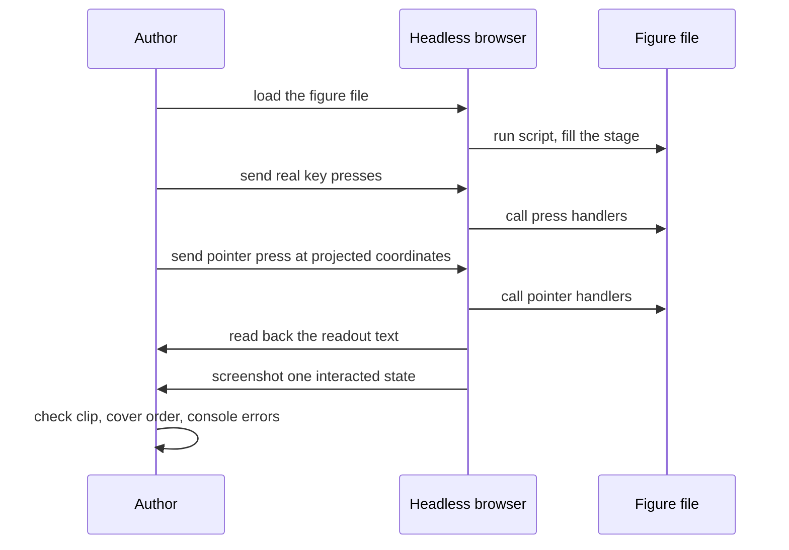

# 05 -- Request to Figure: The Procedure From Prompt to Verified File

The key idea is that a request maps to a figure through a fixed nine-step procedure, and the
first step decides the whole result. Before any drawing, the skill has Claude decide what
pressing a part produces: typed text, a number, a note, a toggled light. Everything else serves
that output. This document walks the procedure and the verification step.

The procedure is the skill's spine, at `skills/iso-figure/SKILL.md`, lines 66-74.

```text
# skills/iso-figure/SKILL.md, lines 66-74
1. **Name the output.** What does pressing a part produce? Typed text, an arithmetic result, a note, a toggled light. Everything else serves that.
2. **Decompose the object** into 3-8 boxes. Write their `(x,y,z,w,d,h)` as a small table first. Pick the pressable parts and the one surface that displays state.
3. **Emit back to front.** Paint order is the only depth sorting: smaller `x+y` first, lower `z` first. For grids (keys, buttons) loop rows by increasing `y`, then columns by increasing `x`. Parts that sit on top of others (black piano keys over white) go after everything beneath them.
4. **Wrap each pressable part in its own `<g class="press" data-…>`** containing its box and its label. A label drawn on the part's TOP plane inside the same group moves with it when pressed.
5. **Frame it numerically.** Project the scene's extreme corners with `P`, then set `OX/OY` and `viewBox` for roughly 8-15% margin on every side. Eyeballing clips tall objects.
6. **Wire state.** One `state` object, one `render()` that toggles classes and rewrites the display and readout. Pointer and keyboard input call the same functions.
7. **Motion in CSS only.** Pressed part: `translateY(4px)` (straight down on screen is −z in iso) over about 60ms, stroke flashing to the live colour. Honour `prefers-reduced-motion`.
8. **Readout** in the bottom-right, terse and lowercase, dot-separated: `off` → `on · 9 chars · key t`. It changes on every interaction.
9. **Verify in a browser.** Load it headless, drive it with real key presses and mouse presses at projected coordinates, read back the readout, and screenshot one interacted state. Check nothing is clipped, nearer parts cover farther ones, and there are no console errors.
```

Each step is a small, checkable rule. The procedure is linear: decide output, decompose, order,
wrap, frame, wire, move, caption, verify.

```mermaid
%%{init: {"flowchart": {"htmlLabels": false}}}%%
flowchart LR
    A["1 name the output"] --> B["2 decompose into boxes"]
    B --> C["3 emit back to front"]
    C --> D["4 wrap pressable parts"]
    D --> E["5 frame numerically"]
    E --> F["6 wire state and render"]
    F --> G["7 motion in CSS"]
    G --> H["8 write the readout"]
    H --> I["9 verify in a browser"]
```



## Step 1: name the output first

The output decision comes before any geometry. The skill repeats it in the opening, at
`skills/iso-figure/SKILL.md`, line 10: the object must do something real; decide what the output
is before drawing anything. The "Don'ts" section closes the loop, at line 114: if the user
cannot press it and get output, pick a different object.

This is why the two shipped examples exist. The calculator produces arithmetic. The synthesizer
produces notes. Neither is a model that only turns.

## Step 2: decompose into three to eight boxes

Complex objects are boxes plus flat detail. The synth is two boxes: a body slab and a riser. The
calculator is one slab plus a glass rectangle. The step asks for a small table of
`(x,y,z,w,d,h)` before any code, so the layout is decided on paper, not discovered while
typing string fragments. Document 02 shows the two scenes that follow from this table.

## Steps 3 and 4: order and wrap

Step 3 states the paint-order rule that document 02 details: far before near, grids by rows
then columns, top layers last. Step 4 gives every pressable part its own group so the press
class and the label travel together. Document 03 reads the press mechanics that follow.

## Step 5: frame numerically

The frame is computed, not guessed. Project the scene's extreme corners with `P`, then choose
`OX`, `OY`, and the `viewBox` for an eight to fifteen percent margin. The two examples show the
resulting numbers: the calculator uses `OX = 334, OY = 46` with `viewBox="0 0 575 372"`; the
synth uses `OX = 211, OY = 122` with `viewBox="0 0 620 450"`. Document 01 explains `P` and the
offsets.

## Step 6-8: wire, move, caption

One `state`, one `render()`, motion only in Cascading Style Sheets (CSS), and a readout that
changes on every interaction. The skill's example readout is `off` then `on · 9 chars · key t`.
The synth produces exactly this shape in its `render()`.

```js
// examples/desk-synth.html, lines 145-152
function render() {
  keyEls.forEach((el, semi) => el.classList.toggle('down', state.held.has(semi)));
  stage.querySelectorAll('.btn').forEach(b => b.classList.toggle('sel', b.dataset.btn === state.wave));
  const mids = [...state.held.values()].map(v => v.midi).sort((a,b) => a-b), top = mids[mids.length-1];
  $('note').textContent = mids.length ? label(top) : '--';
  $('hz').textContent = mids.length ? `${freq(top).toFixed(1)} Hz` + (mids.length > 1 ? ` · ${mids.length} notes` : '') : (ctx ? 'ready' : 'press a key');
  $('readout').textContent = `${LABEL[state.wave].toLowerCase()} · oct ${state.oct} · ` + (mids.length ? mids.map(label).join(' ') : 'silent');
}
```

The readout is lowercase, dot-separated, and rebuilt every call: `saw · oct 4 · silent` becomes
`saw · oct 4 · C4 E4 G4` while a chord is held. Document 03 reads the full state-and-render
pattern.

## The input-pattern notes

Between the procedure and the look rules, the skill holds three short notes on harder outputs,
at `skills/iso-figure/SKILL.md`, lines 94-98.

```text
# skills/iso-figure/SKILL.md, lines 94-98
For parts that are held rather than tapped (instrument keys): use `pointerdown` / `pointermove` / `pointerup` on the svg with `setPointerCapture`, find the part under the pointer with `document.elementFromPoint(...).closest('.key')` so dragging across parts works, set `touch-action:none` on the svg, ignore `e.repeat` on keydown, and release everything on window `blur`.

For text typed onto a screen: show only the tail of the buffer, clip with a `<clipPath>` matching the glass rect, and escape `&` and `<` before writing into the SVG.

For sound: create the `AudioContext` inside the first press handler (browsers block it before a gesture), route through one master gain into an `AnalyserNode`, and draw the analyser's time-domain data as a `<polyline>` on the screen face each animation frame, starting from a rising zero crossing so the trace holds still.
```

Document 03 reads the synth's implementation of the held-part and sound notes. The waveform
trace obeys the zero-crossing rule.

```js
// examples/desk-synth.html, lines 153-162
const scope = $('scope'), N = 120, MID = 11 + SH/2;
(function draw() {
  requestAnimationFrame(draw);
  if (!analyser) return;
  analyser.getFloatTimeDomainData(buf);
  let s = 0; for (let i = 1; i < 900; i++) if (buf[i-1] < 0 && buf[i] >= 0) { s = i; break; }   // lock to a rising edge
  let pts = '';
  for (let i = 0; i <= N; i++) { const y = Math.max(-21, Math.min(21, buf[s + i*5] * -90)); pts += `${18 + i*SW/N},${(MID + y).toFixed(1)} `; }
  scope.setAttribute('points', pts);
})();
```

The loop schedules itself every animation frame, reads the time-domain buffer, finds the first
rising zero crossing, and samples `N` points from there. The trace therefore starts from the
same phase every frame and holds still instead of jumping.

## Step 9: verify in a browser

The last step is not optional. The skill requires a headless load, real key presses and pointer
presses at projected coordinates, reading the readout back, and a screenshot of one interacted
state. The checks: nothing clipped, nearer parts cover farther ones, no console errors.



This step closes the loop from request to file. The figure is not done when the string is
written; it is done when a headless browser proves the output the user asked for.

## The Aha Moment

**Aha:** The nine steps are ordered so that every expensive mistake is caught at the cheapest
moment. The output decision is step 1, before any geometry exists. The box table is step 2,
before any string is concatenated. Paint order is step 3, before any face is drawn. And the
browser check is step 9, after everything, because only a real browser can prove that a press
produces the promised output at the projected coordinates. The procedure is a sequence of
commit points, not a list of tips.

## Cross-References

- The projection used in step 5: [01-projection.md](./01-projection.md).
- The scene construction used in steps 2 and 3: [02-assembly.md](./02-assembly.md).
- The state and render wiring used in step 6: [03-plate-and-parts.md](./03-plate-and-parts.md).

Continue to [06-plugin-packaging.md](06-plugin-packaging.md).
