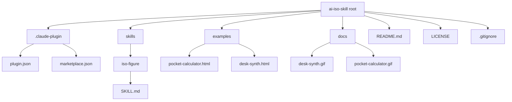
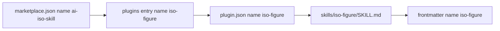

# 06 -- Plugin Packaging: The Skill Folder and the Marketplace

The key idea is that a Claude skill ships as a folder plus a small metadata file. The folder
lives under `skills/<name>/` and holds one `SKILL.md` whose YAML Ain't Markup Language (YAML)
frontmatter carries the name and the trigger description. A `.claude-plugin/` directory adds the plugin and marketplace
metadata that let Claude Code install it. This document reads the packaging and the install
paths.

The repository layout is flat and small.



## The skill folder and its frontmatter

The skill itself is one file: `skills/iso-figure/SKILL.md`. The folder name `iso-figure` is the
skill name. The file opens with a YAML frontmatter block, then the body.

```yaml
# skills/iso-figure/SKILL.md, lines 1-4
---
name: iso-figure
description: Build an interactive isometric line-art "figure" (Fig N style) of an object in a single HTML/SVG file: monochrome technical-illustration look, parts you can press that produce real output, live state readout. Use for hero illustrations, interactive diagrams, product figures, and playable desk objects (computer, synth, calculator).
---
```

Two fields matter. `name` is the skill identifier and matches the folder name. `description` is
the trigger: the host compares it against the user's request to decide whether to load the
skill. The description therefore lists the concrete uses — hero illustrations, interactive
diagrams, product figures, playable desk objects — and the required property, "parts you can
press that produce real output". Document 00 reads the description as the trigger.

## The plugin metadata

`.claude-plugin/plugin.json` describes the plugin for Claude Code.

```json
// .claude-plugin/plugin.json, lines 1-12
{
  "name": "iso-figure",
  "version": "1.0.0",
  "description": "Interactive isometric line-art figures in a single HTML file, with parts you can press.",
  "author": {
    "name": "Tolga Cohce"
  },
  "homepage": "https://github.com/MrBongoC/ai-iso-skill",
  "repository": "https://github.com/MrBongoC/ai-iso-skill",
  "license": "MIT",
  "keywords": ["isometric", "svg", "illustration", "interactive"]
}
```

The `name` here is `iso-figure`, the same as the skill folder and the skill frontmatter. The
`version` is `1.0.0`. The `license` is the Massachusetts Institute of Technology (MIT) License.
`homepage` and `repository` point at the GitHub repository.

`.claude-plugin/marketplace.json` describes the marketplace entry. A marketplace bundles one or
more plugins; here it bundles exactly one.

```json
// .claude-plugin/marketplace.json, lines 1-14
{
  "name": "ai-iso-skill",
  "description": "The iso-figure skill for Claude Code.",
  "owner": {
    "name": "Tolga Cohce"
  },
  "plugins": [
    {
      "name": "iso-figure",
      "source": "./",
      "description": "Interactive isometric line-art figures in a single HTML file, with parts you can press."
    }
  ]
}
```

The marketplace name is `ai-iso-skill`; the plugin name inside it is `iso-figure`. The plugin's
`source` is `./`, the repository root, so the plugin is the `skills/` directory at the top of
the repository. The three names appear in one chain: marketplace `ai-iso-skill` contains plugin
`iso-figure`, which is the skill folder `skills/iso-figure`.



## The three install paths

The README offers three ways to install, at `README.md`, lines 21-35.

```text
# README.md, lines 21-35
Claude Code, as a plugin:

/plugin marketplace add MrBongoC/ai-iso-skill
/plugin install iso-figure@ai-iso-skill

Or copy the skill folder in by hand:

git clone https://github.com/MrBongoC/ai-iso-skill.git
cp -r ai-iso-skill/skills/iso-figure ~/.claude/skills/

On Claude.ai, download `iso-figure.skill` from the latest release and upload it in your skill settings.
```

The first path adds the marketplace, then installs the plugin by its `plugin@marketplace` name.
The second path bypasses the plugin system and copies the skill folder into the user's
`~/.claude/skills/` directory. The third path targets Claude.ai, where a packaged `.skill` file
from the release is uploaded in the skill settings.

## What is not committed

`.gitignore` lists two patterns.

```text
# .gitignore, lines 1-2
.DS_Store
*.skill
```

`.DS_Store` is a macOS Finder metadata file. `*.skill` is the packaged skill archive produced
for the Claude.ai release path. The archive is a build artifact, so it is not committed. The
README points at the latest release for it. The LICENSE file is the standard MIT text, with the
copyright in the name of Tolga Cohce, dated 2026.

## The Aha Moment

**Aha:** One name appears four times on purpose: the folder, the frontmatter, the plugin, and
the marketplace entry all say `iso-figure`. Packaging a skill is mostly keeping those names in
agreement. The host resolves a request against the frontmatter description, and resolves an
install command against the marketplace and plugin names. If any of the four spellings drifts,
one of the three install paths silently stops finding the skill. The metadata is not boilerplate;
it is the wiring.

## Cross-References

- What the description field triggers: [00-purpose-trigger.md](./00-purpose-trigger.md).
- What the skill body, reached through this packaging, instructs: [05-request-to-figure.md](./05-request-to-figure.md).

Continue to [README.md](README.md).
