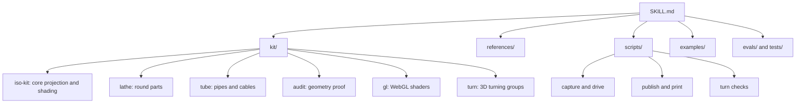
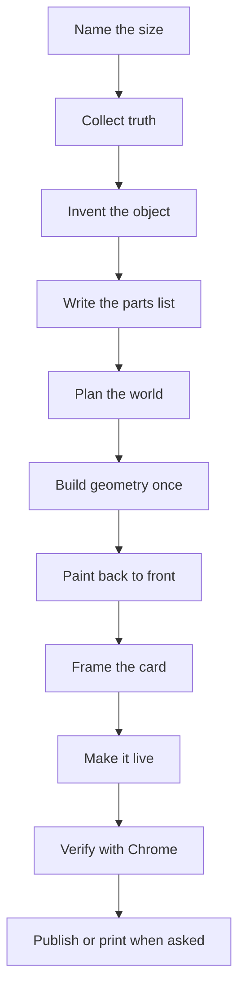

# 00 -- Overview: an exploded-view skill for real objects

`anatomy` turns a concept into a technical exploded-view figure of a real physical object. The builder does not draw boxes and arrows. The builder invents a machine, an instrument or a piece of furniture whose parts map one to one onto the concept. The object itself is the explanation. The figure is isometric, interactive and drawn with the detail of a real thing: screws, seams, bevels, springs, pipes, cables and readouts.

The skill ships as one folder. `SKILL.md` is the entry point. It lists the workflow, the craft rules and the setup. Around it sit the kit modules, the reference documents, the scripts, the examples and the tests.

## What ships



The kit has two editions of the core. `kit/iso-kit.mjs` is for Node build scripts. `kit/iso-kit.ts` is the same module with types for React and Next.js. The two stay in sync.

The core opens with three fixed constants:

```js
// kit/iso-kit.mjs, lines 1-3
export const AZIMUTH = 45;
export const ELEVATION = 30;
export const SHADES = 4;
```

`scripts/inline-kit.mjs` strips the `export` keywords so a page can run the kit as one inline script:

```js
// scripts/inline-kit.mjs, lines 8-14
export function kitScript() {
  return strip("iso-kit.mjs");
}

export function glScript() {
  return strip("gl.mjs");
}
```

## When to use it

Open the skill when a reader must understand a mechanism: a rate limiter, a connection pool, a cache, a pump, a burner or a spring. The figure gives the reader a thing to explore. The trigger words are "explain", "how it works", "isometric", "technical figure", "exploded view" or a request for a polished interactive diagram.

The skill defines three size tiers. A **Figure** has 40 to 80 parts and fills one card. A **Hero** has 80 to 150 parts and fills a wide page. An **Epic** has more and fills a full document. The builder must name the size before any other work.

## The one idea that matters

`SKILL.md` states it directly:

```text
// SKILL.md, line 29
**The object is the explanation.** Don't draw boxes, arrows and labels. Invent a real, well-made physical thing whose working *is* the concept.
```

Every craft rule follows from this idea. Parts are solids, not wireframes. Detail belongs to the mechanism. Lines resolve onto real edges. The subject is the one lit part.

## The workflow in one view



The ten steps are the subject of [01-pipeline.md](./01-pipeline.md). The worked figures are the subject of [12-examples.md](./12-examples.md).

## Compatibility and install

The frontmatter of `SKILL.md` names the frontmatter fields and the supported hosts:

```yaml
# SKILL.md, lines 1-8
---
name: anatomy
description: Build crafted, highly detailed, interactive isometric SVG figures that explain a technical idea as a real physical object (a test rig, a dial gauge, a cabinet of drawers, a plotter, a lock), with many small precise solid parts, four-tone shading, correct painter's order, a framed card with title, hint and live readout, and calm eased motion. Use this whenever someone wants an isometric illustration, an explanatory diagram or figure for docs, a blog post, a landing page or an article, a "Linear-style" or "premium" technical drawing, an interactive explainer, or an SVG that shows how a system, algorithm or component works, even if they never say "isometric". Works framework-free (TypeScript/JS that writes SVG and HTML) and in React/Next.js, and can add realistic WebGL shaders (fire, exhaust, water, caustics, lamp light) that live inside the drawing in the same isometric perspective. Also prints a figure as an A4 PDF (poster, drawing or handout) and publishes it to the Anatomy community gallery when asked.
license: MIT
compatibility: Written for Claude Code; also runs in Antigravity, OpenCode, Codex and MiniMax Code. Needs Node.js 20.10+, and Chrome or Chromium for the checks.
metadata:
  opencode/slash: "true"
---
```

The runtime needs Node 20.10 or newer and a Chrome or Chromium binary. The README shows the install:

```text
// README.md, install section
npx skills add wheresryan22/anatomy -g
```

A user then runs `/anatomy` with a request for a figure.

## The Aha Moment

**Aha:** the figure is not a diagram of the concept. The figure is a real object whose parts behave like the concept.

Once the builder accepts this, the craft rules become obvious. A token bucket becomes a hopper with tokens. A connection pool becomes a rack of sockets. The reader learns the concept by watching the machine, not by reading labels. Every later doc in this series describes one part of making that machine true, proved and shareable.

Continue to [01-pipeline.md](01-pipeline.md).
