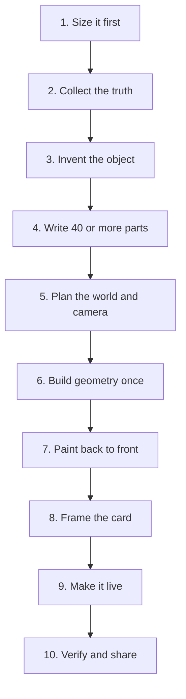
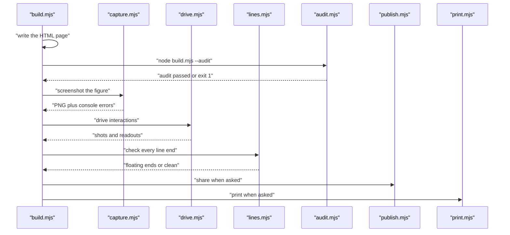

# 01 -- Pipeline: from prompt to published figure

The whole project runs on one idea: a figure is a Node build script that writes a standalone HTML page. Everything else is a chain around that script. The builder captures the truth, builds the geometry once, paints it in depth order, makes it move, then proves it with a headless Chrome toolchain before it is shared.

The ten-step workflow in `SKILL.md` is the map. The toolchain in `scripts/` is the machine that checks the result.

## The ten steps



The steps come from the skill definition:

```text
// SKILL.md, lines 58-70
1. **Size it before you start.** Name the size before any other work...
2. **Truth first.** Collect the real numbers and behaviour of the thing...
3. **Invent the object.** Pick a machine, tool, instrument or piece of furniture...
4. **Parts list.** Write at least 40 parts...
5. **Plan the world.** Use world units of about 1 px of the real thing...
6. **Build geometry once.** Precompute every static path...
7. **Paint back to front, bottom to top.** Sort repeated parts with `depthOf`...
8. **Frame it.** Put the figure in a card...
9. **Make it live.** Use calm time-based motion...
```

The last step of the ten is the verify-and-share step. That step fans out into the scripts.

## The toolchain



The same Node script produces both the dark and the light page. The light page is built with the flag `--light`. A figure with round parts, pipes or cables ends its build with an audit call, so the build fails when the geometry is wrong.

## What a build script looks like

The smallest example is the dial indicator:

```js
// examples/dial-indicator/build.mjs, lines 1-8
import { writeFileSync } from "node:fs";
import { dirname, join } from "node:path";
import { fileURLToPath } from "node:url";
import * as k from "../../kit/iso-kit.mjs";
import { kitScript } from "../../scripts/inline-kit.mjs";

const HERE = dirname(fileURLToPath(import.meta.url));
const theme = process.argv.includes("--light") ? "light" : "dark";
```

The script imports the core kit and the inline-kit helper. It builds path strings, wraps them in a figure and a plate, and writes the page. The inline kit strips the `export` keywords from the kit modules so the page can run them as one inline script.

`scripts/inline-kit.mjs` provides those helpers:

```js
// scripts/inline-kit.mjs, lines 8-14
export function kitScript() {
  return strip("iso-kit.mjs");
}

export function glScript() {
  return strip("gl.mjs");
}
```

The page wrapper comes from the kit:

```js
// kit/iso-kit.mjs, line 557
export function pageHtml({ title, theme = "dark", body, script = "", width = 650 }) {
```

## Verify, then publish

The verify step is real work, not a glance. `references/verify.md` gives the checklist. The builder captures the figure at 4x zoom over every joint, drives it with slow motion to catch pops, runs the line-ends check, and reads every screenshot. Only then is a figure ready for [11-publish-print.md](./11-publish-print.md).

The audit is in [05-audit.md](./05-audit.md). The capture and drive tools are in [10-capture-verify.md](./10-capture-verify.md).

## The Aha Moment

**Aha:** the figure, the proof and the page share one source.

A single build script is the figure. The page inlines the same geometry code the build used. The audit reads the same recorded shapes the build drew. The print sheet replays the same poses the page plays. Because there is one source, the readout, the caption and the motion can never disagree with the drawing.

Continue to [02-isometric-core.md](02-isometric-core.md).
