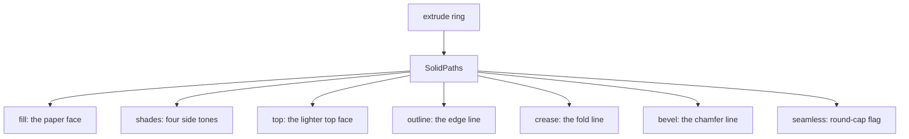
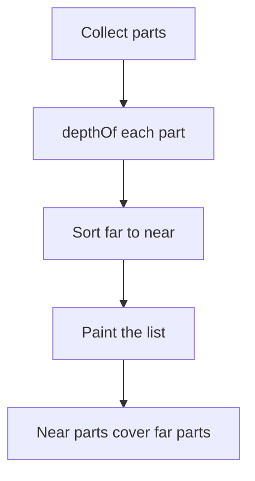

# 02 -- Isometric core: iso-kit and four-tone shading

`kit/iso-kit.mjs` is the core of the project. It turns world points into screen points, gives every solid four side tones plus a lighter top, and assembles those paths into SVG strings. Every other module builds on it. A builder who understands `iso`, `depthOf` and `extrude` understands the whole figure.

The camera is fixed: azimuth 45 degrees and elevation 30 degrees by default. The projection is axonometric, not perspective. Parallel lines stay parallel.

## The camera math

```js
// kit/iso-kit.mjs, lines 1-23
export const AZIMUTH = 45;
export const ELEVATION = 30;
export const SHADES = 4;
const RADIANS = Math.PI / 180;
const UNIT = Math.sqrt(1.6);
export function cameraOf({ scale, azimuth = AZIMUTH, elevation = ELEVATION }) {
    const a = azimuth * RADIANS;
    const e = elevation * RADIANS;
    return { sinA: Math.sin(a), cosA: Math.cos(a), sinE: Math.sin(e), cosE: Math.cos(e), k: scale * UNIT };
}
export function iso([x, y, z], projection) {
    const { origin } = projection;
    const { sinA, cosA, sinE, cosE, k } = cameraOf(projection);
    return [origin[0] + (x * sinA - y * cosA) * k, origin[1] + ((x * cosA + y * sinA) * sinE - z * cosE) * k];
}
export function towardViewer(projection) {
    const { sinA, cosA } = cameraOf(projection);
    return [cosA, sinA];
}
export function depthOf([x, y, z], projection) {
    const { sinA, cosA, sinE, cosE } = cameraOf(projection);
    return (x * cosA + y * sinA) * cosE + z * sinE;
}
```

The constant `k` is `scale` times the square root of 1.6. The factor 1.6 comes from the isometric foreshortening. `iso` projects a 3D point to a flat `[x, y]`. `depthOf` returns the distance of a point from the viewer. `towardViewer` gives the world-space floor vector toward the viewer, used for world-to-screen mapping.

## What a solid is

A solid is a set of SVG path strings, not one path. The builder draws it with `solidSvg`:

```js
// kit/iso-kit.mjs, line 415
export function solidSvg(paths, { tone = "hi", crease = "faint", halo = false, lit = false, flat = false, className, inner = "" } = {}) {
```

`extrude` produces the `SolidPaths` object. Its structure is the visual language of the whole project:



The four side tones come from facing. The core buckets a per-face lighting value (`Math.floor(lit * SHADES)`) into a shade; `SHADES = 4` is in `kit/iso-kit.mjs`. `BANDS = [0, 0.2, 0.42, 0.62]` is a `kit/lathe.mjs` constant for the smooth lathe bands. The tone hierarchy maps a role to a shade: `lo`, `mid`, `hi` and the single accent `lit`. Faint grooves sit below all of them.

## Painter's order

Because the drawing is filled solids, order is depth. A part painted later covers a part painted earlier:



The builder sorts repeated parts with `depthOf`. When parts move and their order changes, the page re-sorts them per frame. The audit in [05-audit.md](./05-audit.md) proves that order instead of trusting the eye.

## Fitting the camera

`fitProjection` picks the scale and origin so a set of world points fits a view box:

```js
// kit/iso-kit.mjs, line 393
export function fitProjection(points, width, height, { pad = 24, headroom = 0, azimuth = AZIMUTH, elevation = ELEVATION } = {}) {
```

The build script passes the corners of the world and the page size. The helper returns a projection `P` that every later call uses. The dial indicator builds its projection from the plate corners and the dial top.

## The SVG builders

The core also exports string builders that keep a figure framework-free: `solidSvg`, `lineSvg`, `dotsSvg`, `fadedSvg`, `fadeLineSvg`, `wireSvg`, `faceTextSvg`, `figureSvg`, `plateHtml` and `pageHtml`. `pageHtml` writes the whole standalone page:

```js
// kit/iso-kit.mjs, line 557
export function pageHtml({ title, theme = "dark", body, script = "", width = 650 }) {
```

`pageHtml` inlines the styles and the script, so one file opens anywhere. The script is normally `kitScript()` from `scripts/inline-kit.mjs`, plus the figure's own live code.

## The Aha Moment

**Aha:** four tones plus depth is the whole visual system.

There is no lighting engine and no gradients in the core. Facing alone picks the tone. Depth alone picks the order. Those two rules give the drawing its volume and its correctness. The lathe in [03-lathe.md](./03-lathe.md) adds smooth shading on top of the same four-tone system for curved parts.

Continue to [03-lathe.md](03-lathe.md).
