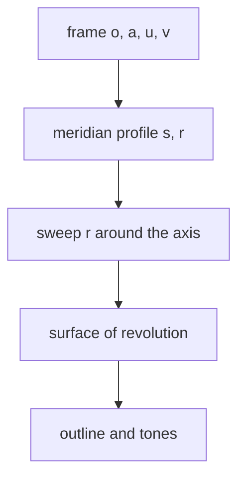
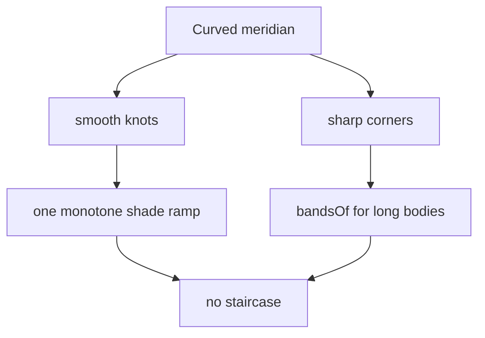

# 03 -- Lathe: round parts on any axis

`kit/lathe.mjs` draws round parts. A round part is a surface of revolution: a meridian profile swept around an axis. The axis can point any direction, so a builder can turn a boiler, a flange, a gauge, a valve or a dome and then mount it on any face.

The module is larger than the core because curved shading is harder than flat shading. The outline and the tones must stay smooth, with no staircase.

## The frame

A round part lives in a frame. The frame is four vectors:

```js
// kit/lathe.mjs, lines 39-57
export function frameAlong(o, a) {
  const axis = unit3(a);
  const helper = Math.abs(axis[2]) > 0.9 ? [1, 0, 0] : [0, 0, 1];
  const u = unit3(cross3(helper, axis));
  const v = cross3(axis, u);
  return { o, a: axis, u, v };
}

export const frameOf = (o, a, u, v) => ({ o, a, u, v });

export function pointOf(F, s, r, angle) {
  const c = Math.cos(angle);
  const n = Math.sin(angle);
  return [
    F.o[0] + F.a[0] * s + r * (c * F.u[0] + n * F.v[0]),
    F.o[1] + F.a[1] * s + r * (c * F.u[1] + n * F.v[1]),
    F.o[2] + F.a[2] * s + r * (c * F.u[2] + n * F.v[2]),
  ];
}
```

`o` is the origin. `a` is the axis. `u` and `v` span the cross-section plane. `pointOf` maps `s` along the axis and `r, angle` around it to a world point. `radialOf` gives the radial direction at an angle and `tangentOf` the tangent.



## The meridian and Hermite splines

A meridian is a list of `[s, r]` points. A point with a third entry `[s, r, 1]` marks a smooth knot. `curveRuns` turns the knots into a Hermite spline with continuous slope:

```js
// kit/lathe.mjs, lines 229-254
export function curveRuns(meridian) {
  const m = meridian.length;
  const segments = new Array(m - 1).fill(null);
  let start = 0;
  while (start < m - 1) {
    let end = start + 1;
    while (end < m - 1 && meridian[end][2] && Math.abs(meridian[end + 1][0] - meridian[end][0]) > 1e-9 && Math.abs(meridian[end][0] - meridian[end - 1][0]) > 1e-9) end++;
    const run = meridian.slice(start, end + 1);
    const n = run.length - 1;
    if (n >= 2 && run.every((point, j) => j === 0 || Math.abs(point[0] - run[j - 1][0]) > 1e-9)) {
      const d = hermiteSlopes(run);
      for (let j = 0; j < n; j++) {
        // ... cubic Hermite radius and slope functions ...
      }
    }
  }
}
```

The Hermite curve gives a `radius(s)` and a `slope(s)` for every point on the axis. The slope is the key to smooth shading: the tone changes continuously with the surface normal instead of jumping between fixed bands.

## The lathe call

```js
// kit/lathe.mjs, line 531
export function lathe(meridian, F, P, { steps = stepsFor(Math.max(...meridian.map(([, r]) => r)), 32, 160, scaleOf(P)), fill = "auto", hole = null, bevel = 0, rims = "all", smooth: asked = "auto", waist = 0.5 } = {}) {
```

`lathe` returns a `SolidPaths` object like the core's `extrude`, but with curved tones. The `smooth` option can carry `{ slope, radius }` functions from an analytic profile, so a large curved body shades from one monotone curve. The audit checks that the profile slope never wobbles.

## Smooth versus stepped shading



Long bodies use `bandsOf` to cut the surface into rows that still taper to nothing at each end. `saddleOf` makes a saddle pad where a flange meets a curved surface. `prismOf` turns a polygon profile. `sphereOf` makes a smooth ball. `solidOf` and `bandOfProfile` give lower-level access.

## Where it fits

Round parts record their shape in the audit and are verified like everything else. A curved body larger than a fitting needs an analytic profile. The rules are in [09-references.md](./09-references.md), and the audit that checks them is in [05-audit.md](./05-audit.md).

## The Aha Moment

**Aha:** a round part is one curve, not a stack of rings.

The builder thinks in meridians, the way a turner thinks. One smooth curve defines the radius and the slope at every point, and that single source draws both the outline and the tones. When the curve is smooth, the shading is smooth for free.

Continue to [04-tube.md](04-tube.md).
