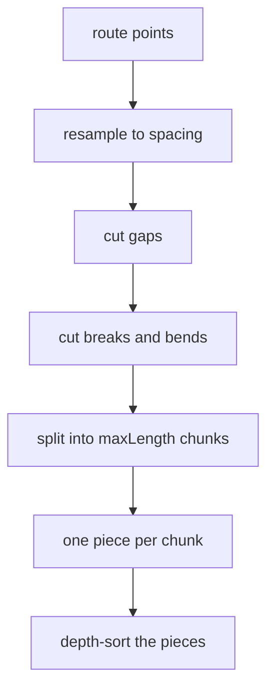
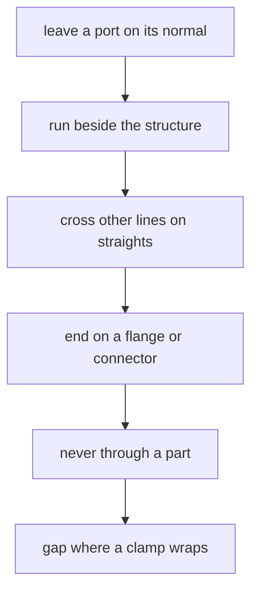

# 04 -- Tube: pipes, hoses and cables

`kit/tube.mjs` draws pipes, hoses and cables. A tube is a swept circle along a 3D route. The hard problem is depth order: one pipe can pass in front of one part and behind another. The module solves that by splitting the route into depth-sortable pieces.

The pieces carry the `.tb-*` class set: `tb-body`, `tb-shine`, `tb-shade`, `tb-ring` and `tb-edge`. Shine and shade are the two stripe tones for wide tubes. Rings are cross-section textures such as braid or corrugation.

## Splitting a route

```js
// kit/tube.mjs, lines 110-123
export function runsOf(total, gaps = []) {
  const cuts = gaps
    .map(([a, b]) => [Math.max(0, Math.min(a, b)), Math.min(total, Math.max(a, b))])
    .filter(([a, b]) => b - a > 1e-6)
    .sort((x, y) => x[0] - y[0]);
  const runs = [];
  let at = 0;
  for (const [a, b] of cuts) {
    if (a > at + 1e-6) runs.push([at, a]);
    at = Math.max(at, b);
  }
  if (total > at + 1e-6) runs.push([at, total]);
  return runs;
}
```

`runsOf` removes the gap spans from the total length. Gaps are where a flange, band, clamp or valve wraps the pipe. A run continues on both sides of the gap.



`tubePieces` does the full split:

```js
// kit/tube.mjs, line 200
export function tubePieces(points3, radius, P, { maxLength = 30, spacing = 2.2, closed = false, breaks = [], gaps = [], caps = true, stripes = "auto", rings = null } = {}) {
```

Each piece is a self-contained shape with a `mid` depth, so the page can sort the pieces with everything else. `breaks` put a physical joint in the pipe. `caps` close the cut ends. `rings` add a texture that follows the cross-section and runs through every chunk joint.

## The piece markup

```js
// kit/tube.mjs, lines 303-305
export function tubeSvg(piece, { tone = "hi" } = {}) {
  const shine = piece.wide ? `<path class="tb-shine" d="${piece.shine}"/><path class="tb-shade" d="${piece.shade}"/>` : "";
  return `<g class="tb"><path class="tb-body" d="${piece.body}"/>${shine}${ringsSvg(piece.rings, piece.ringTone)}<path class="iso-line tb-edge" data-tone="${tone}" d="${piece.edges}"/></g>`;
}
```

`sideOf` and `capOf` build the swept sides and the end caps. `stripeEnd` closes the stripe so there is no hairline at a joint.

## Route rules



The rules are not optional. Each piece is depth-sorted with the same `depthOf` ordering as every solid in [02-isometric-core.md](./02-isometric-core.md). The audit in [05-audit.md](./05-audit.md) checks clearance, terminals, support, folds and crossings. `crossingsOf` finds where a route crosses a circle on a face. `ringsOf` lays texture rings around the tube.

## The Aha Moment

**Aha:** a pipe is many short pieces, not one long shape.

One long path cannot be sorted against the parts it passes. Splitting it into chunks turns an unsortable shape into many sortable ones. The visual joints are hidden by the caps and the continuous stripes, so the reader sees one pipe even though the page draws many pieces.

Continue to [05-audit.md](05-audit.md).
